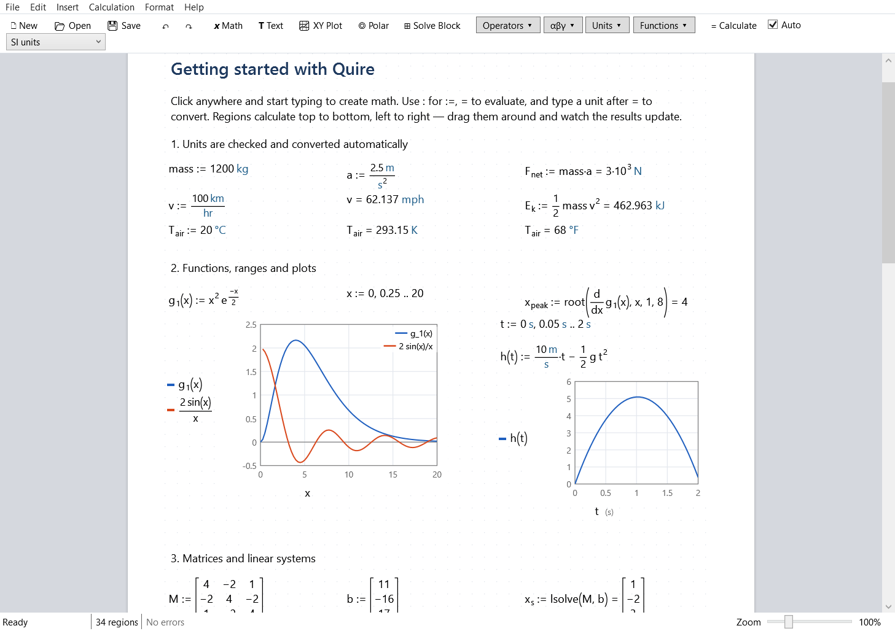

# Quire

An engineering calculation worksheet for Windows (WPF, .NET 10), modelled on the workflow of PTC Mathcad Prime:
math, text and plots are placed freely on a page and calculated **top to bottom, left to right**, with units
carried through every operation.



## Features

- **Live math regions**: type `x := 5 m` (or `x : 5 m`), `x =`, `v = km/hr`. Results update as you edit.
- **Units and dimensions**: SI, US customary and CGS display systems; ~150 built-in units. Mismatches are errors,
  and `20 °C` / `T = °F` handle affine temperatures. Redefining a built-in unit or function gives a warning.
- **Functions and recursion**: `f(x, y) := …`. Functions capture the definitions above them.
- **Range variables and tables**: `x := 0, 0.5 .. 10`, `v[i] := i^2`, and `x^2 =` shows a table.
- **Matrices**: `[1, 2; 3, 4]`, `Mᵀ`, `M^-1`, `|M|`, `lsolve`, `augment`, `submatrix`, `ORIGIN`, …
- **Calculus**: `sum(k^2, k, 1, n)`, `integral(f, x, a, b)` (including ±∞), `deriv(f, x[, n])`, `root(f, x[, a, b])`.
- **Solve blocks**: guess values, constraints (`==`, `<`, `>`) and a solver line using `find`, `minerr`, `minimize`
  or `maximize`.
- **XY and polar plots**: QuickPlot of an undefined variable, range or vector axes, axis units and limits, hover read-out.
- **Global definitions** (`≡` or `~`) are visible everywhere.
- **Rich text** regions.
- **Editing**: drag regions, rubber-band select, undo/redo, copy/paste, zoom.
- **Import Mathcad Prime worksheets** (`.mcdx`, `.mctx`): math, text and collapsible areas come across.
  Unsupported regions become notes.
- **Saving**: worksheets are saved as `.qwx` (a zip package with XML).

Press **F1** in the app for the keyboard syntax reference.

## Build, run, test

```powershell
dotnet build Quire.slnx
dotnet run --project src\Quire                      # opens the "Getting started" worksheet
dotnet run --project src\Quire -- path\to\file.qwx  # or a .mcdx to import
dotnet test Quire.slnx
```

`Quire.exe --render out.png [file]` renders the window and the full worksheet to PNG files and exits. This is
used for visual checks.

## Architecture

The assembly layout mirrors Mathcad Prime 12, and mirrored method bodies are reconstructed from the original
assemblies' IL (see [docs/mirror](docs/mirror/PLAN.md)).

Agent batches follow five steps: claim members, read Mathcad's IL, implement, compare exact
Release IL, and land. All IL inspection uses Release builds. See the [agent workflow](AGENTS.md)
and [Release IL commands](docs/mirror/validation.md).
The [assembly map](docs/mirror/assembly-map.md) lists Mathcad counterparts, prerequisites, and completion order.

| Quire assembly | Responsibility | Mathcad Prime counterpart |
|---|---|---|
| `Quire.Mpl` | Mathcad's runtime types: `Mpl.Run` S-expressions and functions, `Mcd` values (`NumVal`, `MatVal`, `RngVal`, `StrVal`), interned dimensions, units and unit systems | `mplrun` (`Mpl.Run`, `Mcd`) |
| `Quire.Engine` | Mathcad's `IEngine`/`Factory` API over an internal worksheet engine: ordered node list, incremental recalculation, Rl reader, interpreter, built-ins, numerics, solve blocks | `iengine`, `mceng` |
| `Quire.Calculation.Core` | `ICalculatable`, `ICalculatableContext`, result nodes, `EngineResult` | `Ptc.Calculation.Core` |
| `Quire.Calculation` | `CalculationController` (worker thread, cancellation), `ValueToIResultNodeTransform` | `Ptc.Calculation` |
| `Quire.EquationEditor` | `MathNode` tree, `LinearParser`, transforms (Rl, XML, linear text), result formatting, 2D box-layout renderer | `Ptc.EquationEditor` |
| `Quire.Core` | `.qwx` packages, persistent data objects, `WorksheetConverter` (.mcdx import) | `Ptc.Core` |
| `Quire.Controls.Core` | `RegionControl`, `CalculatableRegionControl` | `Ptc.Controls.Core` |
| `Quire.Controls.EquationControl` / `.Text` / `.Plots` / `.SolveBlock` | Region controls | `Ptc.Controls.*` |
| `Quire.Controls.Worksheet` | `WorksheetModel`, `WorksheetItemPositionComparer`, `ControlFactory`, `WorksheetControl` | `Ptc.Controls.Worksheet` |
| `Quire` | Application shell | `MathcadPrime.exe` |

**Data flow.** Each region serialises itself to an Rl S-expression, for example `(define F (op_mult m a))` or
`(eval v (op_div km hr))`. The worksheet model raises *added / moved / removed* events in calculation order. The
`CalculationController` mirrors those events onto the engine's ordered node list from a background thread. The
engine recomputes from the first changed node, and the results come back as display-ready result nodes for the
current unit system. Each region renders those with the same 2D layout engine it uses for its own math.

## Linear syntax at a glance

| Type | Meaning |
|---|---|
| `x := 5 m` (`:` works) | definition |
| `k ≡ 2` (`~` works) | global definition |
| `x =` / `x = ft` | evaluate / evaluate in units |
| `f(x) := x^2` | function |
| `x := 0, 0.1 .. 1` | range variable |
| `[1, 2; 3, 4]`, `v[i]`, `Mᵀ` | matrix, index, transpose |
| `a == b` (Ctrl+=) | comparison / constraint |
| `x_max`, `` `ft·lbf` `` | literal subscript, quoted name |

## Limitations

- No symbolic algebra: the `→` operator is not implemented, and indefinite integrals report an error.
- No complex numbers.
- No programming blocks (`if`/`for`/`while` as multi-line programs). The `if(c, a, b)` function is available.
- Mathcad's contour and 3D plots, spec tables, Excel components and controls aren't implemented. On import they
  become notes.
- Math is edited as linear text with a live 2D preview, not directly in 2D.
