# Assembly dependency map

Generated from installed Mathcad assembly metadata, PE imports and evaluated Release project references.
Snapshot: 2026-10-24T05:34:32+00:00; revision `ae89caeee9b6`.

This is a planning aid for step 1 of the [five-step workflow](PLAN.md). It adds no validation step.

Each Mathcad assembly has one Quire target project in its original language ([D20](decisions.md)).
An arrow **A → B** means B depends on A: complete A before starting B. Frameworks and packages are
treated as available. Native DLLs are mirrored as native projects and share the completion order: a
stopgap import library does not make one available. They are outside the IL gate (D10). Mpl modules
also depend on the Mpl compiler
(`mplasb`, `mplrun`, `msgen`, `msclr`, and native ports of `msmpl` and `mshex`).

“Ready” concerns dependencies, not ownership. Check [WORK](WORK.md) before claiming files.

## Ready now

| Complete next | Language | Newly eligible assemblies |
|---|---|---|
| `Quire.Automation` | CSharp | None yet; other prerequisites remain |
| `Quire.Core` | CSharp | `Quire.Calculation.Core`, `Quire.Media3D` |
| `Quire.EngNotebook.Automation` | CSharp | None yet; other prerequisites remain |
| `Quire.EngNotebookPlus.Automation` | CSharp | None yet; other prerequisites remain |
| `Quire.Engine.Misc` | CSharp | None yet; other prerequisites remain |
| `Quire.Interop.Mathcad` | CSharp | None yet; other prerequisites remain |
| `Quire.Interop.MathcadOld` | CSharp | None yet; other prerequisites remain |
| `Quire.Interop.VSInterfacesLib` | CSharp | None yet; other prerequisites remain |
| `Quire.Mpl` | CSharp | None yet; other prerequisites remain |
| `Quire.Native.Mshex` | Native | `Quire.Native.Engutils` |
| `Quire.Native.Mspcons` | Native | None yet; other prerequisites remain |
| `Quire.Native.Utl` | Native | `Quire.Native.EfisymbolicsUmgd`, `Quire.Native.Mcaduser` |

## Completion order

Assemblies in a row can be worked on independently after every earlier dependency is complete.
The rows are dependency order, not a claim that any assembly is already complete.

| Wave | Assemblies |
|---|---|
| 1 | `Quire.Automation`, `Quire.Core`, `Quire.EngNotebook.Automation`, `Quire.EngNotebookPlus.Automation`, `Quire.Engine.Misc`, `Quire.Interop.Mathcad`, `Quire.Interop.MathcadOld`, `Quire.Interop.VSInterfacesLib`, `Quire.Mpl`, `Quire.Native.Mshex` (native), `Quire.Native.Mspcons` (native), `Quire.Native.Utl` (native) |
| 2 | `Quire.Calculation.Core`, `Quire.Media3D`, `Quire.Msclr`, `Quire.Msgen`, `Quire.Native.EfisymbolicsUmgd` (native), `Quire.Native.Engutils` (native), `Quire.Native.Mcaduser` (native), `Quire.Native.Msprolog` (native) |
| 3 | `Quire.Controls.Core`, `Quire.Native.Msmpl` (native) |
| 4 | `Quire.EfiAffine`, `Quire.EfiBessel`, `Quire.EfiData`, `Quire.EfiDebug`, `Quire.EfiFinance`, `Quire.EfiFourier`, `Quire.EfiIO`, `Quire.EfiImage`, `Quire.EfiSignal`, `Quire.EfiSixsigma`, `Quire.EfiSpecial`, `Quire.EfiStatistics`, `Quire.EfiWavelets`, `Quire.EquationEditor`, `Quire.McdEfi`, `Quire.MplConstants`, `Quire.MplModule`, `Quire.MplPrelude`, `Quire.MplPrimitives`, `Quire.MplSexpr` |
| 5 | `Quire.Controls.EquationControl`, `Quire.Efiutl`, `Quire.Hashtable`, `Quire.McdRun`, `Quire.McdStaticUnitSystem`, `Quire.MplMacro`, `Quire.MplUnitSystemSI` |
| 6 | `Quire.Controls.Include`, `Quire.Controls.Text`, `Quire.EfibesselImpl`, `Quire.EficoreImpl`, `Quire.EfidebugImpl`, `Quire.EfigraphicsImpl`, `Quire.EfispecialImpl`, `Quire.EfisymbolicsImpl`, `Quire.McdStaticUnitSystemCGS`, `Quire.McdStaticUnitSystemNone`, `Quire.McdStaticUnitSystemSI`, `Quire.Native.EfistatsciImpl` (native), `Quire.Native.Mctranslator` (native) |
| 7 | `Quire.Controls.Plots`, `Quire.Controls.Whiteboard`, `Quire.EfiCore`, `Quire.EfiGraphics`, `Quire.EfiSymbolicsLabels`, `Quire.EfiSymbolicsMacros`, `Quire.EfiioCsharp`, `Quire.EfimatrixImpl`, `Quire.McdStaticUnitSystemMKS`, `Quire.McdStaticUnitSystemUS`, `Quire.McdUnitSystemCGS`, `Quire.McdUnitSystemNone` |
| 8 | `Quire.Controls.CollapsibleArea`, `Quire.Controls.SolveBlock`, `Quire.EfiMatrix`, `Quire.EfiSymbolicsMap`, `Quire.EficalculusImpl`, `Quire.EfidiffeqImpl`, `Quire.EfifourierImpl`, `Quire.EfiioImpl`, `Quire.McdUnitSystemSI` |
| 9 | `Quire.EfiCalculus`, `Quire.EfiDiffEQ`, `Quire.EfiSymbolicsLexer`, `Quire.EfiimageImpl`, `Quire.EfiplotImpl`, `Quire.EfisignalImpl`, `Quire.EfistatisticsImpl`, `Quire.EfiwaveletsImpl`, `Quire.McdUnitSystemMKS`, `Quire.McdUnitSystemUS` |
| 10 | `Quire.EfiPlot`, `Quire.EfiSymbolicsParser`, `Quire.EfifittingImpl` |
| 11 | `Quire.EfiFitting`, `Quire.EfiSymbolicsEmitter`, `Quire.EfidataImpl`, `Quire.EfifinanceImpl`, `Quire.EfisolverImpl` |
| 12 | `Quire.Automationmgd`, `Quire.EfiSolver`, `Quire.EfiSymbolics`, `Quire.EfisixsigmaImpl` |
| 13 | `Quire.Automation.Native`, `Quire.Componentsmgd`, `Quire.EngutilsMgd`, `Quire.McdDynamicEfi` |
| 14 | `Quire.Engine`, `Quire.McdTranslator`, `Quire.MspconsMgd` |
| 15 | `Quire.Calculation`, `Quire.Mcdepman`, `Quire.Mslisp` |
| 16 | `Quire.Controls.ExcelComponent`, `Quire.Mccore12` |
| 17 | `Quire.Controls.Worksheet`, `Quire.Mcfront12` |
| 18 | `Quire.Controls`, `Quire.Mceng` |
| 19 | `Quire` |

## Hosts and support projects

A D2 host still holds assemblies whose target project does not exist yet in the original language.
Splitting one out means creating its target and moving its members in the same change.

| Project | Role | Mathcad assemblies it still hosts |
|---|---|---|
| `Quire.Automation.Native` | target and D2 host | `automationmgd`, `componentsmgd` |
| `Quire.Efi` | D2 host | `EfiAffine`, `EfiBessel`, `EfiCalculus`, `EfiCore`, `EfiData`, `EfiDebug`, `EfiDiffEQ`, `EfiFinance`, `EfiFitting`, `EfiFourier`, `EfiGraphics`, `EfiIO`, `EfiImage`, `EfiMatrix`, `EfiPlot`, `EfiSignal`, `EfiSixsigma`, `EfiSolver`, `EfiSpecial`, `EfiStatistics`, `EfiSymbolics`, `EfiSymbolicsEmitter`, `EfiSymbolicsLabels`, `EfiSymbolicsLexer`, `EfiSymbolicsMacros`, `EfiSymbolicsMap`, `EfiSymbolicsParser`, `EfiWavelets`, `efibessel_`, `eficalculus_`, `eficore_`, `efidata_`, `efidebug_`, `efidiffeq_`, `efifinance_`, `efifitting_`, `efifourier_`, `efigraphics_`, `efiimage_`, `efiio-csharp`, `efiio_`, `efimatrix_`, `efiplot_`, `efisignal_`, `efisixsigma_`, `efisolver_`, `efispecial_`, `efistatistics_`, `efisymbolics_`, `efiutl`, `efiwavelets_` |
| `Quire.Engine` | target and D2 host | `engutils-mgd` |
| `Quire.Engine.Native` | D2 host | `mccore12`, `mceng`, `mcfront12`, `msgen`, `mslisp`, `mspcons-mgd` |
| `Quire.Mcd` | D2 host | `McdDynamicEfi`, `McdEfi`, `McdTranslator`, `McdUnitSystemCGS`, `McdUnitSystemMKS`, `McdUnitSystemNone`, `McdUnitSystemSI`, `McdUnitSystemUS`, `mcdepman` |
| `Quire.Mpl.Modules` | D2 host | `Hashtable`, `McdRun`, `McdStaticUnitSystem`, `McdStaticUnitSystemCGS`, `McdStaticUnitSystemMKS`, `McdStaticUnitSystemNone`, `McdStaticUnitSystemSI`, `McdStaticUnitSystemUS`, `Mpl`, `MplConstants`, `MplMacro`, `MplPrelude`, `MplPrimitives`, `MplSexpr`, `MplUnitSystemSI` |
| `Quire.Mirror` | support (no Mathcad counterpart) | None |
| `Quire.Mpl.Runtime` | support (no Mathcad counterpart) | None |

## Native projects

| Target | Original | Imports from Mathcad DLLs | Imported by |
|---|---|---|---|
| `Quire.Native.EfistatsciImpl` | `efistatsci_.dll` | `Quire.Efiutl` | `Quire.EfiimageImpl`, `Quire.EfiioImpl`, `Quire.EfisignalImpl`, `Quire.EfistatisticsImpl` |
| `Quire.Native.EfisymbolicsUmgd` | `efisymbolics-umgd.dll` | `Quire.Native.Utl` | None |
| `Quire.Native.Engutils` | `engutils.dll` | `Quire.Native.Mshex` | `Quire.EngutilsMgd`, `Quire.Mccore12`, `Quire.Native.Mctranslator` |
| `Quire.Native.Mcaduser` | `mcaduser.dll` | `Quire.Native.Utl` | `Quire.Mccore12` |
| `Quire.Native.Mctranslator` | `mctranslator.dll` | `Quire.Efiutl`, `Quire.Native.Engutils`, `Quire.Native.Mshex`, `Quire.Native.Msmpl`, `Quire.Native.Mspcons`, `Quire.Native.Msprolog`, `Quire.Native.Utl` | `Quire.Mccore12` |
| `Quire.Native.Mshex` | `mshex.dll` | None | `Quire.EfiAffine`, `Quire.EfiBessel`, `Quire.EfiCalculus`, `Quire.EfiCore`, `Quire.EfiData`, `Quire.EfiDebug`, `Quire.EfiDiffEQ`, `Quire.EfiFinance`, `Quire.EfiFitting`, `Quire.EfiFourier`, `Quire.EfiGraphics`, `Quire.EfiIO`, `Quire.EfiImage`, `Quire.EfiMatrix`, `Quire.EfiPlot`, `Quire.EfiSignal`, `Quire.EfiSixsigma`, `Quire.EfiSolver`, `Quire.EfiSpecial`, `Quire.EfiStatistics`, `Quire.EfiSymbolics`, `Quire.EfiSymbolicsEmitter`, `Quire.EfiSymbolicsLabels`, `Quire.EfiSymbolicsLexer`, `Quire.EfiSymbolicsMacros`, `Quire.EfiSymbolicsMap`, `Quire.EfiSymbolicsParser`, `Quire.EfiWavelets`, `Quire.Hashtable`, `Quire.Mccore12`, `Quire.McdDynamicEfi`, `Quire.McdEfi`, `Quire.McdRun`, `Quire.McdStaticUnitSystem`, `Quire.McdStaticUnitSystemCGS`, `Quire.McdStaticUnitSystemMKS`, `Quire.McdStaticUnitSystemNone`, `Quire.McdStaticUnitSystemSI`, `Quire.McdStaticUnitSystemUS`, `Quire.McdTranslator`, `Quire.McdUnitSystemCGS`, `Quire.McdUnitSystemMKS`, `Quire.McdUnitSystemNone`, `Quire.McdUnitSystemSI`, `Quire.McdUnitSystemUS`, `Quire.MplConstants`, `Quire.MplMacro`, `Quire.MplModule`, `Quire.MplPrelude`, `Quire.MplPrimitives`, `Quire.MplSexpr`, `Quire.MplUnitSystemSI`, `Quire.Msclr`, `Quire.Msgen`, `Quire.Native.Engutils`, `Quire.Native.Mctranslator`, `Quire.Native.Msmpl` |
| `Quire.Native.Msmpl` | `msmpl.dll` | `Quire.Msclr`, `Quire.Msgen`, `Quire.Native.Mshex`, `Quire.Native.Utl` | `Quire.EfiAffine`, `Quire.EfiBessel`, `Quire.EfiCalculus`, `Quire.EfiCore`, `Quire.EfiData`, `Quire.EfiDebug`, `Quire.EfiDiffEQ`, `Quire.EfiFinance`, `Quire.EfiFitting`, `Quire.EfiFourier`, `Quire.EfiGraphics`, `Quire.EfiIO`, `Quire.EfiImage`, `Quire.EfiMatrix`, `Quire.EfiPlot`, `Quire.EfiSignal`, `Quire.EfiSixsigma`, `Quire.EfiSolver`, `Quire.EfiSpecial`, `Quire.EfiStatistics`, `Quire.EfiSymbolics`, `Quire.EfiSymbolicsEmitter`, `Quire.EfiSymbolicsLabels`, `Quire.EfiSymbolicsLexer`, `Quire.EfiSymbolicsMacros`, `Quire.EfiSymbolicsMap`, `Quire.EfiSymbolicsParser`, `Quire.EfiWavelets`, `Quire.EngutilsMgd`, `Quire.Hashtable`, `Quire.Mccore12`, `Quire.McdDynamicEfi`, `Quire.McdEfi`, `Quire.McdRun`, `Quire.McdStaticUnitSystem`, `Quire.McdStaticUnitSystemCGS`, `Quire.McdStaticUnitSystemMKS`, `Quire.McdStaticUnitSystemNone`, `Quire.McdStaticUnitSystemSI`, `Quire.McdStaticUnitSystemUS`, `Quire.McdTranslator`, `Quire.McdUnitSystemCGS`, `Quire.McdUnitSystemMKS`, `Quire.McdUnitSystemNone`, `Quire.McdUnitSystemSI`, `Quire.McdUnitSystemUS`, `Quire.MplConstants`, `Quire.MplMacro`, `Quire.MplModule`, `Quire.MplPrelude`, `Quire.MplPrimitives`, `Quire.MplSexpr`, `Quire.MplUnitSystemSI`, `Quire.Native.Mctranslator` |
| `Quire.Native.Mspcons` | `mspcons.dll` | None | `Quire.Mcfront12`, `Quire.Native.Mctranslator`, `Quire.Native.Msprolog` |
| `Quire.Native.Msprolog` | `msprolog.dll` | `Quire.Native.Mspcons`, `Quire.Native.Utl` | `Quire.Mcfront12`, `Quire.Native.Mctranslator` |
| `Quire.Native.Utl` | `utl.dll` | None | `Quire.EfimatrixImpl`, `Quire.EfisymbolicsImpl`, `Quire.Efiutl`, `Quire.Engine`, `Quire.Engine.Utl`, `Quire.EngutilsMgd`, `Quire.Mccore12`, `Quire.Mcdepman`, `Quire.Mceng`, `Quire.Mcfront12`, `Quire.Mslisp`, `Quire.Native.EfisymbolicsUmgd`, `Quire.Native.Mcaduser`, `Quire.Native.Mctranslator`, `Quire.Native.Msmpl`, `Quire.Native.Msprolog` |

## Dependency graph

Solid arrows are references of split projects. Dashed arrows come from the original Mathcad references
and native imports. Transitive references are omitted.

```mermaid
flowchart TD
    a0["Quire.Automation.Native (CSharp)"]
    a1["Quire.Automationmgd (CSharp)"]
    a2["Quire.Componentsmgd (CSharp)"]
    a3["Quire.EfiAffine (Mpl)"]
    a4["Quire.EfiBessel (Mpl)"]
    a5["Quire.EfibesselImpl (CppCli)"]
    a6["Quire.EfiCalculus (Mpl)"]
    a7["Quire.EficalculusImpl (CppCli)"]
    a8["Quire.EfiCore (Mpl)"]
    a9["Quire.EficoreImpl (CppCli)"]
    a10["Quire.EfiData (Mpl)"]
    a11["Quire.EfidataImpl (CppCli)"]
    a12["Quire.EfiDebug (Mpl)"]
    a13["Quire.EfidebugImpl (CppCli)"]
    a14["Quire.EfiDiffEQ (Mpl)"]
    a15["Quire.EfidiffeqImpl (CppCli)"]
    a16["Quire.EfiFinance (Mpl)"]
    a17["Quire.EfifinanceImpl (CppCli)"]
    a18["Quire.EfiFitting (Mpl)"]
    a19["Quire.EfifittingImpl (CppCli)"]
    a20["Quire.EfiFourier (Mpl)"]
    a21["Quire.EfifourierImpl (CppCli)"]
    a22["Quire.EfiGraphics (Mpl)"]
    a23["Quire.EfigraphicsImpl (CppCli)"]
    a24["Quire.EfiImage (Mpl)"]
    a25["Quire.EfiimageImpl (CppCli)"]
    a26["Quire.EfiIO (Mpl)"]
    a27["Quire.EfiioImpl (CppCli)"]
    a28["Quire.EfiioCsharp (CSharp)"]
    a29["Quire.EfiMatrix (Mpl)"]
    a30["Quire.EfimatrixImpl (CppCli)"]
    a31["Quire.EfiPlot (Mpl)"]
    a32["Quire.EfiplotImpl (CSharp)"]
    a33["Quire.EfiSignal (Mpl)"]
    a34["Quire.EfisignalImpl (CppCli)"]
    a35["Quire.EfiSixsigma (Mpl)"]
    a36["Quire.EfisixsigmaImpl (CSharp)"]
    a37["Quire.EfiSolver (Mpl)"]
    a38["Quire.EfisolverImpl (CppCli)"]
    a39["Quire.EfiSpecial (Mpl)"]
    a40["Quire.EfispecialImpl (CppCli)"]
    a41["Quire.EfiStatistics (Mpl)"]
    a42["Quire.EfistatisticsImpl (CppCli)"]
    a43["Quire.EfiSymbolics (Mpl)"]
    a44["Quire.EfisymbolicsImpl (CppCli)"]
    a45["Quire.EfiSymbolicsEmitter (Mpl)"]
    a46["Quire.EfiSymbolicsLabels (Mpl)"]
    a47["Quire.EfiSymbolicsLexer (Mpl)"]
    a48["Quire.EfiSymbolicsMacros (Mpl)"]
    a49["Quire.EfiSymbolicsMap (Mpl)"]
    a50["Quire.EfiSymbolicsParser (Mpl)"]
    a51["Quire.Efiutl (CppCli)"]
    a52["Quire.EfiWavelets (Mpl)"]
    a53["Quire.EfiwaveletsImpl (CppCli)"]
    a54["Quire.EngutilsMgd (CppCli)"]
    a55["Quire.Hashtable (Mpl)"]
    a56["Quire.Engine (CppCli)"]
    a57["Quire.Interop.Mathcad (CSharp)"]
    a58["Quire.AutomationPrivate (CSharp)"]
    a59["Quire.Interop.MathcadOld (CSharp)"]
    a60["Quire.Interop.VSInterfacesLib (CSharp)"]
    a61["Quire (CSharp)"]
    a62["Quire.Mccore12 (CppCli)"]
    a63["Quire.McdDynamicEfi (Mpl)"]
    a64["Quire.McdEfi (Mpl)"]
    a65["Quire.Mcdepman (CppCli)"]
    a66["Quire.McdRun (Mpl)"]
    a67["Quire.McdStaticUnitSystem (Mpl)"]
    a68["Quire.McdStaticUnitSystemCGS (Mpl)"]
    a69["Quire.McdStaticUnitSystemMKS (Mpl)"]
    a70["Quire.McdStaticUnitSystemNone (Mpl)"]
    a71["Quire.McdStaticUnitSystemSI (Mpl)"]
    a72["Quire.McdStaticUnitSystemUS (Mpl)"]
    a73["Quire.McdTranslator (Mpl)"]
    a74["Quire.McdUnitSystemCGS (Mpl)"]
    a75["Quire.McdUnitSystemMKS (Mpl)"]
    a76["Quire.McdUnitSystemNone (Mpl)"]
    a77["Quire.McdUnitSystemSI (Mpl)"]
    a78["Quire.McdUnitSystemUS (Mpl)"]
    a79["Quire.Mceng (CppCli)"]
    a80["Quire.Mcfront12 (CppCli)"]
    a81["Quire.Engine.Misc (CSharp)"]
    a82["Quire.MplModule (Mpl)"]
    a83["Quire.Mpl.Emit (CSharp)"]
    a84["Quire.MplConstants (Mpl)"]
    a85["Quire.MplMacro (Mpl)"]
    a86["Quire.MplPrelude (Mpl)"]
    a87["Quire.MplPrimitives (Mpl)"]
    a88["Quire.Mpl (CSharp)"]
    a89["Quire.MplSexpr (Mpl)"]
    a90["Quire.MplUnitSystemSI (Mpl)"]
    a91["Quire.Msclr (CppCli)"]
    a92["Quire.Msgen (CppCli)"]
    a93["Quire.Mslisp (CppCli)"]
    a94["Quire.MspconsMgd (CppCli)"]
    a95["Quire.Calculation (CSharp)"]
    a96["Quire.Calculation.Core (CSharp)"]
    a97["Quire.Controls (CSharp)"]
    a98["Quire.Controls.CollapsibleArea (CSharp)"]
    a99["Quire.Controls.Core (CSharp)"]
    a100["Quire.Controls.EquationControl (CSharp)"]
    a101["Quire.Controls.ExcelComponent (CSharp)"]
    a102["Quire.Controls.Include (CSharp)"]
    a103["Quire.Controls.Plots (CSharp)"]
    a104["Quire.Controls.SolveBlock (CSharp)"]
    a105["Quire.Controls.Text (CSharp)"]
    a106["Quire.Controls.Whiteboard (CSharp)"]
    a107["Quire.Controls.Worksheet (CSharp)"]
    a108["Quire.Core (CSharp)"]
    a109["Quire.EngNotebook.Automation (CSharp)"]
    a110["Quire.EngNotebookPlus.Automation (CSharp)"]
    a111["Quire.EquationEditor (CSharp)"]
    a112["Quire.Automation (CSharp)"]
    a113["Quire.Media3D (CSharp)"]
    a114["Quire.Utils (CSharp)"]
    a115["Quire.Engine.Utl (CppCli)"]
    a116["Quire.Native.EfistatsciImpl (Native)"]
    a117["Quire.Native.EfisymbolicsUmgd (Native)"]
    a118["Quire.Native.Engutils (Native)"]
    a119["Quire.Native.Mcaduser (Native)"]
    a120["Quire.Native.Mctranslator (Native)"]
    a121["Quire.Native.Mshex (Native)"]
    a122["Quire.Native.Msmpl (Native)"]
    a123["Quire.Native.Mspcons (Native)"]
    a124["Quire.Native.Msprolog (Native)"]
    a125["Quire.Native.Utl (Native)"]
    a1 -.-> a0
    a57 -.-> a0
    a45 -.-> a1
    a114 -.-> a1
    a1 -.-> a2
    a57 -.-> a2
    a60 -.-> a2
    a122 -.-> a3
    a122 -.-> a4
    a51 -.-> a5
    a7 -.-> a6
    a30 -.-> a7
    a9 -.-> a8
    a55 -.-> a8
    a66 -.-> a8
    a51 -.-> a9
    a122 -.-> a10
    a7 -.-> a11
    a19 -.-> a11
    a42 -.-> a11
    a81 -.-> a11
    a122 -.-> a12
    a51 -.-> a13
    a15 -.-> a14
    a66 -.-> a14
    a30 -.-> a15
    a122 -.-> a16
    a19 -.-> a17
    a19 -.-> a18
    a25 -.-> a19
    a122 -.-> a20
    a30 -.-> a21
    a23 -.-> a22
    a66 -.-> a22
    a51 -.-> a23
    a122 -.-> a24
    a21 -.-> a25
    a116 -.-> a25
    a122 -.-> a26
    a28 -.-> a27
    a30 -.-> a27
    a116 -.-> a27
    a9 -.-> a28
    a8 -.-> a29
    a30 -.-> a29
    a9 -.-> a30
    a32 -.-> a31
    a29 -.-> a32
    a7 -.-> a32
    a23 -.-> a32
    a122 -.-> a33
    a21 -.-> a34
    a116 -.-> a34
    a122 -.-> a35
    a11 -.-> a36
    a38 -.-> a37
    a66 -.-> a37
    a7 -.-> a38
    a19 -.-> a38
    a122 -.-> a39
    a51 -.-> a40
    a122 -.-> a41
    a21 -.-> a42
    a116 -.-> a42
    a45 -.-> a43
    a51 -.-> a44
    a115 -.-> a44
    a50 -.-> a45
    a44 -.-> a46
    a66 -.-> a46
    a48 -.-> a47
    a49 -.-> a47
    a44 -.-> a48
    a66 -.-> a48
    a85 -.-> a48
    a46 -.-> a49
    a55 -.-> a49
    a47 -.-> a50
    a30 -.-> a50
    a82 -.-> a51
    a122 -.-> a52
    a21 -.-> a53
    a1 -.-> a54
    a118 -.-> a54
    a86 -.-> a55
    a54 -.-> a56
    a57 -.-> a56
    a112 --> a61
    a97 --> a61
    a109 --> a61
    a110 --> a61
    a65 -.-> a62
    a119 -.-> a62
    a120 -.-> a62
    a12 -.-> a63
    a14 -.-> a63
    a22 -.-> a63
    a5 -.-> a63
    a13 -.-> a63
    a17 -.-> a63
    a27 -.-> a63
    a32 -.-> a63
    a34 -.-> a63
    a36 -.-> a63
    a40 -.-> a63
    a53 -.-> a63
    a122 -.-> a64
    a56 -.-> a65
    a86 -.-> a66
    a86 -.-> a67
    a66 -.-> a68
    a67 -.-> a68
    a71 -.-> a69
    a66 -.-> a70
    a66 -.-> a71
    a67 -.-> a71
    a71 -.-> a72
    a2 -.-> a73
    a43 -.-> a73
    a32 -.-> a73
    a68 -.-> a74
    a69 -.-> a75
    a77 -.-> a75
    a70 -.-> a76
    a30 -.-> a77
    a71 -.-> a77
    a72 -.-> a78
    a77 -.-> a78
    a80 -.-> a79
    a58 -.-> a80
    a81 -.-> a80
    a62 -.-> a80
    a93 -.-> a80
    a122 -.-> a82
    a122 -.-> a84
    a86 -.-> a85
    a122 -.-> a86
    a122 -.-> a87
    a83 --> a88
    a122 -.-> a89
    a84 -.-> a90
    a86 -.-> a90
    a88 --> a91
    a121 -.-> a91
    a88 -.-> a92
    a121 -.-> a92
    a94 -.-> a93
    a54 -.-> a94
    a0 --> a95
    a96 --> a95
    a56 --> a95
    a108 --> a96
    a107 --> a97
    a106 --> a98
    a96 --> a99
    a111 --> a100
    a95 --> a101
    a106 --> a101
    a100 --> a102
    a105 --> a103
    a113 --> a103
    a106 --> a104
    a100 -.-> a105
    a102 -.-> a106
    a105 -.-> a106
    a98 -.-> a107
    a101 --> a107
    a103 --> a107
    a104 --> a107
    a99 --> a111
    a88 --> a111
    a108 --> a113
    a125 -.-> a115
    a51 -.-> a116
    a125 -.-> a117
    a121 -.-> a118
    a125 -.-> a119
    a51 -.-> a120
    a118 -.-> a120
    a124 -.-> a120
    a91 -.-> a122
    a92 -.-> a122
    a125 -.-> a122
    a123 -.-> a124
    a125 -.-> a124
```



## Status

Only a split project can be complete. Stub counts of an unsplit assembly are its host’s.
IL counts are the last recorded Release audit of that original’s rows.

| Target | Original | Language | Host | Required | Stub bodies | Scope | Status | Last recorded exact IL |
|---|---|---|---|---|---:|---|---|---|
| `Quire.Automation.Native` | `automation.dll` | CSharp | `Quire.Automation.Native` | `Quire.Automationmgd`, `Quire.Interop.Mathcad`, `Quire.Mpl` | 401 (host) | deferred / out of scope | incomplete | 1 exact; 0 declarations; 0 native pairs; 33 unresolved |
| `Quire.Automationmgd` | `automationmgd.dll` | CSharp | `Quire.Automation.Native` | `Quire.EfiSymbolicsEmitter`, `Quire.Mpl`, `Quire.Utils` | 401 (host) | active / mixed | incomplete | 3 exact; 5 declarations; 0 native pairs; 318 unresolved |
| `Quire.Componentsmgd` | `componentsmgd.dll` | CSharp | `Quire.Automation.Native` | `Quire.Automationmgd`, `Quire.Interop.Mathcad`, `Quire.Interop.VSInterfacesLib`, `Quire.Mpl` | 401 (host) | deferred / out of scope | incomplete | 5 exact; 0 declarations; 0 native pairs; 115 unresolved |
| `Quire.EfiAffine` | `efiaffine.dll` | Mpl | `Quire.Efi` | `Quire.Mpl`, `Quire.Mpl.Emit`, `Quire.Msclr`, `Quire.Msgen`, `Quire.Native.Mshex`, `Quire.Native.Msmpl` | 2592 (host) | deferred / out of scope | incomplete | 0 exact; 0 declarations; 0 native pairs; 2 unresolved |
| `Quire.EfiBessel` | `efibessel.dll` | Mpl | `Quire.Efi` | `Quire.Mpl`, `Quire.Mpl.Emit`, `Quire.Msclr`, `Quire.Msgen`, `Quire.Native.Mshex`, `Quire.Native.Msmpl` | 2592 (host) | deferred / out of scope | incomplete | 0 exact; 0 declarations; 0 native pairs; 2 unresolved |
| `Quire.EfibesselImpl` | `efibessel_.dll` | CppCli | `Quire.Efi` | `Quire.Efiutl`, `Quire.Mpl`, `Quire.MplModule` | 2592 (host) | deferred / out of scope | incomplete | 0 exact; 0 declarations; 0 native pairs; 40 unresolved |
| `Quire.EfiCalculus` | `eficalculus.dll` | Mpl | `Quire.Efi` | `Quire.EficalculusImpl`, `Quire.Mpl`, `Quire.Mpl.Emit`, `Quire.Msclr`, `Quire.Msgen`, `Quire.Native.Mshex`, `Quire.Native.Msmpl` | 2592 (host) | deferred / out of scope | incomplete | 0 exact; 0 declarations; 0 native pairs; 19 unresolved |
| `Quire.EficalculusImpl` | `eficalculus_.dll` | CppCli | `Quire.Efi` | `Quire.EficoreImpl`, `Quire.EfimatrixImpl`, `Quire.Efiutl`, `Quire.Mpl`, `Quire.MplModule` | 2592 (host) | deferred / out of scope | incomplete | 0 exact; 0 declarations; 0 native pairs; 20 unresolved |
| `Quire.EfiCore` | `eficore.dll` | Mpl | `Quire.Efi` | `Quire.EficoreImpl`, `Quire.Hashtable`, `Quire.McdRun`, `Quire.Mpl`, `Quire.Mpl.Emit`, `Quire.MplPrelude`, `Quire.Msclr`, `Quire.Msgen`, `Quire.Native.Mshex`, `Quire.Native.Msmpl` | 2592 (host) | deferred / out of scope | incomplete | 0 exact; 0 declarations; 0 native pairs; 30 unresolved |
| `Quire.EficoreImpl` | `eficore_.dll` | CppCli | `Quire.Efi` | `Quire.Efiutl`, `Quire.Mpl`, `Quire.MplModule` | 2592 (host) | deferred / out of scope | incomplete | 0 exact; 0 declarations; 0 native pairs; 89 unresolved |
| `Quire.EfiData` | `efidata.dll` | Mpl | `Quire.Efi` | `Quire.Mpl`, `Quire.Mpl.Emit`, `Quire.Msclr`, `Quire.Msgen`, `Quire.Native.Mshex`, `Quire.Native.Msmpl` | 2592 (host) | deferred / out of scope | incomplete | 0 exact; 0 declarations; 0 native pairs; 2 unresolved |
| `Quire.EfidataImpl` | `efidata_.dll` | CppCli | `Quire.Efi` | `Quire.EficalculusImpl`, `Quire.EfifittingImpl`, `Quire.EfistatisticsImpl`, `Quire.Efiutl`, `Quire.Engine.Misc`, `Quire.Mpl`, `Quire.MplModule` | 2592 (host) | deferred / out of scope | incomplete | 0 exact; 0 declarations; 0 native pairs; 48 unresolved |
| `Quire.EfiDebug` | `efidebug.dll` | Mpl | `Quire.Efi` | `Quire.Mpl`, `Quire.Mpl.Emit`, `Quire.Msclr`, `Quire.Msgen`, `Quire.Native.Mshex`, `Quire.Native.Msmpl` | 2592 (host) | deferred / out of scope | incomplete | 0 exact; 0 declarations; 0 native pairs; 6 unresolved |
| `Quire.EfidebugImpl` | `efidebug_.dll` | CppCli | `Quire.Efi` | `Quire.Efiutl`, `Quire.Mpl`, `Quire.MplModule` | 2592 (host) | deferred / out of scope | incomplete | 0 exact; 0 declarations; 0 native pairs; 4 unresolved |
| `Quire.EfiDiffEQ` | `efidiffeq.dll` | Mpl | `Quire.Efi` | `Quire.EfidiffeqImpl`, `Quire.EfimatrixImpl`, `Quire.McdRun`, `Quire.Mpl`, `Quire.Mpl.Emit`, `Quire.Msclr`, `Quire.Msgen`, `Quire.Native.Mshex`, `Quire.Native.Msmpl` | 2592 (host) | deferred / out of scope | incomplete | 0 exact; 0 declarations; 0 native pairs; 4 unresolved |
| `Quire.EfidiffeqImpl` | `efidiffeq_.dll` | CppCli | `Quire.Efi` | `Quire.EficoreImpl`, `Quire.EfimatrixImpl`, `Quire.Efiutl`, `Quire.Mpl`, `Quire.MplModule` | 2592 (host) | deferred / out of scope | incomplete | 0 exact; 8 declarations; 0 native pairs; 93 unresolved |
| `Quire.EfiFinance` | `efifinance.dll` | Mpl | `Quire.Efi` | `Quire.Mpl`, `Quire.Mpl.Emit`, `Quire.Msclr`, `Quire.Msgen`, `Quire.Native.Mshex`, `Quire.Native.Msmpl` | 2592 (host) | deferred / out of scope | incomplete | 0 exact; 0 declarations; 0 native pairs; 2 unresolved |
| `Quire.EfifinanceImpl` | `efifinance_.dll` | CppCli | `Quire.Efi` | `Quire.EfifittingImpl`, `Quire.Efiutl`, `Quire.Mpl`, `Quire.MplModule` | 2592 (host) | deferred / out of scope | incomplete | 0 exact; 0 declarations; 0 native pairs; 22 unresolved |
| `Quire.EfiFitting` | `efifitting.dll` | Mpl | `Quire.Efi` | `Quire.EfifittingImpl`, `Quire.Mpl`, `Quire.Mpl.Emit`, `Quire.Msclr`, `Quire.Msgen`, `Quire.Native.Mshex`, `Quire.Native.Msmpl` | 2592 (host) | deferred / out of scope | incomplete | 0 exact; 0 declarations; 0 native pairs; 3 unresolved |
| `Quire.EfifittingImpl` | `efifitting_.dll` | CppCli | `Quire.Efi` | `Quire.EficoreImpl`, `Quire.EfiimageImpl`, `Quire.EfimatrixImpl`, `Quire.Efiutl`, `Quire.Mpl`, `Quire.MplModule` | 2592 (host) | deferred / out of scope | incomplete | 0 exact; 1 declarations; 0 native pairs; 81 unresolved |
| `Quire.EfiFourier` | `efifourier.dll` | Mpl | `Quire.Efi` | `Quire.Mpl`, `Quire.Mpl.Emit`, `Quire.Msclr`, `Quire.Msgen`, `Quire.Native.Mshex`, `Quire.Native.Msmpl` | 2592 (host) | deferred / out of scope | incomplete | 0 exact; 0 declarations; 0 native pairs; 2 unresolved |
| `Quire.EfifourierImpl` | `efifourier_.dll` | CppCli | `Quire.Efi` | `Quire.EfimatrixImpl`, `Quire.Efiutl`, `Quire.Mpl`, `Quire.MplModule` | 2592 (host) | deferred / out of scope | incomplete | 0 exact; 0 declarations; 0 native pairs; 26 unresolved |
| `Quire.EfiGraphics` | `efigraphics.dll` | Mpl | `Quire.Efi` | `Quire.EfigraphicsImpl`, `Quire.McdRun`, `Quire.Mpl`, `Quire.Mpl.Emit`, `Quire.MplPrelude`, `Quire.Msclr`, `Quire.Msgen`, `Quire.Native.Mshex`, `Quire.Native.Msmpl` | 2592 (host) | deferred / out of scope | incomplete | 0 exact; 0 declarations; 0 native pairs; 11 unresolved |
| `Quire.EfigraphicsImpl` | `efigraphics_.dll` | CppCli | `Quire.Efi` | `Quire.Efiutl`, `Quire.Mpl`, `Quire.MplModule` | 2592 (host) | deferred / out of scope | incomplete | 0 exact; 0 declarations; 0 native pairs; 10 unresolved |
| `Quire.EfiImage` | `efiimage.dll` | Mpl | `Quire.Efi` | `Quire.Mpl`, `Quire.Mpl.Emit`, `Quire.Msclr`, `Quire.Msgen`, `Quire.Native.Mshex`, `Quire.Native.Msmpl` | 2592 (host) | deferred / out of scope | incomplete | 0 exact; 0 declarations; 0 native pairs; 2 unresolved |
| `Quire.EfiimageImpl` | `efiimage_.dll` | CppCli | `Quire.Efi` | `Quire.EfifourierImpl`, `Quire.Efiutl`, `Quire.Mpl`, `Quire.MplModule`, `Quire.Native.EfistatsciImpl` | 2592 (host) | deferred / out of scope | incomplete | 0 exact; 0 declarations; 0 native pairs; 137 unresolved |
| `Quire.EfiIO` | `efiio.dll` | Mpl | `Quire.Efi` | `Quire.Mpl`, `Quire.Mpl.Emit`, `Quire.Msclr`, `Quire.Msgen`, `Quire.Native.Mshex`, `Quire.Native.Msmpl` | 2592 (host) | deferred / out of scope | incomplete | 0 exact; 0 declarations; 0 native pairs; 2 unresolved |
| `Quire.EfiioImpl` | `efiio_.dll` | CppCli | `Quire.Efi` | `Quire.EfiioCsharp`, `Quire.EfimatrixImpl`, `Quire.Efiutl`, `Quire.Mpl`, `Quire.MplModule`, `Quire.Native.EfistatsciImpl` | 2592 (host) | deferred / out of scope | incomplete | 0 exact; 2 declarations; 0 native pairs; 87 unresolved |
| `Quire.EfiioCsharp` | `efiio-csharp.dll` | CSharp | `Quire.Efi` | `Quire.EficoreImpl`, `Quire.Mpl` | 2592 (host) | active / mixed | incomplete | 3 exact; 0 declarations; 0 native pairs; 99 unresolved |
| `Quire.EfiMatrix` | `efimatrix.dll` | Mpl | `Quire.Efi` | `Quire.EfiCore`, `Quire.EficoreImpl`, `Quire.EfimatrixImpl`, `Quire.McdRun`, `Quire.Mpl`, `Quire.Mpl.Emit`, `Quire.Msclr`, `Quire.Msgen`, `Quire.Native.Mshex`, `Quire.Native.Msmpl` | 2592 (host) | deferred / out of scope | incomplete | 0 exact; 0 declarations; 0 native pairs; 12 unresolved |
| `Quire.EfimatrixImpl` | `efimatrix_.dll` | CppCli | `Quire.Efi` | `Quire.EficoreImpl`, `Quire.Efiutl`, `Quire.Mpl`, `Quire.MplModule`, `Quire.Native.Utl` | 2592 (host) | deferred / out of scope | incomplete | 0 exact; 0 declarations; 0 native pairs; 130 unresolved |
| `Quire.EfiPlot` | `efiplot.dll` | Mpl | `Quire.Efi` | `Quire.EfiMatrix`, `Quire.EfiplotImpl`, `Quire.Mpl`, `Quire.Mpl.Emit`, `Quire.MplPrelude`, `Quire.Msclr`, `Quire.Msgen`, `Quire.Native.Mshex`, `Quire.Native.Msmpl` | 2592 (host) | deferred / out of scope | incomplete | 0 exact; 0 declarations; 0 native pairs; 7 unresolved |
| `Quire.EfiplotImpl` | `efiplot_.dll` | CSharp | `Quire.Efi` | `Quire.EfiMatrix`, `Quire.EficalculusImpl`, `Quire.EficoreImpl`, `Quire.EfigraphicsImpl`, `Quire.Efiutl`, `Quire.Mpl` | 2592 (host) | active / mixed | incomplete | 10 exact; 5 declarations; 0 native pairs; 311 unresolved |
| `Quire.EfiSignal` | `efisignal.dll` | Mpl | `Quire.Efi` | `Quire.Mpl`, `Quire.Mpl.Emit`, `Quire.Msclr`, `Quire.Msgen`, `Quire.Native.Mshex`, `Quire.Native.Msmpl` | 2592 (host) | deferred / out of scope | incomplete | 0 exact; 0 declarations; 0 native pairs; 2 unresolved |
| `Quire.EfisignalImpl` | `efisignal_.dll` | CppCli | `Quire.Efi` | `Quire.EficoreImpl`, `Quire.EfifourierImpl`, `Quire.EfimatrixImpl`, `Quire.Efiutl`, `Quire.Mpl`, `Quire.MplModule`, `Quire.Native.EfistatsciImpl` | 2592 (host) | deferred / out of scope | incomplete | 0 exact; 0 declarations; 0 native pairs; 76 unresolved |
| `Quire.EfiSixsigma` | `efisixsigma.dll` | Mpl | `Quire.Efi` | `Quire.Mpl`, `Quire.Mpl.Emit`, `Quire.Msclr`, `Quire.Msgen`, `Quire.Native.Mshex`, `Quire.Native.Msmpl` | 2592 (host) | deferred / out of scope | incomplete | 0 exact; 0 declarations; 0 native pairs; 2 unresolved |
| `Quire.EfisixsigmaImpl` | `efisixsigma_.dll` | CSharp | `Quire.Efi` | `Quire.EfidataImpl`, `Quire.EfifittingImpl`, `Quire.EfimatrixImpl`, `Quire.EfistatisticsImpl`, `Quire.Efiutl`, `Quire.Mpl` | 2592 (host) | active / mixed | incomplete | 8 exact; 5 declarations; 0 native pairs; 214 unresolved |
| `Quire.EfiSolver` | `efisolver.dll` | Mpl | `Quire.Efi` | `Quire.EficoreImpl`, `Quire.EfisolverImpl`, `Quire.McdRun`, `Quire.Mpl`, `Quire.Mpl.Emit`, `Quire.MplPrelude`, `Quire.Msclr`, `Quire.Msgen`, `Quire.Native.Mshex`, `Quire.Native.Msmpl` | 2592 (host) | deferred / out of scope | incomplete | 0 exact; 0 declarations; 0 native pairs; 25 unresolved |
| `Quire.EfisolverImpl` | `efisolver_.dll` | CppCli | `Quire.Efi` | `Quire.EficalculusImpl`, `Quire.EficoreImpl`, `Quire.EfifittingImpl`, `Quire.EfimatrixImpl`, `Quire.Efiutl`, `Quire.Mpl`, `Quire.MplModule` | 2592 (host) | deferred / out of scope | incomplete | 0 exact; 0 declarations; 0 native pairs; 60 unresolved |
| `Quire.EfiSpecial` | `efispecial.dll` | Mpl | `Quire.Efi` | `Quire.Mpl`, `Quire.Mpl.Emit`, `Quire.Msclr`, `Quire.Msgen`, `Quire.Native.Mshex`, `Quire.Native.Msmpl` | 2592 (host) | deferred / out of scope | incomplete | 0 exact; 0 declarations; 0 native pairs; 2 unresolved |
| `Quire.EfispecialImpl` | `efispecial_.dll` | CppCli | `Quire.Efi` | `Quire.Efiutl`, `Quire.Mpl`, `Quire.MplModule` | 2592 (host) | deferred / out of scope | incomplete | 0 exact; 0 declarations; 0 native pairs; 16 unresolved |
| `Quire.EfiStatistics` | `efistatistics.dll` | Mpl | `Quire.Efi` | `Quire.Mpl`, `Quire.Mpl.Emit`, `Quire.Msclr`, `Quire.Msgen`, `Quire.Native.Mshex`, `Quire.Native.Msmpl` | 2592 (host) | deferred / out of scope | incomplete | 0 exact; 0 declarations; 0 native pairs; 2 unresolved |
| `Quire.EfistatisticsImpl` | `efistatistics_.dll` | CppCli | `Quire.Efi` | `Quire.EfifourierImpl`, `Quire.Efiutl`, `Quire.Mpl`, `Quire.MplModule`, `Quire.Native.EfistatsciImpl` | 2592 (host) | deferred / out of scope | incomplete | 0 exact; 0 declarations; 0 native pairs; 98 unresolved |
| `Quire.EfiSymbolics` | `efisymbolics.dll` | Mpl | `Quire.Efi` | `Quire.EfiSymbolicsEmitter`, `Quire.EfiSymbolicsLabels`, `Quire.EfiSymbolicsLexer`, `Quire.EfiSymbolicsMap`, `Quire.EfiSymbolicsParser`, `Quire.EficoreImpl`, `Quire.EfisymbolicsImpl`, `Quire.Hashtable`, `Quire.McdRun`, `Quire.Mpl`, `Quire.Mpl.Emit`, `Quire.MplPrelude`, `Quire.Msclr`, `Quire.Msgen`, `Quire.Native.Mshex`, `Quire.Native.Msmpl` | 2592 (host) | deferred / out of scope | incomplete | 0 exact; 0 declarations; 0 native pairs; 63 unresolved |
| `Quire.EfisymbolicsImpl` | `efisymbolics_.dll` | CppCli | `Quire.Efi` | `Quire.Efiutl`, `Quire.Engine.Utl`, `Quire.Mpl`, `Quire.MplModule`, `Quire.Native.Utl` | 2592 (host) | deferred / out of scope | incomplete | 0 exact; 4 declarations; 0 native pairs; 56 unresolved |
| `Quire.EfiSymbolicsEmitter` | `efisymbolicsemitter.dll` | Mpl | `Quire.Efi` | `Quire.EfiSymbolicsLabels`, `Quire.EfiSymbolicsLexer`, `Quire.EfiSymbolicsMacros`, `Quire.EfiSymbolicsMap`, `Quire.EfiSymbolicsParser`, `Quire.EfimatrixImpl`, `Quire.EfisymbolicsImpl`, `Quire.Engine.Utl`, `Quire.Hashtable`, `Quire.McdRun`, `Quire.Mpl`, `Quire.Mpl.Emit`, `Quire.MplPrelude`, `Quire.Msclr`, `Quire.Msgen`, `Quire.Native.Mshex`, `Quire.Native.Msmpl` | 2592 (host) | deferred / out of scope | incomplete | 0 exact; 0 declarations; 0 native pairs; 262 unresolved |
| `Quire.EfiSymbolicsLabels` | `efisymbolicslabels.dll` | Mpl | `Quire.Efi` | `Quire.EfisymbolicsImpl`, `Quire.Engine.Utl`, `Quire.McdRun`, `Quire.Mpl`, `Quire.Mpl.Emit`, `Quire.MplPrelude`, `Quire.Msclr`, `Quire.Msgen`, `Quire.Native.Mshex`, `Quire.Native.Msmpl` | 2592 (host) | deferred / out of scope | incomplete | 0 exact; 0 declarations; 0 native pairs; 24 unresolved |
| `Quire.EfiSymbolicsLexer` | `efisymbolicslexer.dll` | Mpl | `Quire.Efi` | `Quire.EfiSymbolicsLabels`, `Quire.EfiSymbolicsMacros`, `Quire.EfiSymbolicsMap`, `Quire.EfisymbolicsImpl`, `Quire.Engine.Utl`, `Quire.Hashtable`, `Quire.Mpl`, `Quire.Mpl.Emit`, `Quire.MplPrelude`, `Quire.Msclr`, `Quire.Msgen`, `Quire.Native.Mshex`, `Quire.Native.Msmpl` | 2592 (host) | deferred / out of scope | incomplete | 0 exact; 0 declarations; 0 native pairs; 728 unresolved |
| `Quire.EfiSymbolicsMacros` | `efisymbolicsmacros.dll` | Mpl | `Quire.Efi` | `Quire.EfisymbolicsImpl`, `Quire.McdRun`, `Quire.Mpl`, `Quire.Mpl.Emit`, `Quire.MplMacro`, `Quire.MplPrelude`, `Quire.Msclr`, `Quire.Msgen`, `Quire.Native.Mshex`, `Quire.Native.Msmpl` | 2592 (host) | deferred / out of scope | incomplete | 0 exact; 0 declarations; 0 native pairs; 9 unresolved |
| `Quire.EfiSymbolicsMap` | `efisymbolicsmap.dll` | Mpl | `Quire.Efi` | `Quire.EfiSymbolicsLabels`, `Quire.EfisymbolicsImpl`, `Quire.Engine.Utl`, `Quire.Hashtable`, `Quire.Mpl`, `Quire.Mpl.Emit`, `Quire.MplPrelude`, `Quire.Msclr`, `Quire.Msgen`, `Quire.Native.Mshex`, `Quire.Native.Msmpl` | 2592 (host) | deferred / out of scope | incomplete | 0 exact; 0 declarations; 0 native pairs; 19 unresolved |
| `Quire.EfiSymbolicsParser` | `efisymbolicsparser.dll` | Mpl | `Quire.Efi` | `Quire.EfiSymbolicsLabels`, `Quire.EfiSymbolicsLexer`, `Quire.EfiSymbolicsMacros`, `Quire.EfimatrixImpl`, `Quire.McdRun`, `Quire.Mpl`, `Quire.Mpl.Emit`, `Quire.MplPrelude`, `Quire.Msclr`, `Quire.Msgen`, `Quire.Native.Mshex`, `Quire.Native.Msmpl` | 2592 (host) | deferred / out of scope | incomplete | 0 exact; 0 declarations; 0 native pairs; 167 unresolved |
| `Quire.Efiutl` | `efiutl.dll` | CppCli | `Quire.Efi` | `Quire.Mpl`, `Quire.MplModule`, `Quire.Native.Utl` | 2592 (host) | deferred / out of scope | incomplete | 0 exact; 103 declarations; 0 native pairs; 223 unresolved |
| `Quire.EfiWavelets` | `efiwavelets.dll` | Mpl | `Quire.Efi` | `Quire.Mpl`, `Quire.Mpl.Emit`, `Quire.Msclr`, `Quire.Msgen`, `Quire.Native.Mshex`, `Quire.Native.Msmpl` | 2592 (host) | deferred / out of scope | incomplete | 0 exact; 0 declarations; 0 native pairs; 2 unresolved |
| `Quire.EfiwaveletsImpl` | `efiwavelets_.dll` | CppCli | `Quire.Efi` | `Quire.EfifourierImpl`, `Quire.Efiutl`, `Quire.Mpl`, `Quire.MplModule` | 2592 (host) | deferred / out of scope | incomplete | 0 exact; 0 declarations; 0 native pairs; 118 unresolved |
| `Quire.EngutilsMgd` | `engutils-mgd.dll` | CppCli | `Quire.Engine` | `Quire.Automationmgd`, `Quire.Mpl`, `Quire.Native.Engutils`, `Quire.Native.Msmpl`, `Quire.Native.Utl` | 137 (host) | deferred / out of scope | incomplete | 0 exact; 0 declarations; 0 native pairs; 77 unresolved |
| `Quire.Hashtable` | `hashtable.dll` | Mpl | `Quire.Mpl.Modules` | `Quire.Mpl`, `Quire.Mpl.Emit`, `Quire.MplPrelude`, `Quire.Msclr`, `Quire.Msgen`, `Quire.Native.Mshex`, `Quire.Native.Msmpl` | 381 (host) | deferred / out of scope | incomplete | 0 exact; 0 declarations; 0 native pairs; 20 unresolved |
| `Quire.Engine` | `iengine.dll` | CppCli | `Quire.Engine` | `Quire.Automationmgd`, `Quire.Engine.Utl`, `Quire.EngutilsMgd`, `Quire.Interop.Mathcad`, `Quire.Mpl`, `Quire.Native.Utl` | 137 (host) | active / mixed | incomplete | 0 exact; 28 declarations; 0 native pairs; 101 unresolved |
| `Quire.Interop.Mathcad` | `interop.mathcad.dll` | CSharp | `Quire.Interop.Mathcad` | None | 0 (host) | deferred / out of scope | unconfirmed | Not recorded |
| `Quire.AutomationPrivate` | `interop.mathcadautomationprivate.dll` | CSharp | split | None | 0 | deferred / out of scope | complete | 0 exact; 51 declarations; 0 native pairs; 0 unresolved |
| `Quire.Interop.MathcadOld` | `interop.mathcadold.dll` | CSharp | `Quire.Interop.MathcadOld` | None | 0 (host) | deferred / out of scope | unconfirmed | Not recorded |
| `Quire.Interop.VSInterfacesLib` | `interop.vsinterfaceslib.dll` | CSharp | `Quire.Interop.VSInterfacesLib` | None | 0 (host) | deferred / out of scope | unconfirmed | Not recorded |
| `Quire` | `MathcadPrime.dll` | CSharp | split | `Quire.Automation`, `Quire.Calculation`, `Quire.Calculation.Core`, `Quire.Controls`, `Quire.Controls.Core`, `Quire.Controls.EquationControl`, `Quire.Controls.ExcelComponent`, `Quire.Controls.Include`, `Quire.Controls.Plots`, `Quire.Controls.Text`, `Quire.Controls.Worksheet`, `Quire.Core`, `Quire.EngNotebook.Automation`, `Quire.EngNotebookPlus.Automation`, `Quire.Engine`, `Quire.EquationEditor`, `Quire.Mpl` | 2407 | deferred / out of scope | incomplete | 167 exact; 67 declarations; 0 native pairs; 2810 unresolved |
| `Quire.Mccore12` | `mccore12.dll` | CppCli | `Quire.Engine.Native` | `Quire.EfisymbolicsImpl`, `Quire.Engine`, `Quire.Engine.Utl`, `Quire.EngutilsMgd`, `Quire.Mcdepman`, `Quire.Mpl`, `Quire.Mpl.Emit`, `Quire.Msclr`, `Quire.Native.Engutils`, `Quire.Native.Mcaduser`, `Quire.Native.Mctranslator`, `Quire.Native.Mshex`, `Quire.Native.Msmpl`, `Quire.Native.Utl` | 1053 (host) | deferred / out of scope | incomplete | 0 exact; 0 declarations; 0 native pairs; 101 unresolved |
| `Quire.McdDynamicEfi` | `mcddynamicefi.dll` | Mpl | `Quire.Mcd` | `Quire.EfiCore`, `Quire.EfiDebug`, `Quire.EfiDiffEQ`, `Quire.EfiGraphics`, `Quire.EfiMatrix`, `Quire.EfibesselImpl`, `Quire.EficoreImpl`, `Quire.EfidataImpl`, `Quire.EfidebugImpl`, `Quire.EfidiffeqImpl`, `Quire.EfifinanceImpl`, `Quire.EfifittingImpl`, `Quire.EfifourierImpl`, `Quire.EfigraphicsImpl`, `Quire.EfiimageImpl`, `Quire.EfiioImpl`, `Quire.EfimatrixImpl`, `Quire.EfiplotImpl`, `Quire.EfisignalImpl`, `Quire.EfisixsigmaImpl`, `Quire.EfispecialImpl`, `Quire.EfistatisticsImpl`, `Quire.EfiwaveletsImpl`, `Quire.McdRun`, `Quire.Mpl`, `Quire.Mpl.Emit`, `Quire.Msclr`, `Quire.Msgen`, `Quire.Native.Mshex`, `Quire.Native.Msmpl` | 562 (host) | deferred / out of scope | incomplete | 0 exact; 0 declarations; 0 native pairs; 107 unresolved |
| `Quire.McdEfi` | `mcdefi.dll` | Mpl | `Quire.Mcd` | `Quire.Mpl`, `Quire.Mpl.Emit`, `Quire.Msclr`, `Quire.Msgen`, `Quire.Native.Mshex`, `Quire.Native.Msmpl` | 562 (host) | deferred / out of scope | incomplete | 0 exact; 0 declarations; 0 native pairs; 2 unresolved |
| `Quire.Mcdepman` | `mcdepman.dll` | CppCli | `Quire.Mcd` | `Quire.EfisymbolicsImpl`, `Quire.Engine`, `Quire.Engine.Utl`, `Quire.EngutilsMgd`, `Quire.Mpl`, `Quire.Native.Utl` | 562 (host) | deferred / out of scope | incomplete | 0 exact; 28 declarations; 0 native pairs; 362 unresolved |
| `Quire.McdRun` | `mcdrun.dll` | Mpl | `Quire.Mpl.Modules` | `Quire.Mpl`, `Quire.Mpl.Emit`, `Quire.MplPrelude`, `Quire.Msclr`, `Quire.Msgen`, `Quire.Native.Mshex`, `Quire.Native.Msmpl` | 381 (host) | deferred / out of scope | incomplete | 0 exact; 0 declarations; 0 native pairs; 217 unresolved |
| `Quire.McdStaticUnitSystem` | `mcdstaticunitsystem.dll` | Mpl | `Quire.Mpl.Modules` | `Quire.Mpl`, `Quire.Mpl.Emit`, `Quire.MplPrelude`, `Quire.Msclr`, `Quire.Msgen`, `Quire.Native.Mshex`, `Quire.Native.Msmpl` | 381 (host) | deferred / out of scope | incomplete | 0 exact; 0 declarations; 0 native pairs; 24 unresolved |
| `Quire.McdStaticUnitSystemCGS` | `mcdstaticunitsystemcgs.dll` | Mpl | `Quire.Mpl.Modules` | `Quire.McdRun`, `Quire.McdStaticUnitSystem`, `Quire.Mpl`, `Quire.Mpl.Emit`, `Quire.MplPrelude`, `Quire.Msclr`, `Quire.Msgen`, `Quire.Native.Mshex`, `Quire.Native.Msmpl` | 381 (host) | deferred / out of scope | incomplete | 0 exact; 0 declarations; 0 native pairs; 12 unresolved |
| `Quire.McdStaticUnitSystemMKS` | `mcdstaticunitsystemmks.dll` | Mpl | `Quire.Mpl.Modules` | `Quire.McdRun`, `Quire.McdStaticUnitSystemSI`, `Quire.Mpl`, `Quire.Mpl.Emit`, `Quire.Msclr`, `Quire.Msgen`, `Quire.Native.Mshex`, `Quire.Native.Msmpl` | 381 (host) | deferred / out of scope | incomplete | 0 exact; 0 declarations; 0 native pairs; 11 unresolved |
| `Quire.McdStaticUnitSystemNone` | `mcdstaticunitsystemnone.dll` | Mpl | `Quire.Mpl.Modules` | `Quire.McdRun`, `Quire.Mpl`, `Quire.Mpl.Emit`, `Quire.Msclr`, `Quire.Msgen`, `Quire.Native.Mshex`, `Quire.Native.Msmpl` | 381 (host) | deferred / out of scope | incomplete | 0 exact; 0 declarations; 0 native pairs; 3 unresolved |
| `Quire.McdStaticUnitSystemSI` | `mcdstaticunitsystemsi.dll` | Mpl | `Quire.Mpl.Modules` | `Quire.McdRun`, `Quire.McdStaticUnitSystem`, `Quire.Mpl`, `Quire.Mpl.Emit`, `Quire.MplPrelude`, `Quire.Msclr`, `Quire.Msgen`, `Quire.Native.Mshex`, `Quire.Native.Msmpl` | 381 (host) | deferred / out of scope | incomplete | 0 exact; 0 declarations; 0 native pairs; 4 unresolved |
| `Quire.McdStaticUnitSystemUS` | `mcdstaticunitsystemus.dll` | Mpl | `Quire.Mpl.Modules` | `Quire.McdRun`, `Quire.McdStaticUnitSystemSI`, `Quire.Mpl`, `Quire.Mpl.Emit`, `Quire.Msclr`, `Quire.Msgen`, `Quire.Native.Mshex`, `Quire.Native.Msmpl` | 381 (host) | deferred / out of scope | incomplete | 0 exact; 0 declarations; 0 native pairs; 11 unresolved |
| `Quire.McdTranslator` | `mcdtranslator.dll` | Mpl | `Quire.Mcd` | `Quire.Automationmgd`, `Quire.Componentsmgd`, `Quire.EfiSymbolics`, `Quire.EfiSymbolicsParser`, `Quire.EficoreImpl`, `Quire.EfigraphicsImpl`, `Quire.EfimatrixImpl`, `Quire.EfiplotImpl`, `Quire.McdRun`, `Quire.Mpl`, `Quire.Mpl.Emit`, `Quire.MplPrelude`, `Quire.Msclr`, `Quire.Msgen`, `Quire.Native.Mshex`, `Quire.Native.Msmpl` | 562 (host) | deferred / out of scope | incomplete | 0 exact; 0 declarations; 0 native pairs; 110 unresolved |
| `Quire.McdUnitSystemCGS` | `mcdunitsystemcgs.dll` | Mpl | `Quire.Mcd` | `Quire.McdRun`, `Quire.McdStaticUnitSystemCGS`, `Quire.Mpl`, `Quire.Mpl.Emit`, `Quire.Msclr`, `Quire.Msgen`, `Quire.Native.Mshex`, `Quire.Native.Msmpl` | 562 (host) | deferred / out of scope | incomplete | 0 exact; 0 declarations; 0 native pairs; 11 unresolved |
| `Quire.McdUnitSystemMKS` | `mcdunitsystemmks.dll` | Mpl | `Quire.Mcd` | `Quire.McdRun`, `Quire.McdStaticUnitSystemMKS`, `Quire.McdUnitSystemSI`, `Quire.Mpl`, `Quire.Mpl.Emit`, `Quire.Msclr`, `Quire.Msgen`, `Quire.Native.Mshex`, `Quire.Native.Msmpl` | 562 (host) | deferred / out of scope | incomplete | 0 exact; 0 declarations; 0 native pairs; 3 unresolved |
| `Quire.McdUnitSystemNone` | `mcdunitsystemnone.dll` | Mpl | `Quire.Mcd` | `Quire.McdRun`, `Quire.McdStaticUnitSystemNone`, `Quire.Mpl`, `Quire.Mpl.Emit`, `Quire.Msclr`, `Quire.Msgen`, `Quire.Native.Mshex`, `Quire.Native.Msmpl` | 562 (host) | deferred / out of scope | incomplete | 0 exact; 0 declarations; 0 native pairs; 11 unresolved |
| `Quire.McdUnitSystemSI` | `mcdunitsystemsi.dll` | Mpl | `Quire.Mcd` | `Quire.EficoreImpl`, `Quire.EfimatrixImpl`, `Quire.McdRun`, `Quire.McdStaticUnitSystemSI`, `Quire.Mpl`, `Quire.Mpl.Emit`, `Quire.MplPrelude`, `Quire.Msclr`, `Quire.Msgen`, `Quire.Native.Mshex`, `Quire.Native.Msmpl` | 562 (host) | deferred / out of scope | incomplete | 0 exact; 0 declarations; 0 native pairs; 11 unresolved |
| `Quire.McdUnitSystemUS` | `mcdunitsystemus.dll` | Mpl | `Quire.Mcd` | `Quire.McdRun`, `Quire.McdStaticUnitSystemUS`, `Quire.McdUnitSystemSI`, `Quire.Mpl`, `Quire.Mpl.Emit`, `Quire.Msclr`, `Quire.Msgen`, `Quire.Native.Mshex`, `Quire.Native.Msmpl` | 562 (host) | deferred / out of scope | incomplete | 0 exact; 0 declarations; 0 native pairs; 4 unresolved |
| `Quire.Mceng` | `mceng.dll` | CppCli | `Quire.Engine.Native` | `Quire.Engine`, `Quire.Engine.Utl`, `Quire.EngutilsMgd`, `Quire.Mccore12`, `Quire.Mcfront12`, `Quire.Mpl`, `Quire.Mslisp`, `Quire.Native.Utl` | 1053 (host) | deferred / out of scope | incomplete | 0 exact; 0 declarations; 0 native pairs; 12 unresolved |
| `Quire.Mcfront12` | `mcfront12.dll` | CppCli | `Quire.Engine.Native` | `Quire.AutomationPrivate`, `Quire.Automationmgd`, `Quire.Engine`, `Quire.Engine.Misc`, `Quire.Engine.Utl`, `Quire.EngutilsMgd`, `Quire.Interop.Mathcad`, `Quire.Mccore12`, `Quire.Mcdepman`, `Quire.Mpl`, `Quire.Mslisp`, `Quire.MspconsMgd`, `Quire.Native.Mspcons`, `Quire.Native.Msprolog`, `Quire.Native.Utl` | 1053 (host) | deferred / out of scope | incomplete | 0 exact; 44 declarations; 0 native pairs; 388 unresolved |
| `Quire.Engine.Misc` | `mcmisc.dll` | CSharp | split | None | 0 | deferred / out of scope | unconfirmed | 129 exact; 0 declarations; 0 native pairs; 0 unresolved |
| `Quire.MplModule` | `mpl.dll` | Mpl | `Quire.Mpl.Modules` | `Quire.Mpl`, `Quire.Mpl.Emit`, `Quire.Msclr`, `Quire.Msgen`, `Quire.Native.Mshex`, `Quire.Native.Msmpl` | 381 (host) | deferred / out of scope | incomplete | 0 exact; 0 declarations; 0 native pairs; 10 unresolved |
| `Quire.Mpl.Emit` | `mplasb.dll` | CSharp | split | None | 0 | deferred / out of scope | complete | 686 exact; 0 declarations; 0 native pairs; 0 unresolved |
| `Quire.MplConstants` | `mplconstants.dll` | Mpl | `Quire.Mpl.Modules` | `Quire.Mpl`, `Quire.Mpl.Emit`, `Quire.Msclr`, `Quire.Msgen`, `Quire.Native.Mshex`, `Quire.Native.Msmpl` | 381 (host) | deferred / out of scope | incomplete | 0 exact; 0 declarations; 0 native pairs; 2 unresolved |
| `Quire.MplMacro` | `mplmacro.dll` | Mpl | `Quire.Mpl.Modules` | `Quire.Mpl`, `Quire.Mpl.Emit`, `Quire.MplPrelude`, `Quire.Msclr`, `Quire.Msgen`, `Quire.Native.Mshex`, `Quire.Native.Msmpl` | 381 (host) | deferred / out of scope | incomplete | 0 exact; 0 declarations; 0 native pairs; 28 unresolved |
| `Quire.MplPrelude` | `mplprelude.dll` | Mpl | `Quire.Mpl.Modules` | `Quire.Mpl`, `Quire.Mpl.Emit`, `Quire.Msclr`, `Quire.Msgen`, `Quire.Native.Mshex`, `Quire.Native.Msmpl` | 381 (host) | deferred / out of scope | incomplete | 0 exact; 0 declarations; 0 native pairs; 109 unresolved |
| `Quire.MplPrimitives` | `mplprimitives.dll` | Mpl | `Quire.Mpl.Modules` | `Quire.Mpl`, `Quire.Mpl.Emit`, `Quire.Msclr`, `Quire.Msgen`, `Quire.Native.Mshex`, `Quire.Native.Msmpl` | 381 (host) | deferred / out of scope | incomplete | 0 exact; 0 declarations; 0 native pairs; 8 unresolved |
| `Quire.Mpl` | `mplrun.dll` | CSharp | split | `Quire.Mpl.Emit` | 0 | active / mixed | unconfirmed | 1865 exact; 165 declarations; 0 native pairs; 2 unresolved |
| `Quire.MplSexpr` | `mplsexpr.dll` | Mpl | `Quire.Mpl.Modules` | `Quire.Mpl`, `Quire.Mpl.Emit`, `Quire.Msclr`, `Quire.Msgen`, `Quire.Native.Mshex`, `Quire.Native.Msmpl` | 381 (host) | deferred / out of scope | incomplete | 0 exact; 0 declarations; 0 native pairs; 32 unresolved |
| `Quire.MplUnitSystemSI` | `mplunitsystemsi.dll` | Mpl | `Quire.Mpl.Modules` | `Quire.Mpl`, `Quire.Mpl.Emit`, `Quire.MplConstants`, `Quire.MplPrelude`, `Quire.Msclr`, `Quire.Msgen`, `Quire.Native.Mshex`, `Quire.Native.Msmpl` | 381 (host) | deferred / out of scope | incomplete | 0 exact; 0 declarations; 0 native pairs; 2 unresolved |
| `Quire.Msclr` | `msclr.dll` | CppCli | split | `Quire.Mpl`, `Quire.Mpl.Emit`, `Quire.Native.Mshex` | 0 | deferred / out of scope | unconfirmed | 80 exact; 3 declarations; 6 native pairs; 0 unresolved |
| `Quire.Msgen` | `msgen.dll` | CppCli | `Quire.Engine.Native` | `Quire.Mpl`, `Quire.Mpl.Emit`, `Quire.Native.Mshex` | 1053 (host) | deferred / out of scope | incomplete | 0 exact; 7 declarations; 0 native pairs; 617 unresolved |
| `Quire.Mslisp` | `mslisp.dll` | CppCli | `Quire.Engine.Native` | `Quire.Engine.Utl`, `Quire.EngutilsMgd`, `Quire.MspconsMgd`, `Quire.Native.Utl` | 1053 (host) | deferred / out of scope | incomplete | 0 exact; 33 declarations; 0 native pairs; 316 unresolved |
| `Quire.MspconsMgd` | `mspcons-mgd.dll` | CppCli | `Quire.Engine.Native` | `Quire.EngutilsMgd` | 1053 (host) | deferred / out of scope | incomplete | 0 exact; 16 declarations; 0 native pairs; 27 unresolved |
| `Quire.Calculation` | `Ptc.Calculation.dll` | CSharp | split | `Quire.Automation.Native`, `Quire.Automationmgd`, `Quire.Calculation.Core`, `Quire.Core`, `Quire.Engine`, `Quire.Mpl` | 142 | active / mixed | incomplete | 19 exact; 0 declarations; 0 native pairs; 240 unresolved |
| `Quire.Calculation.Core` | `Ptc.Calculation.Core.dll` | CSharp | split | `Quire.Core` | 72 | active / mixed | incomplete | 528 exact; 228 declarations; 0 native pairs; 274 unresolved |
| `Quire.Controls` | `Ptc.Controls.dll` | CSharp | split | `Quire.Calculation.Core`, `Quire.Controls.Core`, `Quire.Controls.EquationControl`, `Quire.Controls.ExcelComponent`, `Quire.Controls.Include`, `Quire.Controls.Plots`, `Quire.Controls.Worksheet`, `Quire.Core`, `Quire.EquationEditor` | 525 | active / mixed | incomplete | 275 exact; 12 declarations; 0 native pairs; 605 unresolved |
| `Quire.Controls.CollapsibleArea` | `Ptc.Controls.CollapsibleArea.dll` | CSharp | split | `Quire.Calculation.Core`, `Quire.Controls.Core`, `Quire.Controls.Whiteboard`, `Quire.Core` | 161 | active / mixed | incomplete | 16 exact; 0 declarations; 0 native pairs; 209 unresolved |
| `Quire.Controls.Core` | `Ptc.Controls.Core.dll` | CSharp | split | `Quire.Calculation.Core`, `Quire.Core` | 2588 | active / mixed | incomplete | 828 exact; 64 declarations; 0 native pairs; 3020 unresolved |
| `Quire.Controls.EquationControl` | `Ptc.Controls.EquationControl.dll` | CSharp | split | `Quire.Calculation.Core`, `Quire.Controls.Core`, `Quire.Core`, `Quire.EquationEditor` | 3507 | active / mixed | incomplete | 590 exact; 54 declarations; 0 native pairs; 4510 unresolved |
| `Quire.Controls.ExcelComponent` | `Ptc.Controls.ExcelComponent.dll` | CSharp | split | `Quire.Automation.Native`, `Quire.Automationmgd`, `Quire.Calculation`, `Quire.Calculation.Core`, `Quire.Controls.Core`, `Quire.Controls.EquationControl`, `Quire.Controls.Whiteboard`, `Quire.Core` | 897 | deferred / out of scope | incomplete | 81 exact; 26 declarations; 0 native pairs; 1171 unresolved |
| `Quire.Controls.Include` | `Ptc.Controls.Include.dll` | CSharp | split | `Quire.Calculation.Core`, `Quire.Controls.Core`, `Quire.Controls.EquationControl`, `Quire.Core` | 456 | active / mixed | incomplete | 59 exact; 0 declarations; 0 native pairs; 494 unresolved |
| `Quire.Controls.Plots` | `Ptc.Controls.Plots.dll` | CSharp | split | `Quire.Calculation.Core`, `Quire.Controls.Core`, `Quire.Controls.EquationControl`, `Quire.Controls.Text`, `Quire.Core`, `Quire.EquationEditor`, `Quire.Media3D` | 4306 | active / mixed | incomplete | 354 exact; 73 declarations; 0 native pairs; 4889 unresolved |
| `Quire.Controls.SolveBlock` | `Ptc.Controls.SolveBlock.dll` | CSharp | split | `Quire.Calculation.Core`, `Quire.Controls.Core`, `Quire.Controls.EquationControl`, `Quire.Controls.Whiteboard`, `Quire.Core`, `Quire.EquationEditor` | 308 | active / mixed | incomplete | 28 exact; 0 declarations; 0 native pairs; 422 unresolved |
| `Quire.Controls.Text` | `Ptc.Controls.Text.dll` | CSharp | split | `Quire.Calculation.Core`, `Quire.Controls.Core`, `Quire.Controls.EquationControl`, `Quire.Core` | 564 | active / mixed | incomplete | 36 exact; 0 declarations; 0 native pairs; 677 unresolved |
| `Quire.Controls.Whiteboard` | `Ptc.Controls.Whiteboard.dll` | CSharp | split | `Quire.Calculation.Core`, `Quire.Controls.Core`, `Quire.Controls.EquationControl`, `Quire.Controls.Include`, `Quire.Controls.Text`, `Quire.Core` | 808 | deferred / out of scope | incomplete | 79 exact; 28 declarations; 0 native pairs; 929 unresolved |
| `Quire.Controls.Worksheet` | `Ptc.Controls.Worksheet.dll` | CSharp | split | `Quire.Calculation`, `Quire.Calculation.Core`, `Quire.Controls.CollapsibleArea`, `Quire.Controls.Core`, `Quire.Controls.EquationControl`, `Quire.Controls.ExcelComponent`, `Quire.Controls.Include`, `Quire.Controls.Plots`, `Quire.Controls.SolveBlock`, `Quire.Controls.Text`, `Quire.Controls.Whiteboard`, `Quire.Core`, `Quire.Engine`, `Quire.EquationEditor` | 2757 | active / mixed | incomplete | 143 exact; 16 declarations; 0 native pairs; 3275 unresolved |
| `Quire.Core` | `Ptc.Core.dll` | CSharp | split | None | 109 | active / mixed | incomplete | 3478 exact; 747 declarations; 0 native pairs; 229 unresolved |
| `Quire.EngNotebook.Automation` | `Ptc.EngNotebook.Automation.dll` | CSharp | split | None | 0 | deferred / out of scope | unconfirmed | 216 exact; 198 declarations; 0 native pairs; 1 unresolved |
| `Quire.EngNotebookPlus.Automation` | `Ptc.EngNotebookPlus.Automation.dll` | CSharp | split | None | 0 | deferred / out of scope | unconfirmed | 215 exact; 197 declarations; 0 native pairs; 1 unresolved |
| `Quire.EquationEditor` | `Ptc.EquationEditor.dll` | CSharp | split | `Quire.Calculation.Core`, `Quire.Controls.Core`, `Quire.Core`, `Quire.Mpl` | 3878 | active / mixed | incomplete | 167 exact; 56 declarations; 0 native pairs; 5284 unresolved |
| `Quire.Automation` | `Ptc.MathcadPrime.Automation.dll` | CSharp | split | None | 0 | deferred / out of scope | unconfirmed | 232 exact; 194 declarations; 0 native pairs; 1 unresolved |
| `Quire.Media3D` | `Ptc.Media3D.dll` | CSharp | split | `Quire.Core` | 3 | deferred / out of scope | incomplete | 629 exact; 7 declarations; 0 native pairs; 5 unresolved |
| `Quire.Utils` | `utilsmgd.dll` | CSharp | split | None | 0 | deferred / out of scope | complete | 37 exact; 5 declarations; 0 native pairs; 0 unresolved |
| `Quire.Engine.Utl` | `utl-mgd.dll` | CppCli | split | `Quire.Native.Utl` | 0 | deferred / out of scope | complete | 346 exact; 18 declarations; 55 native pairs; 0 unresolved |
| `Quire.Native.EfistatsciImpl` | `efistatsci_.dll` | Native | native project | `Quire.Efiutl` | 0 | outside the IL gate (D10) | unconfirmed | Not recorded |
| `Quire.Native.EfisymbolicsUmgd` | `efisymbolics-umgd.dll` | Native | native project | `Quire.Native.Utl` | 0 | outside the IL gate (D10) | not started | Not recorded |
| `Quire.Native.Engutils` | `engutils.dll` | Native | native project | `Quire.Native.Mshex` | 0 | outside the IL gate (D10) | not started | Not recorded |
| `Quire.Native.Mcaduser` | `mcaduser.dll` | Native | native project | `Quire.Native.Utl` | 0 | outside the IL gate (D10) | not started | Not recorded |
| `Quire.Native.Mctranslator` | `mctranslator.dll` | Native | native project | `Quire.Efiutl`, `Quire.Native.Engutils`, `Quire.Native.Mshex`, `Quire.Native.Msmpl`, `Quire.Native.Mspcons`, `Quire.Native.Msprolog`, `Quire.Native.Utl` | 0 | outside the IL gate (D10) | not started | Not recorded |
| `Quire.Native.Mshex` | `mshex.dll` | Native | native project | None | 0 | outside the IL gate (D10) | not started | Not recorded |
| `Quire.Native.Msmpl` | `msmpl.dll` | Native | native project | `Quire.Msclr`, `Quire.Msgen`, `Quire.Native.Mshex`, `Quire.Native.Utl` | 0 | outside the IL gate (D10) | not started | Not recorded |
| `Quire.Native.Mspcons` | `mspcons.dll` | Native | native project | None | 0 | outside the IL gate (D10) | not started | Not recorded |
| `Quire.Native.Msprolog` | `msprolog.dll` | Native | native project | `Quire.Native.Mspcons`, `Quire.Native.Utl` | 0 | outside the IL gate (D10) | not started | Not recorded |
| `Quire.Native.Utl` | `utl.dll` | Native | native project | None | 0 | outside the IL gate (D10) | not started | Not recorded |

## Not mirrored

Every other DLL and EXE in the install, with the reason it has no Quire project ([scope](scope.md),
[decisions](decisions.md)). “Used by” lists the units whose original references or imports it.

| File | Kind | Treatment | Used by |
|---|---|---|---|
| `asyncoremt.dll` | native | deferred: PTC Creo platform (D5) | None |
| `axiom/win_nt/x86e_win64/AXIOMSys.exe` | native | dependency: FriCAS for Axiom | None |
| `baselibmt.dll` | native | deferred: PTC Creo platform (D5) | None |
| `chartappole_sh/asyncoremt.dll` | native | deferred: PTC Creo platform (D5) | None |
| `chartappole_sh/baselibmt.dll` | native | deferred: PTC Creo platform (D5) | None |
| `chartappole_sh/chartappole_sh.dll` | native | deferred: PTC Creo platform (D5) | None |
| `chartappole_sh/chartdir70.dll` | native | deferred: PTC Creo platform (D5) | None |
| `chartappole_sh/coretools_sh.dll` | native | deferred: PTC Creo platform (D5) | None |
| `chartappole_sh/coreutils_sh.dll` | native | deferred: PTC Creo platform (D5) | None |
| `chartappole_sh/dlmmgrmt.dll` | native | deferred: PTC Creo platform (D5) | None |
| `chartappole_sh/i18nmt.dll` | native | deferred: PTC Creo platform (D5) | None |
| `chartappole_sh/i18nxmt.dll` | native | deferred: PTC Creo platform (D5) | None |
| `chartappole_sh/ic_sh.dll` | native | deferred: PTC Creo platform (D5) | None |
| `chartappole_sh/libgifmt.dll` | native | deferred: PTC Creo platform (D5) | None |
| `chartappole_sh/libjpegmt.dll` | native | deferred: PTC Creo platform (D5) | None |
| `chartappole_sh/libpngmt.dll` | native | deferred: PTC Creo platform (D5) | None |
| `chartappole_sh/libtiffmt.dll` | native | deferred: PTC Creo platform (D5) | None |
| `chartappole_sh/libui_sh.dll` | native | deferred: PTC Creo platform (D5) | None |
| `chartappole_sh/resources/apps/chartapp/chartl10n/text/compiled_resource/chartl10n_chinese_cn_resources.dll` | native | deferred: PTC Creo platform (D5) | None |
| `chartappole_sh/resources/apps/chartapp/chartl10n/text/compiled_resource/chartl10n_chinese_tw_resources.dll` | native | deferred: PTC Creo platform (D5) | None |
| `chartappole_sh/resources/apps/chartapp/chartl10n/text/compiled_resource/chartl10n_french_resources.dll` | native | deferred: PTC Creo platform (D5) | None |
| `chartappole_sh/resources/apps/chartapp/chartl10n/text/compiled_resource/chartl10n_german_resources.dll` | native | deferred: PTC Creo platform (D5) | None |
| `chartappole_sh/resources/apps/chartapp/chartl10n/text/compiled_resource/chartl10n_italian_resources.dll` | native | deferred: PTC Creo platform (D5) | None |
| `chartappole_sh/resources/apps/chartapp/chartl10n/text/compiled_resource/chartl10n_japanese_resources.dll` | native | deferred: PTC Creo platform (D5) | None |
| `chartappole_sh/resources/apps/chartapp/chartl10n/text/compiled_resource/chartl10n_korean_resources.dll` | native | deferred: PTC Creo platform (D5) | None |
| `chartappole_sh/resources/apps/chartapp/chartl10n/text/compiled_resource/chartl10n_portuguese_br_resources.dll` | native | deferred: PTC Creo platform (D5) | None |
| `chartappole_sh/resources/apps/chartapp/chartl10n/text/compiled_resource/chartl10n_russian_resources.dll` | native | deferred: PTC Creo platform (D5) | None |
| `chartappole_sh/resources/apps/chartapp/chartl10n/text/compiled_resource/chartl10n_spanish_resources.dll` | native | deferred: PTC Creo platform (D5) | None |
| `chartappole_sh/resources/apps/chartapp/text/compiled_resource/chartapp_chinese_cn_resources.dll` | native | deferred: PTC Creo platform (D5) | None |
| `chartappole_sh/resources/apps/chartapp/text/compiled_resource/chartapp_chinese_tw_resources.dll` | native | deferred: PTC Creo platform (D5) | None |
| `chartappole_sh/resources/apps/chartapp/text/compiled_resource/chartapp_french_resources.dll` | native | deferred: PTC Creo platform (D5) | None |
| `chartappole_sh/resources/apps/chartapp/text/compiled_resource/chartapp_german_resources.dll` | native | deferred: PTC Creo platform (D5) | None |
| `chartappole_sh/resources/apps/chartapp/text/compiled_resource/chartapp_italian_resources.dll` | native | deferred: PTC Creo platform (D5) | None |
| `chartappole_sh/resources/apps/chartapp/text/compiled_resource/chartapp_japanese_resources.dll` | native | deferred: PTC Creo platform (D5) | None |
| `chartappole_sh/resources/apps/chartapp/text/compiled_resource/chartapp_korean_resources.dll` | native | deferred: PTC Creo platform (D5) | None |
| `chartappole_sh/resources/apps/chartapp/text/compiled_resource/chartapp_portuguese_br_resources.dll` | native | deferred: PTC Creo platform (D5) | None |
| `chartappole_sh/resources/apps/chartapp/text/compiled_resource/chartapp_resources.dll` | native | deferred: PTC Creo platform (D5) | None |
| `chartappole_sh/resources/apps/chartapp/text/compiled_resource/chartapp_russian_resources.dll` | native | deferred: PTC Creo platform (D5) | None |
| `chartappole_sh/resources/apps/chartapp/text/compiled_resource/chartapp_spanish_resources.dll` | native | deferred: PTC Creo platform (D5) | None |
| `chartappole_sh/resources/proe/uitools/text/compiled_resource/uitools_chinese_cn_resources.dll` | native | deferred: PTC Creo platform (D5) | None |
| `chartappole_sh/resources/proe/uitools/text/compiled_resource/uitools_chinese_tw_resources.dll` | native | deferred: PTC Creo platform (D5) | None |
| `chartappole_sh/resources/proe/uitools/text/compiled_resource/uitools_french_resources.dll` | native | deferred: PTC Creo platform (D5) | None |
| `chartappole_sh/resources/proe/uitools/text/compiled_resource/uitools_german_resources.dll` | native | deferred: PTC Creo platform (D5) | None |
| `chartappole_sh/resources/proe/uitools/text/compiled_resource/uitools_italian_resources.dll` | native | deferred: PTC Creo platform (D5) | None |
| `chartappole_sh/resources/proe/uitools/text/compiled_resource/uitools_japanese_resources.dll` | native | deferred: PTC Creo platform (D5) | None |
| `chartappole_sh/resources/proe/uitools/text/compiled_resource/uitools_korean_resources.dll` | native | deferred: PTC Creo platform (D5) | None |
| `chartappole_sh/resources/proe/uitools/text/compiled_resource/uitools_portuguese_br_resources.dll` | native | deferred: PTC Creo platform (D5) | None |
| `chartappole_sh/resources/proe/uitools/text/compiled_resource/uitools_resources.dll` | native | deferred: PTC Creo platform (D5) | None |
| `chartappole_sh/resources/proe/uitools/text/compiled_resource/uitools_russian_resources.dll` | native | deferred: PTC Creo platform (D5) | None |
| `chartappole_sh/resources/proe/uitools/text/compiled_resource/uitools_spanish_resources.dll` | native | deferred: PTC Creo platform (D5) | None |
| `chartappole_sh/resources/text/compiled_resource/pro_default_resources.dll` | native | deferred: PTC Creo platform (D5) | None |
| `chartappole_sh/rtlcoremt.dll` | native | deferred: PTC Creo platform (D5) | None |
| `chartappole_sh/ucore68.dll` | native | deferred: PTC Creo platform (D5) | None |
| `chartappole_sh/udata68.dll` | native | deferred: PTC Creo platform (D5) | None |
| `chartappole_sh/ui18n68.dll` | native | deferred: PTC Creo platform (D5) | None |
| `chartappole_sh/unifilesmt.dll` | native | deferred: PTC Creo platform (D5) | None |
| `chartappole_sh/utfstrmt.dll` | native | deferred: PTC Creo platform (D5) | None |
| `chartappole_sh/zlib-ngmt.dll` | native | deferred: PTC Creo platform (D5) | None |
| `ClearScript.Core.dll` | managed | dependency: Microsoft.ClearScript | `Quire.Controls.EquationControl` |
| `ClearScript.Windows.Core.dll` | managed | dependency: Microsoft.ClearScript | `Quire.Controls.EquationControl` |
| `ClearScript.Windows.dll` | managed | dependency: Microsoft.ClearScript | `Quire.Controls.EquationControl` |
| `concrt140.dll` | native | not needed: MSVC runtime redistributable | None |
| `coretools_sh.dll` | native | deferred: PTC Creo platform (D5) | None |
| `coreutils_sh.dll` | native | deferred: PTC Creo platform (D5) | None |
| `creo3dfit.dll` | native | deferred (D5) | `Quire.EfigraphicsImpl` |
| `cryptomt.dll` | native | not needed: .NET cryptography replaces OpenSSL | None |
| `DevComponents.WpfDock.dll` | managed | substitute: Fluent.Ribbon / Dirkster.AvalonDock for DevComponents (D6) | `Quire` |
| `DevComponents.WpfRibbon.dll` | managed | substitute: Fluent.Ribbon / Dirkster.AvalonDock for DevComponents (D6) | `Quire`, `Quire.Controls`, `Quire.Controls.EquationControl`, `Quire.Controls.Plots`, `Quire.Controls.Worksheet` |
| `dlmmgrmt.dll` | native | deferred: PTC Creo platform (D5) | None |
| `DocumentFormat.OpenXml.dll` | managed | dependency: DocumentFormat.OpenXml | `Quire.Controls.Core` |
| `exitlogger_app_sh.dll` | native | deferred: PTC Creo platform (D5) | None |
| `i18nmt.dll` | native | deferred: PTC Creo platform (D5) | None |
| `Ijwhost.dll` | native | toolchain: .NET host shim the C++/CLI build ships | `Quire.EfibesselImpl`, `Quire.EficalculusImpl`, `Quire.EficoreImpl`, `Quire.EfidataImpl`, `Quire.EfidebugImpl`, `Quire.EfidiffeqImpl`, `Quire.EfifinanceImpl`, `Quire.EfifittingImpl`, `Quire.EfifourierImpl`, `Quire.EfigraphicsImpl`, `Quire.EfiimageImpl`, `Quire.EfiioImpl`, `Quire.EfimatrixImpl`, `Quire.EfisignalImpl`, `Quire.EfisolverImpl`, `Quire.EfispecialImpl`, `Quire.EfistatisticsImpl`, `Quire.EfisymbolicsImpl`, `Quire.Efiutl`, `Quire.EfiwaveletsImpl`, `Quire.Engine`, `Quire.Engine.Utl`, `Quire.EngutilsMgd`, `Quire.Mccore12`, `Quire.Mcdepman`, `Quire.Mceng`, `Quire.Mcfront12`, `Quire.Msclr`, `Quire.Msgen`, `Quire.Mslisp`, `Quire.MspconsMgd` |
| `knitro1510.dll` | native | substitute: IPOPT or NLopt for Knitro (D6) | `Quire.EfisolverImpl` |
| `liappcoremt.dll` | native | deferred: PTC Creo platform (D5) | None |
| `libimalloc.dll` | native | substitute: MathNet.Numerics for Intel oneMKL (D6) | None |
| `libiomp5md.dll` | native | substitute: MathNet.Numerics for Intel oneMKL (D6) | None |
| `LicenseWizard.dll` | managed | deferred: licensing (D5) | None |
| `LicenseWizard.exe` | native | deferred: licensing (D5) | None |
| `licommonmt.dll` | native | deferred: PTC Creo platform (D5) | None |
| `limanifestmt.dll` | native | deferred: PTC Creo platform (D5) | None |
| `lutilsmt.dll` | native | deferred: PTC Creo platform (D5) | None |
| `MathcadPrime.exe` | native | app host: built with the Quire project | None |
| `mfc140u.dll` | native | not needed: MSVC runtime redistributable | `Quire.EfiioImpl` |
| `Microsoft.Extensions.ObjectPool.dll` | managed | dependency: Microsoft.Extensions.ObjectPool | None |
| `mkl_core.2.dll` | native | substitute: MathNet.Numerics for Intel oneMKL (D6) | None |
| `mkl_def.2.dll` | native | substitute: MathNet.Numerics for Intel oneMKL (D6) | None |
| `mkl_intel_thread.2.dll` | native | substitute: MathNet.Numerics for Intel oneMKL (D6) | `Quire.EfidiffeqImpl`, `Quire.EfifourierImpl`, `Quire.EfimatrixImpl` |
| `mkl_vml_cmpt.2.dll` | native | substitute: MathNet.Numerics for Intel oneMKL (D6) | None |
| `mkl_vml_def.2.dll` | native | substitute: MathNet.Numerics for Intel oneMKL (D6) | None |
| `msvcp140.dll` | native | not needed: MSVC runtime redistributable | `Quire.EfidataImpl`, `Quire.EfidiffeqImpl`, `Quire.EfigraphicsImpl`, `Quire.EfiimageImpl`, `Quire.EfiioImpl`, `Quire.EfisignalImpl`, `Quire.EfisymbolicsImpl`, `Quire.Efiutl`, `Quire.EfiwaveletsImpl`, `Quire.Engine.Utl`, `Quire.EngutilsMgd`, `Quire.Mccore12`, `Quire.Mcdepman`, `Quire.Mceng`, `Quire.Mcfront12`, `Quire.Msclr`, `Quire.Msgen`, `Quire.Mslisp`, `Quire.Native.EfisymbolicsUmgd`, `Quire.Native.Engutils`, `Quire.Native.Mcaduser`, `Quire.Native.Mctranslator`, `Quire.Native.Mshex`, `Quire.Native.Msmpl`, `Quire.Native.Mspcons`, `Quire.Native.Msprolog`, `Quire.Native.Utl` |
| `nrtftree-library.dll` | managed | dependency: NRtfTree (licence D7) | `Quire.Controls.Core`, `Quire.Controls.Worksheet` |
| `prod_dcu.exe` | native | deferred: PTC Creo platform (D5) | None |
| `Ptc.License.Plpf.dll` | managed | deferred: licensing (D5) | `Quire` |
| `Ptc.OleInterop.dll` | managed | deferred (D5) | `Quire.Controls.ExcelComponent` |
| `Python.Runtime.dll` | managed | dependency: pythonnet | `Quire.Controls.EquationControl` |
| `rtlcoremt.dll` | native | deferred: PTC Creo platform (D5) | None |
| `runtimes/win/lib/net10.0/System.Management.dll` | managed | dependency: System.Management | None |
| `srvcmgrmt.dll` | native | deferred: PTC Creo platform (D5) | None |
| `System.ServiceModel.Duplex.dll` | managed | dependency: System.ServiceModel (dotnet/wcf) | None |
| `System.ServiceModel.Http.dll` | managed | dependency: System.ServiceModel (dotnet/wcf) | None |
| `System.ServiceModel.Primitives.dll` | managed | dependency: System.ServiceModel (dotnet/wcf) | None |
| `System.ServiceModel.Security.dll` | managed | dependency: System.ServiceModel (dotnet/wcf) | None |
| `System.Windows.Interactivity.dll` | managed | substitute: Microsoft.Xaml.Behaviors.Wpf | `Quire` |
| `telecon_utils.dll` | native | deferred: PTC Creo platform (D5) | None |
| `ucore68.dll` | native | not needed: .NET globalisation replaces ICU | None |
| `udata68.dll` | native | not needed: .NET globalisation replaces ICU | None |
| `utfstrmt.dll` | native | deferred: PTC Creo platform (D5) | None |
| `vcomp140.dll` | native | not needed: MSVC runtime redistributable | None |
| `vcruntime140.dll` | native | not needed: MSVC runtime redistributable | `Quire.EfibesselImpl`, `Quire.EficalculusImpl`, `Quire.EficoreImpl`, `Quire.EfidataImpl`, `Quire.EfidebugImpl`, `Quire.EfidiffeqImpl`, `Quire.EfifinanceImpl`, `Quire.EfifittingImpl`, `Quire.EfifourierImpl`, `Quire.EfigraphicsImpl`, `Quire.EfiimageImpl`, `Quire.EfiioImpl`, `Quire.EfimatrixImpl`, `Quire.EfisignalImpl`, `Quire.EfisolverImpl`, `Quire.EfispecialImpl`, `Quire.EfistatisticsImpl`, `Quire.EfisymbolicsImpl`, `Quire.Efiutl`, `Quire.EfiwaveletsImpl`, `Quire.Engine`, `Quire.Engine.Utl`, `Quire.EngutilsMgd`, `Quire.Mccore12`, `Quire.Mcdepman`, `Quire.Mceng`, `Quire.Mcfront12`, `Quire.Msclr`, `Quire.Msgen`, `Quire.Mslisp`, `Quire.MspconsMgd`, `Quire.Native.EfistatsciImpl`, `Quire.Native.EfisymbolicsUmgd`, `Quire.Native.Engutils`, `Quire.Native.Mcaduser`, `Quire.Native.Mctranslator`, `Quire.Native.Mshex`, `Quire.Native.Msmpl`, `Quire.Native.Mspcons`, `Quire.Native.Msprolog`, `Quire.Native.Utl` |
| `vcruntime140_1.dll` | native | not needed: MSVC runtime redistributable | `Quire.EfidataImpl`, `Quire.EfidiffeqImpl`, `Quire.EfifittingImpl`, `Quire.EfifourierImpl`, `Quire.EfiimageImpl`, `Quire.EfiioImpl`, `Quire.EfimatrixImpl`, `Quire.EfisignalImpl`, `Quire.EfispecialImpl`, `Quire.EfistatisticsImpl`, `Quire.EfisymbolicsImpl`, `Quire.Efiutl`, `Quire.EfiwaveletsImpl`, `Quire.Mccore12`, `Quire.Mcfront12`, `Quire.Native.EfistatsciImpl`, `Quire.Native.EfisymbolicsUmgd`, `Quire.Native.Engutils`, `Quire.Native.Mcaduser`, `Quire.Native.Mctranslator`, `Quire.Native.Mshex`, `Quire.Native.Msmpl`, `Quire.Native.Mspcons`, `Quire.Native.Msprolog`, `Quire.Native.Utl` |
| `xercescmt.dll` | native | not needed: System.Xml replaces Xerces-C++ | None |

## Satellite resource assemblies

Localised resources ship beside their assembly in one folder per culture. Quire builds its own from
Quire-authored resources ([D21](decisions.md)).

| Assembly | Cultures |
|---|---|
| `DevComponents.WpfDock.dll` | de, en-US, es, fr, it, ja, ko, ru, zh-CN, zh-TW |
| `DevComponents.WpfRibbon.dll` | de, en-US, es, fr, it, ja, ko, ru, zh-CN, zh-TW |
| `LicenseWizard.dll` | de, en-US, es, fr, it, ja, ko, ru, zh-CN, zh-TW |
| `Quire` | de, en-US, es, fr, it, ja, ko, ru, zh-CN, zh-TW |
| `Quire.Calculation.Core` | de, en-US, es, fr, it, ja, ko, ru, zh-CN, zh-TW |
| `Quire.Controls` | de, en-US, es, fr, it, ja, ko, ru, zh-CN, zh-TW |
| `Quire.Controls.CollapsibleArea` | de, en-US, es, fr, it, ja, ko, ru, zh-CN, zh-TW |
| `Quire.Controls.Core` | de, en-US, es, fr, it, ja, ko, ru, zh-CN, zh-TW |
| `Quire.Controls.EquationControl` | de, en-US, es, fr, it, ja, ko, ru, zh-CN, zh-TW |
| `Quire.Controls.ExcelComponent` | de, en-US, es, fr, it, ja, ko, ru, zh-CN, zh-TW |
| `Quire.Controls.Include` | de, en-US, es, fr, it, ja, ko, ru, zh-CN, zh-TW |
| `Quire.Controls.Plots` | de, en-US, es, fr, it, ja, ko, ru, zh-CN, zh-TW |
| `Quire.Controls.SolveBlock` | de, en-US, es, fr, it, ja, ko, ru, zh-CN, zh-TW |
| `Quire.Controls.Text` | de, en-US, es, fr, it, ja, ko, ru, zh-CN, zh-TW |
| `Quire.Controls.Whiteboard` | de, en-US, es, fr, it, ja, ko, ru, zh-CN, zh-TW |
| `Quire.Controls.Worksheet` | de, en-US, es, fr, it, ja, ko, ru, zh-CN, zh-TW |
| `System.Windows.Interactivity.dll` | de, en, es, fr, it, ja, ko, ru, zh-Hans, zh-Hant |

## Regenerate / explore the next unlocks

```powershell
python tools/validation/assembly_map.py
python tools/validation/assembly_map.py --assume-complete Quire.Core
```

The scenario changes the readiness calculation only. It does not grant an IL pass or edit completion records.
Whole-assembly completion requires the assembly’s own project, all mapped original methods represented and
every compiled method matching, with current artifact identities. A source with no stubs is not sufficient.

The companion `assembly-map.json` holds every unit with its original references, native imports, scope
counts, host and project references.
