# Assembly dependency map

Generated from installed Mathcad assembly metadata, PE imports and evaluated Release project references.
Snapshot: 2026-10-23T16:12:13+00:00; revision `333c71168c85`.

This is a planning aid for step 1 of the [five-step workflow](PLAN.md). It adds no validation step.

Each Mathcad assembly has one Quire target project in its original language ([D20](decisions.md)).
An arrow **A → B** means B depends on A: complete A before starting B. Frameworks and packages are
treated as available. Native projects are link inputs outside the IL gate (D10): their stopgap import
libraries make them available, so they never block a wave. Mpl modules also depend on the Mpl compiler
(`mplasb`, `mplrun`, `msgen`, `msclr`, and native ports of `msmpl` and `mshex`).

“Ready” concerns dependencies, not ownership. Check [WORK](WORK.md) before claiming files.

## Ready now

| Complete next | Language | Newly eligible assemblies |
|---|---|---|
| `Quire.Automation` | CSharp | None yet; other prerequisites remain |
| `Quire.Core` | CSharp | `Quire.Calculation.Core`, `Quire.Media3D` |
| `Quire.EngNotebook.Automation` | CSharp | None yet; other prerequisites remain |
| `Quire.EngNotebookPlus.Automation` | CSharp | None yet; other prerequisites remain |
| `Quire.Engine.Misc` | CSharp | None yet; other prerequisites remain |
| `Quire.Engine.Utl` | CppCli | None yet; other prerequisites remain |
| `Quire.Mpl.Emit` | CSharp | `Quire.Mpl` |
| `Quire.Utils` | CSharp | None yet; other prerequisites remain |

## Completion order

Assemblies in a row can be worked on independently after every earlier dependency is complete.
The rows are dependency order, not a claim that any assembly is already complete.

| Wave | Assemblies |
|---|---|
| 1 | `Quire.Automation`, `Quire.Core`, `Quire.EngNotebook.Automation`, `Quire.EngNotebookPlus.Automation`, `Quire.Engine.Misc`, `Quire.Engine.Utl`, `Quire.Mpl.Emit`, `Quire.Utils` |
| 2 | `Quire.Calculation.Core`, `Quire.Media3D`, `Quire.Mpl` |
| 3 | `Quire.Controls.Core`, `Quire.Msclr`, `Quire.Msgen` |
| 4 | `Quire.EfiAffine`, `Quire.EfiBessel`, `Quire.EfiData`, `Quire.EfiDebug`, `Quire.EfiFinance`, `Quire.EfiFourier`, `Quire.EfiIO`, `Quire.EfiImage`, `Quire.EfiSignal`, `Quire.EfiSixsigma`, `Quire.EfiSpecial`, `Quire.EfiStatistics`, `Quire.EfiWavelets`, `Quire.EquationEditor`, `Quire.McdEfi`, `Quire.MplConstants`, `Quire.MplModule`, `Quire.MplPrelude`, `Quire.MplPrimitives`, `Quire.MplSexpr` |
| 5 | `Quire.Controls.EquationControl`, `Quire.Efiutl`, `Quire.Hashtable`, `Quire.McdRun`, `Quire.McdStaticUnitSystem`, `Quire.MplMacro`, `Quire.MplUnitSystemSI` |
| 6 | `Quire.Controls.Include`, `Quire.Controls.Text`, `Quire.EfibesselImpl`, `Quire.EficoreImpl`, `Quire.EfidebugImpl`, `Quire.EfigraphicsImpl`, `Quire.EfispecialImpl`, `Quire.EfisymbolicsImpl`, `Quire.McdStaticUnitSystemCGS`, `Quire.McdStaticUnitSystemNone`, `Quire.McdStaticUnitSystemSI` |
| 7 | `Quire.Controls.Plots`, `Quire.Controls.Whiteboard`, `Quire.EfiCore`, `Quire.EfiGraphics`, `Quire.EfiSymbolicsLabels`, `Quire.EfiSymbolicsMacros`, `Quire.EfiioCsharp`, `Quire.EfimatrixImpl`, `Quire.McdStaticUnitSystemMKS`, `Quire.McdStaticUnitSystemUS`, `Quire.McdUnitSystemCGS`, `Quire.McdUnitSystemNone` |
| 8 | `Quire.Controls.CollapsibleArea`, `Quire.Controls.SolveBlock`, `Quire.EfiMatrix`, `Quire.EfiSymbolicsMap`, `Quire.EficalculusImpl`, `Quire.EfidiffeqImpl`, `Quire.EfifourierImpl`, `Quire.EfiioImpl`, `Quire.McdUnitSystemSI` |
| 9 | `Quire.EfiCalculus`, `Quire.EfiDiffEQ`, `Quire.EfiSymbolicsLexer`, `Quire.EfiimageImpl`, `Quire.EfiplotImpl`, `Quire.EfisignalImpl`, `Quire.EfistatisticsImpl`, `Quire.EfiwaveletsImpl`, `Quire.McdUnitSystemMKS`, `Quire.McdUnitSystemUS` |
| 10 | `Quire.EfiPlot`, `Quire.EfiSymbolicsParser`, `Quire.EfifittingImpl` |
| 11 | `Quire.EfiFitting`, `Quire.EfiSymbolicsEmitter`, `Quire.EfidataImpl`, `Quire.EfifinanceImpl`, `Quire.EfisolverImpl` |
| 12 | `Quire.Automationmgd`, `Quire.EfiSolver`, `Quire.EfiSymbolics`, `Quire.EfisixsigmaImpl` |
| 13 | `Quire.Automation.Native`, `Quire.Componentsmgd`, `Quire.EngutilsMgd`, `Quire.McdDynamicEfi` |
| 14 | `Quire.Engine`, `Quire.McdTranslator`, `Quire.MspconsMgd` |
| 15 | `Quire.Calculation`, `Quire.Mcdepman`, `Quire.Mslisp` |
| 16 | `Quire.Controls.ExcelComponent`, `Quire.Mccore12` |
| 17 | `Quire.Controls.Worksheet`, `Quire.Mcfront12` |
| 18 | `Quire.Controls`, `Quire.Mceng` |
| 19 | `Quire` |

## Hosts and support projects

A D2 host still holds assemblies whose target project does not exist yet in the original language.
Splitting one out means creating its target and moving its members in the same change.

| Project | Role | Mathcad assemblies it still hosts |
|---|---|---|
| `Quire.Automation.Native` | target and D2 host | `automationmgd`, `componentsmgd` |
| `Quire.Efi` | D2 host | `EfiAffine`, `EfiBessel`, `EfiCalculus`, `EfiCore`, `EfiData`, `EfiDebug`, `EfiDiffEQ`, `EfiFinance`, `EfiFitting`, `EfiFourier`, `EfiGraphics`, `EfiIO`, `EfiImage`, `EfiMatrix`, `EfiPlot`, `EfiSignal`, `EfiSixsigma`, `EfiSolver`, `EfiSpecial`, `EfiStatistics`, `EfiSymbolics`, `EfiSymbolicsEmitter`, `EfiSymbolicsLabels`, `EfiSymbolicsLexer`, `EfiSymbolicsMacros`, `EfiSymbolicsMap`, `EfiSymbolicsParser`, `EfiWavelets`, `efibessel_`, `eficalculus_`, `eficore_`, `efidata_`, `efidebug_`, `efidiffeq_`, `efifinance_`, `efifitting_`, `efifourier_`, `efigraphics_`, `efiimage_`, `efiio-csharp`, `efiio_`, `efimatrix_`, `efiplot_`, `efisignal_`, `efisixsigma_`, `efisolver_`, `efispecial_`, `efistatistics_`, `efisymbolics_`, `efiutl`, `efiwavelets_` |
| `Quire.Engine` | target and D2 host | `engutils-mgd` |
| `Quire.Engine.Native` | D2 host | `mccore12`, `mceng`, `mcfront12`, `msclr`, `msgen`, `mslisp`, `mspcons-mgd` |
| `Quire.Mcd` | D2 host | `McdDynamicEfi`, `McdEfi`, `McdTranslator`, `McdUnitSystemCGS`, `McdUnitSystemMKS`, `McdUnitSystemNone`, `McdUnitSystemSI`, `McdUnitSystemUS`, `mcdepman` |
| `Quire.Mpl.Modules` | D2 host | `Hashtable`, `McdRun`, `McdStaticUnitSystem`, `McdStaticUnitSystemCGS`, `McdStaticUnitSystemMKS`, `McdStaticUnitSystemNone`, `McdStaticUnitSystemSI`, `McdStaticUnitSystemUS`, `Mpl`, `MplConstants`, `MplMacro`, `MplPrelude`, `MplPrimitives`, `MplSexpr`, `MplUnitSystemSI` |
| `Quire.Mirror` | support (no Mathcad counterpart) | None |
| `Quire.Mpl.Runtime` | support (no Mathcad counterpart) | None |

## Native projects

| Target | Original | Imports from Mathcad DLLs | Imported by |
|---|---|---|---|
| `Quire.Native.EfistatsciImpl` | `efistatsci_.dll` | `Quire.Efiutl` | `Quire.EfiimageImpl`, `Quire.EfiioImpl`, `Quire.EfisignalImpl`, `Quire.EfistatisticsImpl` |
| `Quire.Native.EfisymbolicsUmgd` | `efisymbolics-umgd.dll` | `Quire.Native.Utl` | None |
| `Quire.Native.Engutils` | `engutils.dll` | `Quire.Native.Mshex` | `Quire.EngutilsMgd`, `Quire.Mccore12`, `Quire.Native.Mctranslator` |
| `Quire.Native.Mcaduser` | `mcaduser.dll` | `Quire.Native.Utl` | `Quire.Mccore12` |
| `Quire.Native.Mctranslator` | `mctranslator.dll` | `Quire.Efiutl`, `Quire.Native.Engutils`, `Quire.Native.Mshex`, `Quire.Native.Msmpl`, `Quire.Native.Mspcons`, `Quire.Native.Msprolog`, `Quire.Native.Utl` | `Quire.Mccore12` |
| `Quire.Native.Mshex` | `mshex.dll` | None | `Quire.EfiAffine`, `Quire.EfiBessel`, `Quire.EfiCalculus`, `Quire.EfiCore`, `Quire.EfiData`, `Quire.EfiDebug`, `Quire.EfiDiffEQ`, `Quire.EfiFinance`, `Quire.EfiFitting`, `Quire.EfiFourier`, `Quire.EfiGraphics`, `Quire.EfiIO`, `Quire.EfiImage`, `Quire.EfiMatrix`, `Quire.EfiPlot`, `Quire.EfiSignal`, `Quire.EfiSixsigma`, `Quire.EfiSolver`, `Quire.EfiSpecial`, `Quire.EfiStatistics`, `Quire.EfiSymbolics`, `Quire.EfiSymbolicsEmitter`, `Quire.EfiSymbolicsLabels`, `Quire.EfiSymbolicsLexer`, `Quire.EfiSymbolicsMacros`, `Quire.EfiSymbolicsMap`, `Quire.EfiSymbolicsParser`, `Quire.EfiWavelets`, `Quire.Hashtable`, `Quire.Mccore12`, `Quire.McdDynamicEfi`, `Quire.McdEfi`, `Quire.McdRun`, `Quire.McdStaticUnitSystem`, `Quire.McdStaticUnitSystemCGS`, `Quire.McdStaticUnitSystemMKS`, `Quire.McdStaticUnitSystemNone`, `Quire.McdStaticUnitSystemSI`, `Quire.McdStaticUnitSystemUS`, `Quire.McdTranslator`, `Quire.McdUnitSystemCGS`, `Quire.McdUnitSystemMKS`, `Quire.McdUnitSystemNone`, `Quire.McdUnitSystemSI`, `Quire.McdUnitSystemUS`, `Quire.MplConstants`, `Quire.MplMacro`, `Quire.MplModule`, `Quire.MplPrelude`, `Quire.MplPrimitives`, `Quire.MplSexpr`, `Quire.MplUnitSystemSI`, `Quire.Msclr`, `Quire.Msgen`, `Quire.Native.Engutils`, `Quire.Native.Mctranslator`, `Quire.Native.Msmpl` |
| `Quire.Native.Msmpl` | `msmpl.dll` | `Quire.Msclr`, `Quire.Msgen`, `Quire.Native.Mshex`, `Quire.Native.Utl` | `Quire.EfiAffine`, `Quire.EfiBessel`, `Quire.EfiCalculus`, `Quire.EfiCore`, `Quire.EfiData`, `Quire.EfiDebug`, `Quire.EfiDiffEQ`, `Quire.EfiFinance`, `Quire.EfiFitting`, `Quire.EfiFourier`, `Quire.EfiGraphics`, `Quire.EfiIO`, `Quire.EfiImage`, `Quire.EfiMatrix`, `Quire.EfiPlot`, `Quire.EfiSignal`, `Quire.EfiSixsigma`, `Quire.EfiSolver`, `Quire.EfiSpecial`, `Quire.EfiStatistics`, `Quire.EfiSymbolics`, `Quire.EfiSymbolicsEmitter`, `Quire.EfiSymbolicsLabels`, `Quire.EfiSymbolicsLexer`, `Quire.EfiSymbolicsMacros`, `Quire.EfiSymbolicsMap`, `Quire.EfiSymbolicsParser`, `Quire.EfiWavelets`, `Quire.EngutilsMgd`, `Quire.Hashtable`, `Quire.Mccore12`, `Quire.McdDynamicEfi`, `Quire.McdEfi`, `Quire.McdRun`, `Quire.McdStaticUnitSystem`, `Quire.McdStaticUnitSystemCGS`, `Quire.McdStaticUnitSystemMKS`, `Quire.McdStaticUnitSystemNone`, `Quire.McdStaticUnitSystemSI`, `Quire.McdStaticUnitSystemUS`, `Quire.McdTranslator`, `Quire.McdUnitSystemCGS`, `Quire.McdUnitSystemMKS`, `Quire.McdUnitSystemNone`, `Quire.McdUnitSystemSI`, `Quire.McdUnitSystemUS`, `Quire.MplConstants`, `Quire.MplMacro`, `Quire.MplModule`, `Quire.MplPrelude`, `Quire.MplPrimitives`, `Quire.MplSexpr`, `Quire.MplUnitSystemSI`, `Quire.Native.Mctranslator` |
| `Quire.Native.Mspcons` | `mspcons.dll` | None | `Quire.Mcfront12`, `Quire.Native.Mctranslator`, `Quire.Native.Msprolog` |
| `Quire.Native.Msprolog` | `msprolog.dll` | `Quire.Native.Mspcons`, `Quire.Native.Utl` | `Quire.Mcfront12`, `Quire.Native.Mctranslator` |
| `Quire.Native.Utl` | `utl.dll` | None | `Quire.EfimatrixImpl`, `Quire.EfisymbolicsImpl`, `Quire.Efiutl`, `Quire.Engine`, `Quire.Engine.Utl`, `Quire.EngutilsMgd`, `Quire.Mccore12`, `Quire.Mcdepman`, `Quire.Mceng`, `Quire.Mcfront12`, `Quire.Mslisp`, `Quire.Native.EfisymbolicsUmgd`, `Quire.Native.Mcaduser`, `Quire.Native.Mctranslator`, `Quire.Native.Msmpl`, `Quire.Native.Msprolog` |

## Dependency graph

Solid arrows are references of split projects. Dashed arrows come from the original Mathcad references
and native imports. Transitive references are omitted.

```mermaid
flowchart TD
    a0["Quire.Automation.Native (CSharp)"]
    a1["Quire.Automationmgd (CSharp)"]
    a2["Quire.Componentsmgd (CSharp)"]
    a3["Quire.EfiAffine (Mpl)"]
    a4["Quire.EfiBessel (Mpl)"]
    a5["Quire.EfibesselImpl (CppCli)"]
    a6["Quire.EfiCalculus (Mpl)"]
    a7["Quire.EficalculusImpl (CppCli)"]
    a8["Quire.EfiCore (Mpl)"]
    a9["Quire.EficoreImpl (CppCli)"]
    a10["Quire.EfiData (Mpl)"]
    a11["Quire.EfidataImpl (CppCli)"]
    a12["Quire.EfiDebug (Mpl)"]
    a13["Quire.EfidebugImpl (CppCli)"]
    a14["Quire.EfiDiffEQ (Mpl)"]
    a15["Quire.EfidiffeqImpl (CppCli)"]
    a16["Quire.EfiFinance (Mpl)"]
    a17["Quire.EfifinanceImpl (CppCli)"]
    a18["Quire.EfiFitting (Mpl)"]
    a19["Quire.EfifittingImpl (CppCli)"]
    a20["Quire.EfiFourier (Mpl)"]
    a21["Quire.EfifourierImpl (CppCli)"]
    a22["Quire.EfiGraphics (Mpl)"]
    a23["Quire.EfigraphicsImpl (CppCli)"]
    a24["Quire.EfiImage (Mpl)"]
    a25["Quire.EfiimageImpl (CppCli)"]
    a26["Quire.EfiIO (Mpl)"]
    a27["Quire.EfiioImpl (CppCli)"]
    a28["Quire.EfiioCsharp (CSharp)"]
    a29["Quire.EfiMatrix (Mpl)"]
    a30["Quire.EfimatrixImpl (CppCli)"]
    a31["Quire.EfiPlot (Mpl)"]
    a32["Quire.EfiplotImpl (CSharp)"]
    a33["Quire.EfiSignal (Mpl)"]
    a34["Quire.EfisignalImpl (CppCli)"]
    a35["Quire.EfiSixsigma (Mpl)"]
    a36["Quire.EfisixsigmaImpl (CSharp)"]
    a37["Quire.EfiSolver (Mpl)"]
    a38["Quire.EfisolverImpl (CppCli)"]
    a39["Quire.EfiSpecial (Mpl)"]
    a40["Quire.EfispecialImpl (CppCli)"]
    a41["Quire.EfiStatistics (Mpl)"]
    a42["Quire.EfistatisticsImpl (CppCli)"]
    a43["Quire.EfiSymbolics (Mpl)"]
    a44["Quire.EfisymbolicsImpl (CppCli)"]
    a45["Quire.EfiSymbolicsEmitter (Mpl)"]
    a46["Quire.EfiSymbolicsLabels (Mpl)"]
    a47["Quire.EfiSymbolicsLexer (Mpl)"]
    a48["Quire.EfiSymbolicsMacros (Mpl)"]
    a49["Quire.EfiSymbolicsMap (Mpl)"]
    a50["Quire.EfiSymbolicsParser (Mpl)"]
    a51["Quire.Efiutl (CppCli)"]
    a52["Quire.EfiWavelets (Mpl)"]
    a53["Quire.EfiwaveletsImpl (CppCli)"]
    a54["Quire.EngutilsMgd (CppCli)"]
    a55["Quire.Hashtable (Mpl)"]
    a56["Quire.Engine (CppCli)"]
    a57["Quire (CSharp)"]
    a58["Quire.Mccore12 (CppCli)"]
    a59["Quire.McdDynamicEfi (Mpl)"]
    a60["Quire.McdEfi (Mpl)"]
    a61["Quire.Mcdepman (CppCli)"]
    a62["Quire.McdRun (Mpl)"]
    a63["Quire.McdStaticUnitSystem (Mpl)"]
    a64["Quire.McdStaticUnitSystemCGS (Mpl)"]
    a65["Quire.McdStaticUnitSystemMKS (Mpl)"]
    a66["Quire.McdStaticUnitSystemNone (Mpl)"]
    a67["Quire.McdStaticUnitSystemSI (Mpl)"]
    a68["Quire.McdStaticUnitSystemUS (Mpl)"]
    a69["Quire.McdTranslator (Mpl)"]
    a70["Quire.McdUnitSystemCGS (Mpl)"]
    a71["Quire.McdUnitSystemMKS (Mpl)"]
    a72["Quire.McdUnitSystemNone (Mpl)"]
    a73["Quire.McdUnitSystemSI (Mpl)"]
    a74["Quire.McdUnitSystemUS (Mpl)"]
    a75["Quire.Mceng (CppCli)"]
    a76["Quire.Mcfront12 (CppCli)"]
    a77["Quire.Engine.Misc (CSharp)"]
    a78["Quire.MplModule (Mpl)"]
    a79["Quire.Mpl.Emit (CSharp)"]
    a80["Quire.MplConstants (Mpl)"]
    a81["Quire.MplMacro (Mpl)"]
    a82["Quire.MplPrelude (Mpl)"]
    a83["Quire.MplPrimitives (Mpl)"]
    a84["Quire.Mpl (CSharp)"]
    a85["Quire.MplSexpr (Mpl)"]
    a86["Quire.MplUnitSystemSI (Mpl)"]
    a87["Quire.Msclr (CppCli)"]
    a88["Quire.Msgen (CppCli)"]
    a89["Quire.Mslisp (CppCli)"]
    a90["Quire.MspconsMgd (CppCli)"]
    a91["Quire.Calculation (CSharp)"]
    a92["Quire.Calculation.Core (CSharp)"]
    a93["Quire.Controls (CSharp)"]
    a94["Quire.Controls.CollapsibleArea (CSharp)"]
    a95["Quire.Controls.Core (CSharp)"]
    a96["Quire.Controls.EquationControl (CSharp)"]
    a97["Quire.Controls.ExcelComponent (CSharp)"]
    a98["Quire.Controls.Include (CSharp)"]
    a99["Quire.Controls.Plots (CSharp)"]
    a100["Quire.Controls.SolveBlock (CSharp)"]
    a101["Quire.Controls.Text (CSharp)"]
    a102["Quire.Controls.Whiteboard (CSharp)"]
    a103["Quire.Controls.Worksheet (CSharp)"]
    a104["Quire.Core (CSharp)"]
    a105["Quire.EngNotebook.Automation (CSharp)"]
    a106["Quire.EngNotebookPlus.Automation (CSharp)"]
    a107["Quire.EquationEditor (CSharp)"]
    a108["Quire.Automation (CSharp)"]
    a109["Quire.Media3D (CSharp)"]
    a110["Quire.Utils (CSharp)"]
    a111["Quire.Engine.Utl (CppCli)"]
    a112["Quire.Native.EfistatsciImpl (Native)"]
    a113["Quire.Native.EfisymbolicsUmgd (Native)"]
    a114["Quire.Native.Engutils (Native)"]
    a115["Quire.Native.Mcaduser (Native)"]
    a116["Quire.Native.Mctranslator (Native)"]
    a117["Quire.Native.Mshex (Native)"]
    a118["Quire.Native.Msmpl (Native)"]
    a119["Quire.Native.Mspcons (Native)"]
    a120["Quire.Native.Msprolog (Native)"]
    a121["Quire.Native.Utl (Native)"]
    a1 -.-> a0
    a45 -.-> a1
    a110 -.-> a1
    a1 -.-> a2
    a118 -.-> a3
    a118 -.-> a4
    a51 -.-> a5
    a7 -.-> a6
    a30 -.-> a7
    a9 -.-> a8
    a55 -.-> a8
    a62 -.-> a8
    a51 -.-> a9
    a118 -.-> a10
    a7 -.-> a11
    a19 -.-> a11
    a42 -.-> a11
    a77 -.-> a11
    a118 -.-> a12
    a51 -.-> a13
    a15 -.-> a14
    a62 -.-> a14
    a30 -.-> a15
    a118 -.-> a16
    a19 -.-> a17
    a19 -.-> a18
    a25 -.-> a19
    a118 -.-> a20
    a30 -.-> a21
    a23 -.-> a22
    a62 -.-> a22
    a51 -.-> a23
    a118 -.-> a24
    a21 -.-> a25
    a112 -.-> a25
    a118 -.-> a26
    a28 -.-> a27
    a30 -.-> a27
    a112 -.-> a27
    a9 -.-> a28
    a8 -.-> a29
    a30 -.-> a29
    a9 -.-> a30
    a32 -.-> a31
    a29 -.-> a32
    a7 -.-> a32
    a23 -.-> a32
    a118 -.-> a33
    a21 -.-> a34
    a112 -.-> a34
    a118 -.-> a35
    a11 -.-> a36
    a38 -.-> a37
    a62 -.-> a37
    a7 -.-> a38
    a19 -.-> a38
    a118 -.-> a39
    a51 -.-> a40
    a118 -.-> a41
    a21 -.-> a42
    a112 -.-> a42
    a45 -.-> a43
    a51 -.-> a44
    a111 -.-> a44
    a50 -.-> a45
    a44 -.-> a46
    a62 -.-> a46
    a48 -.-> a47
    a49 -.-> a47
    a44 -.-> a48
    a62 -.-> a48
    a81 -.-> a48
    a46 -.-> a49
    a55 -.-> a49
    a47 -.-> a50
    a30 -.-> a50
    a78 -.-> a51
    a118 -.-> a52
    a21 -.-> a53
    a1 -.-> a54
    a114 -.-> a54
    a82 -.-> a55
    a54 -.-> a56
    a108 --> a57
    a93 --> a57
    a105 --> a57
    a106 --> a57
    a61 -.-> a58
    a115 -.-> a58
    a116 -.-> a58
    a12 -.-> a59
    a14 -.-> a59
    a22 -.-> a59
    a5 -.-> a59
    a13 -.-> a59
    a17 -.-> a59
    a27 -.-> a59
    a32 -.-> a59
    a34 -.-> a59
    a36 -.-> a59
    a40 -.-> a59
    a53 -.-> a59
    a118 -.-> a60
    a56 -.-> a61
    a82 -.-> a62
    a82 -.-> a63
    a62 -.-> a64
    a63 -.-> a64
    a67 -.-> a65
    a62 -.-> a66
    a62 -.-> a67
    a63 -.-> a67
    a67 -.-> a68
    a2 -.-> a69
    a43 -.-> a69
    a32 -.-> a69
    a64 -.-> a70
    a65 -.-> a71
    a73 -.-> a71
    a66 -.-> a72
    a30 -.-> a73
    a67 -.-> a73
    a68 -.-> a74
    a73 -.-> a74
    a76 -.-> a75
    a77 -.-> a76
    a58 -.-> a76
    a89 -.-> a76
    a118 -.-> a78
    a118 -.-> a80
    a82 -.-> a81
    a118 -.-> a82
    a118 -.-> a83
    a79 --> a84
    a118 -.-> a85
    a80 -.-> a86
    a82 -.-> a86
    a84 -.-> a87
    a117 -.-> a87
    a84 -.-> a88
    a117 -.-> a88
    a90 -.-> a89
    a54 -.-> a90
    a0 --> a91
    a92 --> a91
    a56 --> a91
    a104 --> a92
    a103 --> a93
    a102 --> a94
    a92 --> a95
    a107 --> a96
    a91 --> a97
    a102 --> a97
    a96 --> a98
    a101 --> a99
    a109 --> a99
    a102 --> a100
    a96 -.-> a101
    a98 -.-> a102
    a101 -.-> a102
    a94 -.-> a103
    a97 --> a103
    a99 --> a103
    a100 --> a103
    a95 --> a107
    a84 --> a107
    a104 --> a109
    a121 -.-> a111
    a51 -.-> a112
    a121 -.-> a113
    a117 -.-> a114
    a121 -.-> a115
    a51 -.-> a116
    a114 -.-> a116
    a120 -.-> a116
    a87 -.-> a118
    a88 -.-> a118
    a121 -.-> a118
    a119 -.-> a120
    a121 -.-> a120
```



## Status

Only a split project can be complete. Stub counts of an unsplit assembly are its host’s.
IL counts are the last recorded Release audit of that original’s rows.

| Target | Original | Language | Host | Required | Stub bodies | Scope | Status | Last recorded exact IL |
|---|---|---|---|---|---:|---|---|---|
| `Quire.Automation.Native` | `automation.dll` | CSharp | `Quire.Automation.Native` | `Quire.Automationmgd`, `Quire.Mpl` | 401 (host) | deferred / out of scope | incomplete | Not recorded |
| `Quire.Automationmgd` | `automationmgd.dll` | CSharp | `Quire.Automation.Native` | `Quire.EfiSymbolicsEmitter`, `Quire.Mpl`, `Quire.Utils` | 401 (host) | active / mixed | incomplete | Not recorded |
| `Quire.Componentsmgd` | `componentsmgd.dll` | CSharp | `Quire.Automation.Native` | `Quire.Automationmgd`, `Quire.Mpl` | 401 (host) | deferred / out of scope | incomplete | Not recorded |
| `Quire.EfiAffine` | `efiaffine.dll` | Mpl | `Quire.Efi` | `Quire.Mpl`, `Quire.Mpl.Emit`, `Quire.Msclr`, `Quire.Msgen`, `Quire.Native.Mshex`, `Quire.Native.Msmpl` | 2592 (host) | deferred / out of scope | incomplete | Not recorded |
| `Quire.EfiBessel` | `efibessel.dll` | Mpl | `Quire.Efi` | `Quire.Mpl`, `Quire.Mpl.Emit`, `Quire.Msclr`, `Quire.Msgen`, `Quire.Native.Mshex`, `Quire.Native.Msmpl` | 2592 (host) | deferred / out of scope | incomplete | Not recorded |
| `Quire.EfibesselImpl` | `efibessel_.dll` | CppCli | `Quire.Efi` | `Quire.Efiutl`, `Quire.Mpl`, `Quire.MplModule` | 2592 (host) | deferred / out of scope | incomplete | Not recorded |
| `Quire.EfiCalculus` | `eficalculus.dll` | Mpl | `Quire.Efi` | `Quire.EficalculusImpl`, `Quire.Mpl`, `Quire.Mpl.Emit`, `Quire.Msclr`, `Quire.Msgen`, `Quire.Native.Mshex`, `Quire.Native.Msmpl` | 2592 (host) | deferred / out of scope | incomplete | Not recorded |
| `Quire.EficalculusImpl` | `eficalculus_.dll` | CppCli | `Quire.Efi` | `Quire.EficoreImpl`, `Quire.EfimatrixImpl`, `Quire.Efiutl`, `Quire.Mpl`, `Quire.MplModule` | 2592 (host) | deferred / out of scope | incomplete | Not recorded |
| `Quire.EfiCore` | `eficore.dll` | Mpl | `Quire.Efi` | `Quire.EficoreImpl`, `Quire.Hashtable`, `Quire.McdRun`, `Quire.Mpl`, `Quire.Mpl.Emit`, `Quire.MplPrelude`, `Quire.Msclr`, `Quire.Msgen`, `Quire.Native.Mshex`, `Quire.Native.Msmpl` | 2592 (host) | deferred / out of scope | incomplete | Not recorded |
| `Quire.EficoreImpl` | `eficore_.dll` | CppCli | `Quire.Efi` | `Quire.Efiutl`, `Quire.Mpl`, `Quire.MplModule` | 2592 (host) | deferred / out of scope | incomplete | Not recorded |
| `Quire.EfiData` | `efidata.dll` | Mpl | `Quire.Efi` | `Quire.Mpl`, `Quire.Mpl.Emit`, `Quire.Msclr`, `Quire.Msgen`, `Quire.Native.Mshex`, `Quire.Native.Msmpl` | 2592 (host) | deferred / out of scope | incomplete | Not recorded |
| `Quire.EfidataImpl` | `efidata_.dll` | CppCli | `Quire.Efi` | `Quire.EficalculusImpl`, `Quire.EfifittingImpl`, `Quire.EfistatisticsImpl`, `Quire.Efiutl`, `Quire.Engine.Misc`, `Quire.Mpl`, `Quire.MplModule` | 2592 (host) | deferred / out of scope | incomplete | Not recorded |
| `Quire.EfiDebug` | `efidebug.dll` | Mpl | `Quire.Efi` | `Quire.Mpl`, `Quire.Mpl.Emit`, `Quire.Msclr`, `Quire.Msgen`, `Quire.Native.Mshex`, `Quire.Native.Msmpl` | 2592 (host) | deferred / out of scope | incomplete | Not recorded |
| `Quire.EfidebugImpl` | `efidebug_.dll` | CppCli | `Quire.Efi` | `Quire.Efiutl`, `Quire.Mpl`, `Quire.MplModule` | 2592 (host) | deferred / out of scope | incomplete | Not recorded |
| `Quire.EfiDiffEQ` | `efidiffeq.dll` | Mpl | `Quire.Efi` | `Quire.EfidiffeqImpl`, `Quire.EfimatrixImpl`, `Quire.McdRun`, `Quire.Mpl`, `Quire.Mpl.Emit`, `Quire.Msclr`, `Quire.Msgen`, `Quire.Native.Mshex`, `Quire.Native.Msmpl` | 2592 (host) | deferred / out of scope | incomplete | Not recorded |
| `Quire.EfidiffeqImpl` | `efidiffeq_.dll` | CppCli | `Quire.Efi` | `Quire.EficoreImpl`, `Quire.EfimatrixImpl`, `Quire.Efiutl`, `Quire.Mpl`, `Quire.MplModule` | 2592 (host) | deferred / out of scope | incomplete | Not recorded |
| `Quire.EfiFinance` | `efifinance.dll` | Mpl | `Quire.Efi` | `Quire.Mpl`, `Quire.Mpl.Emit`, `Quire.Msclr`, `Quire.Msgen`, `Quire.Native.Mshex`, `Quire.Native.Msmpl` | 2592 (host) | deferred / out of scope | incomplete | Not recorded |
| `Quire.EfifinanceImpl` | `efifinance_.dll` | CppCli | `Quire.Efi` | `Quire.EfifittingImpl`, `Quire.Efiutl`, `Quire.Mpl`, `Quire.MplModule` | 2592 (host) | deferred / out of scope | incomplete | Not recorded |
| `Quire.EfiFitting` | `efifitting.dll` | Mpl | `Quire.Efi` | `Quire.EfifittingImpl`, `Quire.Mpl`, `Quire.Mpl.Emit`, `Quire.Msclr`, `Quire.Msgen`, `Quire.Native.Mshex`, `Quire.Native.Msmpl` | 2592 (host) | deferred / out of scope | incomplete | Not recorded |
| `Quire.EfifittingImpl` | `efifitting_.dll` | CppCli | `Quire.Efi` | `Quire.EficoreImpl`, `Quire.EfiimageImpl`, `Quire.EfimatrixImpl`, `Quire.Efiutl`, `Quire.Mpl`, `Quire.MplModule` | 2592 (host) | deferred / out of scope | incomplete | Not recorded |
| `Quire.EfiFourier` | `efifourier.dll` | Mpl | `Quire.Efi` | `Quire.Mpl`, `Quire.Mpl.Emit`, `Quire.Msclr`, `Quire.Msgen`, `Quire.Native.Mshex`, `Quire.Native.Msmpl` | 2592 (host) | deferred / out of scope | incomplete | Not recorded |
| `Quire.EfifourierImpl` | `efifourier_.dll` | CppCli | `Quire.Efi` | `Quire.EfimatrixImpl`, `Quire.Efiutl`, `Quire.Mpl`, `Quire.MplModule` | 2592 (host) | deferred / out of scope | incomplete | Not recorded |
| `Quire.EfiGraphics` | `efigraphics.dll` | Mpl | `Quire.Efi` | `Quire.EfigraphicsImpl`, `Quire.McdRun`, `Quire.Mpl`, `Quire.Mpl.Emit`, `Quire.MplPrelude`, `Quire.Msclr`, `Quire.Msgen`, `Quire.Native.Mshex`, `Quire.Native.Msmpl` | 2592 (host) | deferred / out of scope | incomplete | Not recorded |
| `Quire.EfigraphicsImpl` | `efigraphics_.dll` | CppCli | `Quire.Efi` | `Quire.Efiutl`, `Quire.Mpl`, `Quire.MplModule` | 2592 (host) | deferred / out of scope | incomplete | Not recorded |
| `Quire.EfiImage` | `efiimage.dll` | Mpl | `Quire.Efi` | `Quire.Mpl`, `Quire.Mpl.Emit`, `Quire.Msclr`, `Quire.Msgen`, `Quire.Native.Mshex`, `Quire.Native.Msmpl` | 2592 (host) | deferred / out of scope | incomplete | Not recorded |
| `Quire.EfiimageImpl` | `efiimage_.dll` | CppCli | `Quire.Efi` | `Quire.EfifourierImpl`, `Quire.Efiutl`, `Quire.Mpl`, `Quire.MplModule`, `Quire.Native.EfistatsciImpl` | 2592 (host) | deferred / out of scope | incomplete | Not recorded |
| `Quire.EfiIO` | `efiio.dll` | Mpl | `Quire.Efi` | `Quire.Mpl`, `Quire.Mpl.Emit`, `Quire.Msclr`, `Quire.Msgen`, `Quire.Native.Mshex`, `Quire.Native.Msmpl` | 2592 (host) | deferred / out of scope | incomplete | Not recorded |
| `Quire.EfiioImpl` | `efiio_.dll` | CppCli | `Quire.Efi` | `Quire.EfiioCsharp`, `Quire.EfimatrixImpl`, `Quire.Efiutl`, `Quire.Mpl`, `Quire.MplModule`, `Quire.Native.EfistatsciImpl` | 2592 (host) | deferred / out of scope | incomplete | Not recorded |
| `Quire.EfiioCsharp` | `efiio-csharp.dll` | CSharp | `Quire.Efi` | `Quire.EficoreImpl`, `Quire.Mpl` | 2592 (host) | active / mixed | incomplete | Not recorded |
| `Quire.EfiMatrix` | `efimatrix.dll` | Mpl | `Quire.Efi` | `Quire.EfiCore`, `Quire.EficoreImpl`, `Quire.EfimatrixImpl`, `Quire.McdRun`, `Quire.Mpl`, `Quire.Mpl.Emit`, `Quire.Msclr`, `Quire.Msgen`, `Quire.Native.Mshex`, `Quire.Native.Msmpl` | 2592 (host) | deferred / out of scope | incomplete | Not recorded |
| `Quire.EfimatrixImpl` | `efimatrix_.dll` | CppCli | `Quire.Efi` | `Quire.EficoreImpl`, `Quire.Efiutl`, `Quire.Mpl`, `Quire.MplModule`, `Quire.Native.Utl` | 2592 (host) | deferred / out of scope | incomplete | Not recorded |
| `Quire.EfiPlot` | `efiplot.dll` | Mpl | `Quire.Efi` | `Quire.EfiMatrix`, `Quire.EfiplotImpl`, `Quire.Mpl`, `Quire.Mpl.Emit`, `Quire.MplPrelude`, `Quire.Msclr`, `Quire.Msgen`, `Quire.Native.Mshex`, `Quire.Native.Msmpl` | 2592 (host) | deferred / out of scope | incomplete | Not recorded |
| `Quire.EfiplotImpl` | `efiplot_.dll` | CSharp | `Quire.Efi` | `Quire.EfiMatrix`, `Quire.EficalculusImpl`, `Quire.EficoreImpl`, `Quire.EfigraphicsImpl`, `Quire.Efiutl`, `Quire.Mpl` | 2592 (host) | active / mixed | incomplete | Not recorded |
| `Quire.EfiSignal` | `efisignal.dll` | Mpl | `Quire.Efi` | `Quire.Mpl`, `Quire.Mpl.Emit`, `Quire.Msclr`, `Quire.Msgen`, `Quire.Native.Mshex`, `Quire.Native.Msmpl` | 2592 (host) | deferred / out of scope | incomplete | Not recorded |
| `Quire.EfisignalImpl` | `efisignal_.dll` | CppCli | `Quire.Efi` | `Quire.EficoreImpl`, `Quire.EfifourierImpl`, `Quire.EfimatrixImpl`, `Quire.Efiutl`, `Quire.Mpl`, `Quire.MplModule`, `Quire.Native.EfistatsciImpl` | 2592 (host) | deferred / out of scope | incomplete | Not recorded |
| `Quire.EfiSixsigma` | `efisixsigma.dll` | Mpl | `Quire.Efi` | `Quire.Mpl`, `Quire.Mpl.Emit`, `Quire.Msclr`, `Quire.Msgen`, `Quire.Native.Mshex`, `Quire.Native.Msmpl` | 2592 (host) | deferred / out of scope | incomplete | Not recorded |
| `Quire.EfisixsigmaImpl` | `efisixsigma_.dll` | CSharp | `Quire.Efi` | `Quire.EfidataImpl`, `Quire.EfifittingImpl`, `Quire.EfimatrixImpl`, `Quire.EfistatisticsImpl`, `Quire.Efiutl`, `Quire.Mpl` | 2592 (host) | active / mixed | incomplete | Not recorded |
| `Quire.EfiSolver` | `efisolver.dll` | Mpl | `Quire.Efi` | `Quire.EficoreImpl`, `Quire.EfisolverImpl`, `Quire.McdRun`, `Quire.Mpl`, `Quire.Mpl.Emit`, `Quire.MplPrelude`, `Quire.Msclr`, `Quire.Msgen`, `Quire.Native.Mshex`, `Quire.Native.Msmpl` | 2592 (host) | deferred / out of scope | incomplete | Not recorded |
| `Quire.EfisolverImpl` | `efisolver_.dll` | CppCli | `Quire.Efi` | `Quire.EficalculusImpl`, `Quire.EficoreImpl`, `Quire.EfifittingImpl`, `Quire.EfimatrixImpl`, `Quire.Efiutl`, `Quire.Mpl`, `Quire.MplModule` | 2592 (host) | deferred / out of scope | incomplete | Not recorded |
| `Quire.EfiSpecial` | `efispecial.dll` | Mpl | `Quire.Efi` | `Quire.Mpl`, `Quire.Mpl.Emit`, `Quire.Msclr`, `Quire.Msgen`, `Quire.Native.Mshex`, `Quire.Native.Msmpl` | 2592 (host) | deferred / out of scope | incomplete | Not recorded |
| `Quire.EfispecialImpl` | `efispecial_.dll` | CppCli | `Quire.Efi` | `Quire.Efiutl`, `Quire.Mpl`, `Quire.MplModule` | 2592 (host) | deferred / out of scope | incomplete | Not recorded |
| `Quire.EfiStatistics` | `efistatistics.dll` | Mpl | `Quire.Efi` | `Quire.Mpl`, `Quire.Mpl.Emit`, `Quire.Msclr`, `Quire.Msgen`, `Quire.Native.Mshex`, `Quire.Native.Msmpl` | 2592 (host) | deferred / out of scope | incomplete | Not recorded |
| `Quire.EfistatisticsImpl` | `efistatistics_.dll` | CppCli | `Quire.Efi` | `Quire.EfifourierImpl`, `Quire.Efiutl`, `Quire.Mpl`, `Quire.MplModule`, `Quire.Native.EfistatsciImpl` | 2592 (host) | deferred / out of scope | incomplete | Not recorded |
| `Quire.EfiSymbolics` | `efisymbolics.dll` | Mpl | `Quire.Efi` | `Quire.EfiSymbolicsEmitter`, `Quire.EfiSymbolicsLabels`, `Quire.EfiSymbolicsLexer`, `Quire.EfiSymbolicsMap`, `Quire.EfiSymbolicsParser`, `Quire.EficoreImpl`, `Quire.EfisymbolicsImpl`, `Quire.Hashtable`, `Quire.McdRun`, `Quire.Mpl`, `Quire.Mpl.Emit`, `Quire.MplPrelude`, `Quire.Msclr`, `Quire.Msgen`, `Quire.Native.Mshex`, `Quire.Native.Msmpl` | 2592 (host) | deferred / out of scope | incomplete | Not recorded |
| `Quire.EfisymbolicsImpl` | `efisymbolics_.dll` | CppCli | `Quire.Efi` | `Quire.Efiutl`, `Quire.Engine.Utl`, `Quire.Mpl`, `Quire.MplModule`, `Quire.Native.Utl` | 2592 (host) | deferred / out of scope | incomplete | Not recorded |
| `Quire.EfiSymbolicsEmitter` | `efisymbolicsemitter.dll` | Mpl | `Quire.Efi` | `Quire.EfiSymbolicsLabels`, `Quire.EfiSymbolicsLexer`, `Quire.EfiSymbolicsMacros`, `Quire.EfiSymbolicsMap`, `Quire.EfiSymbolicsParser`, `Quire.EfimatrixImpl`, `Quire.EfisymbolicsImpl`, `Quire.Engine.Utl`, `Quire.Hashtable`, `Quire.McdRun`, `Quire.Mpl`, `Quire.Mpl.Emit`, `Quire.MplPrelude`, `Quire.Msclr`, `Quire.Msgen`, `Quire.Native.Mshex`, `Quire.Native.Msmpl` | 2592 (host) | deferred / out of scope | incomplete | Not recorded |
| `Quire.EfiSymbolicsLabels` | `efisymbolicslabels.dll` | Mpl | `Quire.Efi` | `Quire.EfisymbolicsImpl`, `Quire.Engine.Utl`, `Quire.McdRun`, `Quire.Mpl`, `Quire.Mpl.Emit`, `Quire.MplPrelude`, `Quire.Msclr`, `Quire.Msgen`, `Quire.Native.Mshex`, `Quire.Native.Msmpl` | 2592 (host) | deferred / out of scope | incomplete | Not recorded |
| `Quire.EfiSymbolicsLexer` | `efisymbolicslexer.dll` | Mpl | `Quire.Efi` | `Quire.EfiSymbolicsLabels`, `Quire.EfiSymbolicsMacros`, `Quire.EfiSymbolicsMap`, `Quire.EfisymbolicsImpl`, `Quire.Engine.Utl`, `Quire.Hashtable`, `Quire.Mpl`, `Quire.Mpl.Emit`, `Quire.MplPrelude`, `Quire.Msclr`, `Quire.Msgen`, `Quire.Native.Mshex`, `Quire.Native.Msmpl` | 2592 (host) | deferred / out of scope | incomplete | Not recorded |
| `Quire.EfiSymbolicsMacros` | `efisymbolicsmacros.dll` | Mpl | `Quire.Efi` | `Quire.EfisymbolicsImpl`, `Quire.McdRun`, `Quire.Mpl`, `Quire.Mpl.Emit`, `Quire.MplMacro`, `Quire.MplPrelude`, `Quire.Msclr`, `Quire.Msgen`, `Quire.Native.Mshex`, `Quire.Native.Msmpl` | 2592 (host) | deferred / out of scope | incomplete | Not recorded |
| `Quire.EfiSymbolicsMap` | `efisymbolicsmap.dll` | Mpl | `Quire.Efi` | `Quire.EfiSymbolicsLabels`, `Quire.EfisymbolicsImpl`, `Quire.Engine.Utl`, `Quire.Hashtable`, `Quire.Mpl`, `Quire.Mpl.Emit`, `Quire.MplPrelude`, `Quire.Msclr`, `Quire.Msgen`, `Quire.Native.Mshex`, `Quire.Native.Msmpl` | 2592 (host) | deferred / out of scope | incomplete | Not recorded |
| `Quire.EfiSymbolicsParser` | `efisymbolicsparser.dll` | Mpl | `Quire.Efi` | `Quire.EfiSymbolicsLabels`, `Quire.EfiSymbolicsLexer`, `Quire.EfiSymbolicsMacros`, `Quire.EfimatrixImpl`, `Quire.McdRun`, `Quire.Mpl`, `Quire.Mpl.Emit`, `Quire.MplPrelude`, `Quire.Msclr`, `Quire.Msgen`, `Quire.Native.Mshex`, `Quire.Native.Msmpl` | 2592 (host) | deferred / out of scope | incomplete | Not recorded |
| `Quire.Efiutl` | `efiutl.dll` | CppCli | `Quire.Efi` | `Quire.Mpl`, `Quire.MplModule`, `Quire.Native.Utl` | 2592 (host) | deferred / out of scope | incomplete | Not recorded |
| `Quire.EfiWavelets` | `efiwavelets.dll` | Mpl | `Quire.Efi` | `Quire.Mpl`, `Quire.Mpl.Emit`, `Quire.Msclr`, `Quire.Msgen`, `Quire.Native.Mshex`, `Quire.Native.Msmpl` | 2592 (host) | deferred / out of scope | incomplete | Not recorded |
| `Quire.EfiwaveletsImpl` | `efiwavelets_.dll` | CppCli | `Quire.Efi` | `Quire.EfifourierImpl`, `Quire.Efiutl`, `Quire.Mpl`, `Quire.MplModule` | 2592 (host) | deferred / out of scope | incomplete | Not recorded |
| `Quire.EngutilsMgd` | `engutils-mgd.dll` | CppCli | `Quire.Engine` | `Quire.Automationmgd`, `Quire.Mpl`, `Quire.Native.Engutils`, `Quire.Native.Msmpl`, `Quire.Native.Utl` | 137 (host) | deferred / out of scope | incomplete | Not recorded |
| `Quire.Hashtable` | `hashtable.dll` | Mpl | `Quire.Mpl.Modules` | `Quire.Mpl`, `Quire.Mpl.Emit`, `Quire.MplPrelude`, `Quire.Msclr`, `Quire.Msgen`, `Quire.Native.Mshex`, `Quire.Native.Msmpl` | 381 (host) | deferred / out of scope | incomplete | Not recorded |
| `Quire.Engine` | `iengine.dll` | CppCli | `Quire.Engine` | `Quire.Automationmgd`, `Quire.Engine.Utl`, `Quire.EngutilsMgd`, `Quire.Mpl`, `Quire.Native.Utl` | 137 (host) | active / mixed | incomplete | Not recorded |
| `Quire` | `MathcadPrime.dll` | CSharp | split | `Quire.Automation`, `Quire.Calculation`, `Quire.Calculation.Core`, `Quire.Controls`, `Quire.Controls.Core`, `Quire.Controls.EquationControl`, `Quire.Controls.ExcelComponent`, `Quire.Controls.Include`, `Quire.Controls.Plots`, `Quire.Controls.Text`, `Quire.Controls.Worksheet`, `Quire.Core`, `Quire.EngNotebook.Automation`, `Quire.EngNotebookPlus.Automation`, `Quire.Engine`, `Quire.EquationEditor`, `Quire.Mpl` | 2407 | deferred / out of scope | incomplete | Not recorded |
| `Quire.Mccore12` | `mccore12.dll` | CppCli | `Quire.Engine.Native` | `Quire.EfisymbolicsImpl`, `Quire.Engine`, `Quire.Engine.Utl`, `Quire.EngutilsMgd`, `Quire.Mcdepman`, `Quire.Mpl`, `Quire.Mpl.Emit`, `Quire.Msclr`, `Quire.Native.Engutils`, `Quire.Native.Mcaduser`, `Quire.Native.Mctranslator`, `Quire.Native.Mshex`, `Quire.Native.Msmpl`, `Quire.Native.Utl` | 1053 (host) | deferred / out of scope | incomplete | Not recorded |
| `Quire.McdDynamicEfi` | `mcddynamicefi.dll` | Mpl | `Quire.Mcd` | `Quire.EfiCore`, `Quire.EfiDebug`, `Quire.EfiDiffEQ`, `Quire.EfiGraphics`, `Quire.EfiMatrix`, `Quire.EfibesselImpl`, `Quire.EficoreImpl`, `Quire.EfidataImpl`, `Quire.EfidebugImpl`, `Quire.EfidiffeqImpl`, `Quire.EfifinanceImpl`, `Quire.EfifittingImpl`, `Quire.EfifourierImpl`, `Quire.EfigraphicsImpl`, `Quire.EfiimageImpl`, `Quire.EfiioImpl`, `Quire.EfimatrixImpl`, `Quire.EfiplotImpl`, `Quire.EfisignalImpl`, `Quire.EfisixsigmaImpl`, `Quire.EfispecialImpl`, `Quire.EfistatisticsImpl`, `Quire.EfiwaveletsImpl`, `Quire.McdRun`, `Quire.Mpl`, `Quire.Mpl.Emit`, `Quire.Msclr`, `Quire.Msgen`, `Quire.Native.Mshex`, `Quire.Native.Msmpl` | 562 (host) | deferred / out of scope | incomplete | Not recorded |
| `Quire.McdEfi` | `mcdefi.dll` | Mpl | `Quire.Mcd` | `Quire.Mpl`, `Quire.Mpl.Emit`, `Quire.Msclr`, `Quire.Msgen`, `Quire.Native.Mshex`, `Quire.Native.Msmpl` | 562 (host) | deferred / out of scope | incomplete | Not recorded |
| `Quire.Mcdepman` | `mcdepman.dll` | CppCli | `Quire.Mcd` | `Quire.EfisymbolicsImpl`, `Quire.Engine`, `Quire.Engine.Utl`, `Quire.EngutilsMgd`, `Quire.Mpl`, `Quire.Native.Utl` | 562 (host) | deferred / out of scope | incomplete | Not recorded |
| `Quire.McdRun` | `mcdrun.dll` | Mpl | `Quire.Mpl.Modules` | `Quire.Mpl`, `Quire.Mpl.Emit`, `Quire.MplPrelude`, `Quire.Msclr`, `Quire.Msgen`, `Quire.Native.Mshex`, `Quire.Native.Msmpl` | 381 (host) | deferred / out of scope | incomplete | Not recorded |
| `Quire.McdStaticUnitSystem` | `mcdstaticunitsystem.dll` | Mpl | `Quire.Mpl.Modules` | `Quire.Mpl`, `Quire.Mpl.Emit`, `Quire.MplPrelude`, `Quire.Msclr`, `Quire.Msgen`, `Quire.Native.Mshex`, `Quire.Native.Msmpl` | 381 (host) | deferred / out of scope | incomplete | Not recorded |
| `Quire.McdStaticUnitSystemCGS` | `mcdstaticunitsystemcgs.dll` | Mpl | `Quire.Mpl.Modules` | `Quire.McdRun`, `Quire.McdStaticUnitSystem`, `Quire.Mpl`, `Quire.Mpl.Emit`, `Quire.MplPrelude`, `Quire.Msclr`, `Quire.Msgen`, `Quire.Native.Mshex`, `Quire.Native.Msmpl` | 381 (host) | deferred / out of scope | incomplete | Not recorded |
| `Quire.McdStaticUnitSystemMKS` | `mcdstaticunitsystemmks.dll` | Mpl | `Quire.Mpl.Modules` | `Quire.McdRun`, `Quire.McdStaticUnitSystemSI`, `Quire.Mpl`, `Quire.Mpl.Emit`, `Quire.Msclr`, `Quire.Msgen`, `Quire.Native.Mshex`, `Quire.Native.Msmpl` | 381 (host) | deferred / out of scope | incomplete | Not recorded |
| `Quire.McdStaticUnitSystemNone` | `mcdstaticunitsystemnone.dll` | Mpl | `Quire.Mpl.Modules` | `Quire.McdRun`, `Quire.Mpl`, `Quire.Mpl.Emit`, `Quire.Msclr`, `Quire.Msgen`, `Quire.Native.Mshex`, `Quire.Native.Msmpl` | 381 (host) | deferred / out of scope | incomplete | Not recorded |
| `Quire.McdStaticUnitSystemSI` | `mcdstaticunitsystemsi.dll` | Mpl | `Quire.Mpl.Modules` | `Quire.McdRun`, `Quire.McdStaticUnitSystem`, `Quire.Mpl`, `Quire.Mpl.Emit`, `Quire.MplPrelude`, `Quire.Msclr`, `Quire.Msgen`, `Quire.Native.Mshex`, `Quire.Native.Msmpl` | 381 (host) | deferred / out of scope | incomplete | Not recorded |
| `Quire.McdStaticUnitSystemUS` | `mcdstaticunitsystemus.dll` | Mpl | `Quire.Mpl.Modules` | `Quire.McdRun`, `Quire.McdStaticUnitSystemSI`, `Quire.Mpl`, `Quire.Mpl.Emit`, `Quire.Msclr`, `Quire.Msgen`, `Quire.Native.Mshex`, `Quire.Native.Msmpl` | 381 (host) | deferred / out of scope | incomplete | Not recorded |
| `Quire.McdTranslator` | `mcdtranslator.dll` | Mpl | `Quire.Mcd` | `Quire.Automationmgd`, `Quire.Componentsmgd`, `Quire.EfiSymbolics`, `Quire.EfiSymbolicsParser`, `Quire.EficoreImpl`, `Quire.EfigraphicsImpl`, `Quire.EfimatrixImpl`, `Quire.EfiplotImpl`, `Quire.McdRun`, `Quire.Mpl`, `Quire.Mpl.Emit`, `Quire.MplPrelude`, `Quire.Msclr`, `Quire.Msgen`, `Quire.Native.Mshex`, `Quire.Native.Msmpl` | 562 (host) | deferred / out of scope | incomplete | Not recorded |
| `Quire.McdUnitSystemCGS` | `mcdunitsystemcgs.dll` | Mpl | `Quire.Mcd` | `Quire.McdRun`, `Quire.McdStaticUnitSystemCGS`, `Quire.Mpl`, `Quire.Mpl.Emit`, `Quire.Msclr`, `Quire.Msgen`, `Quire.Native.Mshex`, `Quire.Native.Msmpl` | 562 (host) | deferred / out of scope | incomplete | Not recorded |
| `Quire.McdUnitSystemMKS` | `mcdunitsystemmks.dll` | Mpl | `Quire.Mcd` | `Quire.McdRun`, `Quire.McdStaticUnitSystemMKS`, `Quire.McdUnitSystemSI`, `Quire.Mpl`, `Quire.Mpl.Emit`, `Quire.Msclr`, `Quire.Msgen`, `Quire.Native.Mshex`, `Quire.Native.Msmpl` | 562 (host) | deferred / out of scope | incomplete | Not recorded |
| `Quire.McdUnitSystemNone` | `mcdunitsystemnone.dll` | Mpl | `Quire.Mcd` | `Quire.McdRun`, `Quire.McdStaticUnitSystemNone`, `Quire.Mpl`, `Quire.Mpl.Emit`, `Quire.Msclr`, `Quire.Msgen`, `Quire.Native.Mshex`, `Quire.Native.Msmpl` | 562 (host) | deferred / out of scope | incomplete | Not recorded |
| `Quire.McdUnitSystemSI` | `mcdunitsystemsi.dll` | Mpl | `Quire.Mcd` | `Quire.EficoreImpl`, `Quire.EfimatrixImpl`, `Quire.McdRun`, `Quire.McdStaticUnitSystemSI`, `Quire.Mpl`, `Quire.Mpl.Emit`, `Quire.MplPrelude`, `Quire.Msclr`, `Quire.Msgen`, `Quire.Native.Mshex`, `Quire.Native.Msmpl` | 562 (host) | deferred / out of scope | incomplete | Not recorded |
| `Quire.McdUnitSystemUS` | `mcdunitsystemus.dll` | Mpl | `Quire.Mcd` | `Quire.McdRun`, `Quire.McdStaticUnitSystemUS`, `Quire.McdUnitSystemSI`, `Quire.Mpl`, `Quire.Mpl.Emit`, `Quire.Msclr`, `Quire.Msgen`, `Quire.Native.Mshex`, `Quire.Native.Msmpl` | 562 (host) | deferred / out of scope | incomplete | Not recorded |
| `Quire.Mceng` | `mceng.dll` | CppCli | `Quire.Engine.Native` | `Quire.Engine`, `Quire.Engine.Utl`, `Quire.EngutilsMgd`, `Quire.Mccore12`, `Quire.Mcfront12`, `Quire.Mpl`, `Quire.Mslisp`, `Quire.Native.Utl` | 1053 (host) | deferred / out of scope | incomplete | Not recorded |
| `Quire.Mcfront12` | `mcfront12.dll` | CppCli | `Quire.Engine.Native` | `Quire.Automationmgd`, `Quire.Engine`, `Quire.Engine.Misc`, `Quire.Engine.Utl`, `Quire.EngutilsMgd`, `Quire.Mccore12`, `Quire.Mcdepman`, `Quire.Mpl`, `Quire.Mslisp`, `Quire.MspconsMgd`, `Quire.Native.Mspcons`, `Quire.Native.Msprolog`, `Quire.Native.Utl` | 1053 (host) | deferred / out of scope | incomplete | Not recorded |
| `Quire.Engine.Misc` | `mcmisc.dll` | CSharp | split | None | 0 | deferred / out of scope | unconfirmed | Not recorded |
| `Quire.MplModule` | `mpl.dll` | Mpl | `Quire.Mpl.Modules` | `Quire.Mpl`, `Quire.Mpl.Emit`, `Quire.Msclr`, `Quire.Msgen`, `Quire.Native.Mshex`, `Quire.Native.Msmpl` | 381 (host) | deferred / out of scope | incomplete | Not recorded |
| `Quire.Mpl.Emit` | `mplasb.dll` | CSharp | split | None | 0 | deferred / out of scope | unconfirmed | Not recorded |
| `Quire.MplConstants` | `mplconstants.dll` | Mpl | `Quire.Mpl.Modules` | `Quire.Mpl`, `Quire.Mpl.Emit`, `Quire.Msclr`, `Quire.Msgen`, `Quire.Native.Mshex`, `Quire.Native.Msmpl` | 381 (host) | deferred / out of scope | incomplete | Not recorded |
| `Quire.MplMacro` | `mplmacro.dll` | Mpl | `Quire.Mpl.Modules` | `Quire.Mpl`, `Quire.Mpl.Emit`, `Quire.MplPrelude`, `Quire.Msclr`, `Quire.Msgen`, `Quire.Native.Mshex`, `Quire.Native.Msmpl` | 381 (host) | deferred / out of scope | incomplete | Not recorded |
| `Quire.MplPrelude` | `mplprelude.dll` | Mpl | `Quire.Mpl.Modules` | `Quire.Mpl`, `Quire.Mpl.Emit`, `Quire.Msclr`, `Quire.Msgen`, `Quire.Native.Mshex`, `Quire.Native.Msmpl` | 381 (host) | deferred / out of scope | incomplete | Not recorded |
| `Quire.MplPrimitives` | `mplprimitives.dll` | Mpl | `Quire.Mpl.Modules` | `Quire.Mpl`, `Quire.Mpl.Emit`, `Quire.Msclr`, `Quire.Msgen`, `Quire.Native.Mshex`, `Quire.Native.Msmpl` | 381 (host) | deferred / out of scope | incomplete | Not recorded |
| `Quire.Mpl` | `mplrun.dll` | CSharp | split | `Quire.Mpl.Emit` | 0 | active / mixed | unconfirmed | Not recorded |
| `Quire.MplSexpr` | `mplsexpr.dll` | Mpl | `Quire.Mpl.Modules` | `Quire.Mpl`, `Quire.Mpl.Emit`, `Quire.Msclr`, `Quire.Msgen`, `Quire.Native.Mshex`, `Quire.Native.Msmpl` | 381 (host) | deferred / out of scope | incomplete | Not recorded |
| `Quire.MplUnitSystemSI` | `mplunitsystemsi.dll` | Mpl | `Quire.Mpl.Modules` | `Quire.Mpl`, `Quire.Mpl.Emit`, `Quire.MplConstants`, `Quire.MplPrelude`, `Quire.Msclr`, `Quire.Msgen`, `Quire.Native.Mshex`, `Quire.Native.Msmpl` | 381 (host) | deferred / out of scope | incomplete | Not recorded |
| `Quire.Msclr` | `msclr.dll` | CppCli | `Quire.Engine.Native` | `Quire.Mpl`, `Quire.Mpl.Emit`, `Quire.Native.Mshex` | 1053 (host) | deferred / out of scope | incomplete | Not recorded |
| `Quire.Msgen` | `msgen.dll` | CppCli | `Quire.Engine.Native` | `Quire.Mpl`, `Quire.Mpl.Emit`, `Quire.Native.Mshex` | 1053 (host) | deferred / out of scope | incomplete | Not recorded |
| `Quire.Mslisp` | `mslisp.dll` | CppCli | `Quire.Engine.Native` | `Quire.Engine.Utl`, `Quire.EngutilsMgd`, `Quire.MspconsMgd`, `Quire.Native.Utl` | 1053 (host) | deferred / out of scope | incomplete | Not recorded |
| `Quire.MspconsMgd` | `mspcons-mgd.dll` | CppCli | `Quire.Engine.Native` | `Quire.EngutilsMgd` | 1053 (host) | deferred / out of scope | incomplete | Not recorded |
| `Quire.Calculation` | `Ptc.Calculation.dll` | CSharp | split | `Quire.Automation.Native`, `Quire.Automationmgd`, `Quire.Calculation.Core`, `Quire.Core`, `Quire.Engine`, `Quire.Mpl` | 142 | active / mixed | incomplete | Not recorded |
| `Quire.Calculation.Core` | `Ptc.Calculation.Core.dll` | CSharp | split | `Quire.Core` | 72 | active / mixed | incomplete | Not recorded |
| `Quire.Controls` | `Ptc.Controls.dll` | CSharp | split | `Quire.Calculation.Core`, `Quire.Controls.Core`, `Quire.Controls.EquationControl`, `Quire.Controls.ExcelComponent`, `Quire.Controls.Include`, `Quire.Controls.Plots`, `Quire.Controls.Worksheet`, `Quire.Core`, `Quire.EquationEditor` | 525 | active / mixed | incomplete | Not recorded |
| `Quire.Controls.CollapsibleArea` | `Ptc.Controls.CollapsibleArea.dll` | CSharp | split | `Quire.Calculation.Core`, `Quire.Controls.Core`, `Quire.Controls.Whiteboard`, `Quire.Core` | 161 | active / mixed | incomplete | Not recorded |
| `Quire.Controls.Core` | `Ptc.Controls.Core.dll` | CSharp | split | `Quire.Calculation.Core`, `Quire.Core` | 2588 | active / mixed | incomplete | Not recorded |
| `Quire.Controls.EquationControl` | `Ptc.Controls.EquationControl.dll` | CSharp | split | `Quire.Calculation.Core`, `Quire.Controls.Core`, `Quire.Core`, `Quire.EquationEditor` | 3507 | active / mixed | incomplete | Not recorded |
| `Quire.Controls.ExcelComponent` | `Ptc.Controls.ExcelComponent.dll` | CSharp | split | `Quire.Automation.Native`, `Quire.Automationmgd`, `Quire.Calculation`, `Quire.Calculation.Core`, `Quire.Controls.Core`, `Quire.Controls.EquationControl`, `Quire.Controls.Whiteboard`, `Quire.Core` | 897 | deferred / out of scope | incomplete | Not recorded |
| `Quire.Controls.Include` | `Ptc.Controls.Include.dll` | CSharp | split | `Quire.Calculation.Core`, `Quire.Controls.Core`, `Quire.Controls.EquationControl`, `Quire.Core` | 456 | active / mixed | incomplete | Not recorded |
| `Quire.Controls.Plots` | `Ptc.Controls.Plots.dll` | CSharp | split | `Quire.Calculation.Core`, `Quire.Controls.Core`, `Quire.Controls.EquationControl`, `Quire.Controls.Text`, `Quire.Core`, `Quire.EquationEditor`, `Quire.Media3D` | 4306 | active / mixed | incomplete | Not recorded |
| `Quire.Controls.SolveBlock` | `Ptc.Controls.SolveBlock.dll` | CSharp | split | `Quire.Calculation.Core`, `Quire.Controls.Core`, `Quire.Controls.EquationControl`, `Quire.Controls.Whiteboard`, `Quire.Core`, `Quire.EquationEditor` | 308 | active / mixed | incomplete | Not recorded |
| `Quire.Controls.Text` | `Ptc.Controls.Text.dll` | CSharp | split | `Quire.Calculation.Core`, `Quire.Controls.Core`, `Quire.Controls.EquationControl`, `Quire.Core` | 564 | active / mixed | incomplete | Not recorded |
| `Quire.Controls.Whiteboard` | `Ptc.Controls.Whiteboard.dll` | CSharp | split | `Quire.Calculation.Core`, `Quire.Controls.Core`, `Quire.Controls.EquationControl`, `Quire.Controls.Include`, `Quire.Controls.Text`, `Quire.Core` | 808 | deferred / out of scope | incomplete | Not recorded |
| `Quire.Controls.Worksheet` | `Ptc.Controls.Worksheet.dll` | CSharp | split | `Quire.Calculation`, `Quire.Calculation.Core`, `Quire.Controls.CollapsibleArea`, `Quire.Controls.Core`, `Quire.Controls.EquationControl`, `Quire.Controls.ExcelComponent`, `Quire.Controls.Include`, `Quire.Controls.Plots`, `Quire.Controls.SolveBlock`, `Quire.Controls.Text`, `Quire.Controls.Whiteboard`, `Quire.Core`, `Quire.Engine`, `Quire.EquationEditor` | 2757 | active / mixed | incomplete | Not recorded |
| `Quire.Core` | `Ptc.Core.dll` | CSharp | split | None | 270 | active / mixed | incomplete | Not recorded |
| `Quire.EngNotebook.Automation` | `Ptc.EngNotebook.Automation.dll` | CSharp | split | None | 0 | deferred / out of scope | unconfirmed | Not recorded |
| `Quire.EngNotebookPlus.Automation` | `Ptc.EngNotebookPlus.Automation.dll` | CSharp | split | None | 0 | deferred / out of scope | unconfirmed | Not recorded |
| `Quire.EquationEditor` | `Ptc.EquationEditor.dll` | CSharp | split | `Quire.Calculation.Core`, `Quire.Controls.Core`, `Quire.Core`, `Quire.Mpl` | 3878 | active / mixed | incomplete | Not recorded |
| `Quire.Automation` | `Ptc.MathcadPrime.Automation.dll` | CSharp | split | None | 0 | deferred / out of scope | unconfirmed | Not recorded |
| `Quire.Media3D` | `Ptc.Media3D.dll` | CSharp | split | `Quire.Core` | 3 | deferred / out of scope | incomplete | Not recorded |
| `Quire.Utils` | `utilsmgd.dll` | CSharp | split | None | 0 | deferred / out of scope | unconfirmed | Not recorded |
| `Quire.Engine.Utl` | `utl-mgd.dll` | CppCli | `Quire.Engine.Utl` | `Quire.Native.Utl` | 0 (host) | deferred / out of scope | unconfirmed | Not recorded |

## Regenerate / explore the next unlocks

```powershell
python tools/validation/assembly_map.py
python tools/validation/assembly_map.py --assume-complete Quire.Core
```

The scenario changes the readiness calculation only. It does not grant an IL pass or edit completion records.
Whole-assembly completion requires the assembly’s own project, all mapped original methods represented and
every compiled method matching, with current artifact identities. A source with no stubs is not sufficient.

The companion `assembly-map.json` holds every unit with its original references, native imports, scope
counts, host and project references.
