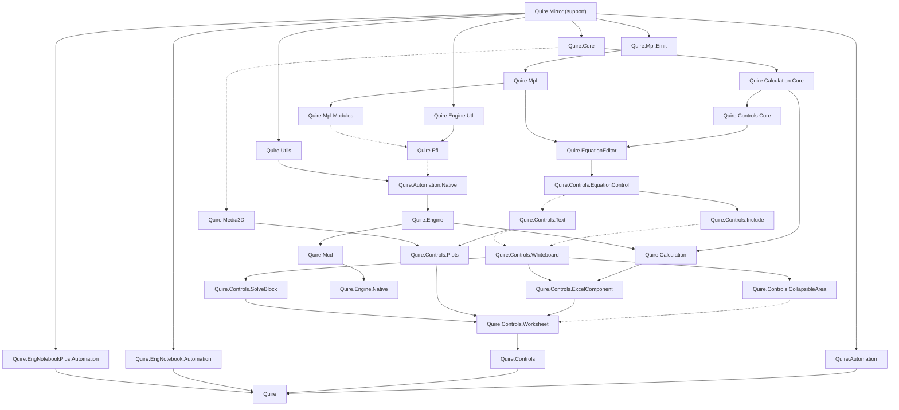

# Assembly dependency map

Generated from evaluated Release project references and installed Mathcad assembly metadata.
Snapshot: 2026-10-20T16:54:41+00:00; revision `17a1bc5efac8`.

This is a planning aid for step 1 of the [five-step workflow](PLAN.md). It adds no validation step.

An arrow **A → B** means B depends on A: complete A before starting B in an assembly-by-assembly plan.
Frameworks and restored packages are treated as available. `Quire.Mirror` is support code, not a Mathcad mirror.

## Assemblies with no references / no counterpart

| Meaning | Assemblies |
|---|---|
| No Quire project references | `Quire.Mirror` |
| No Mathcad counterpart | `Quire.Mirror` |
| No unfinished mirroring prerequisite; ready now | `Quire.Automation`, `Quire.Core`, `Quire.EngNotebook.Automation`, `Quire.EngNotebookPlus.Automation`, `Quire.Engine.Utl`, `Quire.Mpl.Emit`, `Quire.Utils` |

Original Mathcad roots (no reference to another assembly in the mapped Mathcad set): `Ptc.Core`, `Ptc.EngNotebook.Automation`, `Ptc.EngNotebookPlus.Automation`, `Ptc.MathcadPrime.Automation`, `mcmisc`, `mplasb`, `utilsmgd`, `utl-mgd`.

The planning graph combines actual project references with mapped original references. Stub projects
can omit references that the finished implementation will need. Those original dependencies still count.

“Ready” concerns dependencies, not ownership. Check [WORK](WORK.md) before claiming files.

## What completing a ready assembly unlocks

Each row assumes only that assembly is newly completed; other unfinished assemblies remain unfinished.

| Complete next | Newly eligible assemblies |
|---|---|
| `Quire.Automation` | None yet; other prerequisites remain |
| `Quire.Core` | `Quire.Calculation.Core`, `Quire.Media3D` |
| `Quire.EngNotebook.Automation` | None yet; other prerequisites remain |
| `Quire.EngNotebookPlus.Automation` | None yet; other prerequisites remain |
| `Quire.Engine.Utl` | None yet; other prerequisites remain |
| `Quire.Mpl.Emit` | `Quire.Mpl` |
| `Quire.Utils` | None yet; other prerequisites remain |

## Quire assembly completion order

Assemblies in a row can be worked on independently after every required earlier dependency is complete.
The rows are dependency order, not a claim that any assembly is already complete.

| Wave | Assemblies |
|---|---|
| 1 | `Quire.Automation`, `Quire.Core`, `Quire.EngNotebook.Automation`, `Quire.EngNotebookPlus.Automation`, `Quire.Engine.Utl`, `Quire.Mpl.Emit`, `Quire.Utils` |
| 2 | `Quire.Calculation.Core`, `Quire.Media3D`, `Quire.Mpl` |
| 3 | `Quire.Controls.Core`, `Quire.Mpl.Modules` |
| 4 | `Quire.Efi`, `Quire.EquationEditor` |
| 5 | `Quire.Automation.Native`, `Quire.Controls.EquationControl` |
| 6 | `Quire.Controls.Include`, `Quire.Controls.Text`, `Quire.Engine` |
| 7 | `Quire.Calculation`, `Quire.Controls.Plots`, `Quire.Controls.Whiteboard`, `Quire.Mcd` |
| 8 | `Quire.Controls.CollapsibleArea`, `Quire.Controls.ExcelComponent`, `Quire.Controls.SolveBlock`, `Quire.Engine.Native` |
| 9 | `Quire.Controls.Worksheet` |
| 10 | `Quire.Controls` |
| 11 | `Quire` |

## Original Mathcad assembly completion order

This finer view follows the original binaries before Quire consolidates some of them into one project.
It assumes no original binary has been independently confirmed complete. These are dependency waves,
not completion claims. External framework/package references are omitted.

| Wave | Original assemblies |
|---|---|
| 1 | `Ptc.Core`, `Ptc.EngNotebook.Automation`, `Ptc.EngNotebookPlus.Automation`, `Ptc.MathcadPrime.Automation`, `mcmisc`, `mplasb`, `utilsmgd`, `utl-mgd` |
| 2 | `Ptc.Calculation.Core`, `Ptc.Media3D`, `mplrun` |
| 3 | `EfiAffine`, `EfiBessel`, `EfiData`, `EfiDebug`, `EfiFinance`, `EfiFourier`, `EfiIO`, `EfiImage`, `EfiSignal`, `EfiSixsigma`, `EfiSpecial`, `EfiStatistics`, `EfiWavelets`, `McdEfi`, `Mpl`, `MplConstants`, `MplPrelude`, `MplPrimitives`, `MplSexpr`, `Ptc.Controls.Core`, `msclr`, `msgen` |
| 4 | `Hashtable`, `McdRun`, `McdStaticUnitSystem`, `MplMacro`, `MplUnitSystemSI`, `Ptc.EquationEditor`, `eficore_`, `efiutl` |
| 5 | `EfiCore`, `McdStaticUnitSystemCGS`, `McdStaticUnitSystemNone`, `McdStaticUnitSystemSI`, `Ptc.Controls.EquationControl`, `efibessel_`, `efidebug_`, `efigraphics_`, `efiio-csharp`, `efimatrix_`, `efispecial_`, `efisymbolics_` |
| 6 | `EfiGraphics`, `EfiMatrix`, `EfiSymbolicsLabels`, `EfiSymbolicsMacros`, `McdStaticUnitSystemMKS`, `McdStaticUnitSystemUS`, `McdUnitSystemCGS`, `McdUnitSystemNone`, `McdUnitSystemSI`, `Ptc.Controls.Include`, `Ptc.Controls.Text`, `eficalculus_`, `efidiffeq_`, `efifourier_`, `efiio_` |
| 7 | `EfiCalculus`, `EfiDiffEQ`, `EfiSymbolicsMap`, `McdUnitSystemMKS`, `McdUnitSystemUS`, `Ptc.Controls.Plots`, `Ptc.Controls.Whiteboard`, `efiimage_`, `efiplot_`, `efisignal_`, `efistatistics_`, `efiwavelets_` |
| 8 | `EfiPlot`, `EfiSymbolicsLexer`, `Ptc.Controls.CollapsibleArea`, `Ptc.Controls.SolveBlock`, `efifitting_` |
| 9 | `EfiFitting`, `EfiSymbolicsParser`, `efidata_`, `efifinance_`, `efisolver_` |
| 10 | `EfiSolver`, `EfiSymbolicsEmitter`, `efisixsigma_` |
| 11 | `EfiSymbolics`, `McdDynamicEfi`, `automationmgd` |
| 12 | `automation`, `componentsmgd`, `engutils-mgd` |
| 13 | `McdTranslator`, `iengine`, `mspcons-mgd` |
| 14 | `Ptc.Calculation`, `mcdepman`, `mslisp` |
| 15 | `Ptc.Controls.ExcelComponent`, `mccore12` |
| 16 | `Ptc.Controls.Worksheet`, `mcfront12` |
| 17 | `Ptc.Controls`, `mceng` |
| 18 | `MathcadPrime` |

## Dependency graph

Solid arrows are current project references. Dashed arrows come from the original Mathcad assembly
references and are not yet wired into the stub project. Transitive references are omitted here.



## Assembly map and current status

Stub counts are source evidence of incompleteness. IL counts are the last recorded Release audit;
a passing batch report alone does not establish whole-assembly completion.

Scope follows the existing tier lists; dependency order does not authorize deferred/out-of-scope work.

| Quire assembly | Mathcad counterpart(s) | Required assemblies | Stub bodies | Scope | Status | Last recorded exact IL |
|---|---|---|---:|---|---|---|
| `Quire` | `MathcadPrime.dll` | `Quire.Automation`, `Quire.Calculation`, `Quire.Calculation.Core`, `Quire.Controls`, `Quire.Controls.Core`, `Quire.Controls.EquationControl`, `Quire.Controls.ExcelComponent`, `Quire.Controls.Include`, `Quire.Controls.Plots`, `Quire.Controls.Text`, `Quire.Controls.Worksheet`, `Quire.Core`, `Quire.EngNotebook.Automation`, `Quire.EngNotebookPlus.Automation`, `Quire.Engine`, `Quire.EquationEditor`, `Quire.Mirror`, `Quire.Mpl` | 2407 | deferred / out of scope | incomplete | Not recorded |
| `Quire.Automation` | `Ptc.MathcadPrime.Automation.dll` | `Quire.Mirror` | 357 | deferred / out of scope | incomplete | Not recorded |
| `Quire.Automation.Native` | `automation.dll`, `automationmgd.dll`, `componentsmgd.dll` | `Quire.Efi`, `Quire.Mirror`, `Quire.Mpl`, `Quire.Utils` | 401 | active / mixed | incomplete | Not recorded |
| `Quire.Calculation` | `Ptc.Calculation.dll` | `Quire.Automation.Native`, `Quire.Calculation.Core`, `Quire.Core`, `Quire.Engine`, `Quire.Mirror`, `Quire.Mpl` | 137 | active / mixed | incomplete | 18 exact; 0 declarations; 239 unresolved |
| `Quire.Calculation.Core` | `Ptc.Calculation.Core.dll` | `Quire.Core`, `Quire.Mirror` | 467 | active / mixed | incomplete | 228 exact; 11 declarations; 748 unresolved |
| `Quire.Controls` | `Ptc.Controls.dll` | `Quire.Calculation.Core`, `Quire.Controls.Core`, `Quire.Controls.EquationControl`, `Quire.Controls.ExcelComponent`, `Quire.Controls.Include`, `Quire.Controls.Plots`, `Quire.Controls.Worksheet`, `Quire.Core`, `Quire.EquationEditor`, `Quire.Mirror` | 530 | active / mixed | incomplete | Not recorded |
| `Quire.Controls.CollapsibleArea` | `Ptc.Controls.CollapsibleArea.dll` | `Quire.Calculation.Core`, `Quire.Controls.Core`, `Quire.Controls.Whiteboard`, `Quire.Core`, `Quire.Mirror` | 161 | active / mixed | incomplete | Not recorded |
| `Quire.Controls.Core` | `Ptc.Controls.Core.dll` | `Quire.Calculation.Core`, `Quire.Core`, `Quire.Mirror` | 2588 | active / mixed | incomplete | Not recorded |
| `Quire.Controls.EquationControl` | `Ptc.Controls.EquationControl.dll` | `Quire.Calculation.Core`, `Quire.Controls.Core`, `Quire.Core`, `Quire.EquationEditor`, `Quire.Mirror` | 3507 | active / mixed | incomplete | Not recorded |
| `Quire.Controls.ExcelComponent` | `Ptc.Controls.ExcelComponent.dll` | `Quire.Automation.Native`, `Quire.Calculation`, `Quire.Calculation.Core`, `Quire.Controls.Core`, `Quire.Controls.EquationControl`, `Quire.Controls.Whiteboard`, `Quire.Core`, `Quire.Mirror` | 902 | deferred / out of scope | incomplete | Not recorded |
| `Quire.Controls.Include` | `Ptc.Controls.Include.dll` | `Quire.Calculation.Core`, `Quire.Controls.Core`, `Quire.Controls.EquationControl`, `Quire.Core`, `Quire.Mirror` | 458 | active / mixed | incomplete | Not recorded |
| `Quire.Controls.Plots` | `Ptc.Controls.Plots.dll` | `Quire.Calculation.Core`, `Quire.Controls.Core`, `Quire.Controls.EquationControl`, `Quire.Controls.Text`, `Quire.Core`, `Quire.EquationEditor`, `Quire.Media3D`, `Quire.Mirror` | 4306 | active / mixed | incomplete | Not recorded |
| `Quire.Controls.SolveBlock` | `Ptc.Controls.SolveBlock.dll` | `Quire.Calculation.Core`, `Quire.Controls.Core`, `Quire.Controls.EquationControl`, `Quire.Controls.Whiteboard`, `Quire.Core`, `Quire.EquationEditor`, `Quire.Mirror` | 324 | active / mixed | incomplete | Not recorded |
| `Quire.Controls.Text` | `Ptc.Controls.Text.dll` | `Quire.Calculation.Core`, `Quire.Controls.Core`, `Quire.Controls.EquationControl`, `Quire.Core`, `Quire.Mirror` | 564 | active / mixed | incomplete | Not recorded |
| `Quire.Controls.Whiteboard` | `Ptc.Controls.Whiteboard.dll` | `Quire.Calculation.Core`, `Quire.Controls.Core`, `Quire.Controls.EquationControl`, `Quire.Controls.Include`, `Quire.Controls.Text`, `Quire.Core`, `Quire.Mirror` | 808 | deferred / out of scope | incomplete | Not recorded |
| `Quire.Controls.Worksheet` | `Ptc.Controls.Worksheet.dll` | `Quire.Calculation`, `Quire.Calculation.Core`, `Quire.Controls.CollapsibleArea`, `Quire.Controls.Core`, `Quire.Controls.EquationControl`, `Quire.Controls.ExcelComponent`, `Quire.Controls.Include`, `Quire.Controls.Plots`, `Quire.Controls.SolveBlock`, `Quire.Controls.Text`, `Quire.Controls.Whiteboard`, `Quire.Core`, `Quire.EquationEditor`, `Quire.Mirror` | 2757 | active / mixed | incomplete | Not recorded |
| `Quire.Core` | `Ptc.Core.dll` | `Quire.Mirror` | 1902 | active / mixed | incomplete | 1879 exact; 80 declarations; 2240 unresolved |
| `Quire.Efi` | `efiaffine.dll`, `efibessel.dll`, `efibessel_.dll`, `eficalculus.dll`, `eficalculus_.dll`, `eficore.dll`, `eficore_.dll`, `efidata.dll`, `efidata_.dll`, `efidebug.dll`, `efidebug_.dll`, `efidiffeq.dll`, `efidiffeq_.dll`, `efifinance.dll`, `efifinance_.dll`, `efifitting.dll`, `efifitting_.dll`, `efifourier.dll`, `efifourier_.dll`, `efigraphics.dll`, `efigraphics_.dll`, `efiimage.dll`, `efiimage_.dll`, `efiio.dll`, `efiio_.dll`, `efiio-csharp.dll`, `efimatrix.dll`, `efimatrix_.dll`, `efiplot.dll`, `efiplot_.dll`, `efisignal.dll`, `efisignal_.dll`, `efisixsigma.dll`, `efisixsigma_.dll`, `efisolver.dll`, `efisolver_.dll`, `efispecial.dll`, `efispecial_.dll`, `efistatistics.dll`, `efistatistics_.dll`, `efisymbolics.dll`, `efisymbolics_.dll`, `efisymbolicsemitter.dll`, `efisymbolicslabels.dll`, `efisymbolicslexer.dll`, `efisymbolicsmacros.dll`, `efisymbolicsmap.dll`, `efisymbolicsparser.dll`, `efiutl.dll`, `efiwavelets.dll`, `efiwavelets_.dll` | `Quire.Engine.Utl`, `Quire.Mirror`, `Quire.Mpl`, `Quire.Mpl.Modules` | 2592 | active / mixed | incomplete | Not recorded |
| `Quire.Engine` | `engutils-mgd.dll`, `iengine.dll` | `Quire.Automation.Native`, `Quire.Engine.Utl`, `Quire.Mirror`, `Quire.Mpl` | 137 | active / mixed | incomplete | Not recorded |
| `Quire.Engine.Native` | `mccore12.dll`, `mceng.dll`, `mcfront12.dll`, `msclr.dll`, `msgen.dll`, `mslisp.dll`, `mspcons-mgd.dll` | `Quire.Automation.Native`, `Quire.Efi`, `Quire.Engine`, `Quire.Engine.Utl`, `Quire.Mcd`, `Quire.Mirror`, `Quire.Mpl`, `Quire.Mpl.Emit` | 1053 | deferred / out of scope | incomplete | Not recorded |
| `Quire.Engine.Utl` | `mcmisc.dll`, `utl-mgd.dll` | `Quire.Mirror` | 248 | deferred / out of scope | incomplete | Not recorded |
| `Quire.EngNotebook.Automation` | `Ptc.EngNotebook.Automation.dll` | `Quire.Mirror` | 348 | deferred / out of scope | incomplete | Not recorded |
| `Quire.EngNotebookPlus.Automation` | `Ptc.EngNotebookPlus.Automation.dll` | `Quire.Mirror` | 346 | deferred / out of scope | incomplete | Not recorded |
| `Quire.EquationEditor` | `Ptc.EquationEditor.dll` | `Quire.Calculation.Core`, `Quire.Controls.Core`, `Quire.Core`, `Quire.Mirror`, `Quire.Mpl` | 3878 | active / mixed | incomplete | Not recorded |
| `Quire.Mcd` | `mcddynamicefi.dll`, `mcdefi.dll`, `mcdepman.dll`, `mcdtranslator.dll`, `mcdunitsystemcgs.dll`, `mcdunitsystemmks.dll`, `mcdunitsystemnone.dll`, `mcdunitsystemsi.dll`, `mcdunitsystemus.dll` | `Quire.Automation.Native`, `Quire.Efi`, `Quire.Engine`, `Quire.Engine.Utl`, `Quire.Mirror`, `Quire.Mpl`, `Quire.Mpl.Modules` | 562 | deferred / out of scope | incomplete | Not recorded |
| `Quire.Media3D` | `Ptc.Media3D.dll` | `Quire.Core`, `Quire.Mirror` | 473 | deferred / out of scope | incomplete | Not recorded |
| `Quire.Mirror` | None (support) | None | 0 | support | support | Not recorded |
| `Quire.Mpl` | `mplrun.dll` | `Quire.Mirror`, `Quire.Mpl.Emit` | 42 | active / mixed | incomplete | 1524 exact; 165 declarations; 405 unresolved |
| `Quire.Mpl.Emit` | `mplasb.dll` | `Quire.Mirror` | 401 | deferred / out of scope | incomplete | Not recorded |
| `Quire.Mpl.Modules` | `hashtable.dll`, `mcdrun.dll`, `mcdstaticunitsystem.dll`, `mcdstaticunitsystemcgs.dll`, `mcdstaticunitsystemmks.dll`, `mcdstaticunitsystemnone.dll`, `mcdstaticunitsystemsi.dll`, `mcdstaticunitsystemus.dll`, `mpl.dll`, `mplconstants.dll`, `mplmacro.dll`, `mplprelude.dll`, `mplprimitives.dll`, `mplsexpr.dll`, `mplunitsystemsi.dll` | `Quire.Mirror`, `Quire.Mpl` | 381 | deferred / out of scope | incomplete | Not recorded |
| `Quire.Utils` | `utilsmgd.dll` | `Quire.Mirror` | 31 | deferred / out of scope | incomplete | Not recorded |

<details>
<summary>All original assembly references and their Quire targets</summary>

| Original assembly | Quire target | Other mapped original references |
|---|---|---|
| `automation` | `Quire.Automation.Native` | `automationmgd`, `mplrun` |
| `automationmgd` | `Quire.Automation.Native` | `EfiSymbolicsEmitter`, `mplrun`, `utilsmgd` |
| `componentsmgd` | `Quire.Automation.Native` | `automationmgd`, `mplrun` |
| `EfiAffine` | `Quire.Efi` | `mplrun` |
| `EfiBessel` | `Quire.Efi` | `mplrun` |
| `efibessel_` | `Quire.Efi` | `Mpl`, `efiutl`, `mplrun` |
| `EfiCalculus` | `Quire.Efi` | `eficalculus_`, `mplrun` |
| `eficalculus_` | `Quire.Efi` | `Mpl`, `eficore_`, `efimatrix_`, `efiutl`, `mplrun` |
| `EfiCore` | `Quire.Efi` | `Hashtable`, `McdRun`, `MplPrelude`, `eficore_`, `mplrun` |
| `eficore_` | `Quire.Efi` | `Mpl`, `mplrun` |
| `EfiData` | `Quire.Efi` | `mplrun` |
| `efidata_` | `Quire.Efi` | `Mpl`, `eficalculus_`, `efifitting_`, `efistatistics_`, `efiutl`, `mcmisc`, `mplrun` |
| `EfiDebug` | `Quire.Efi` | `mplrun` |
| `efidebug_` | `Quire.Efi` | `Mpl`, `efiutl`, `mplrun` |
| `EfiDiffEQ` | `Quire.Efi` | `McdRun`, `efidiffeq_`, `efimatrix_`, `mplrun` |
| `efidiffeq_` | `Quire.Efi` | `Mpl`, `eficore_`, `efimatrix_`, `efiutl`, `mplrun` |
| `EfiFinance` | `Quire.Efi` | `mplrun` |
| `efifinance_` | `Quire.Efi` | `Mpl`, `efifitting_`, `efiutl`, `mplrun` |
| `EfiFitting` | `Quire.Efi` | `efifitting_`, `mplrun` |
| `efifitting_` | `Quire.Efi` | `Mpl`, `eficore_`, `efiimage_`, `efimatrix_`, `efiutl`, `mplrun` |
| `EfiFourier` | `Quire.Efi` | `mplrun` |
| `efifourier_` | `Quire.Efi` | `Mpl`, `efimatrix_`, `efiutl`, `mplrun` |
| `EfiGraphics` | `Quire.Efi` | `McdRun`, `MplPrelude`, `efigraphics_`, `mplrun` |
| `efigraphics_` | `Quire.Efi` | `Mpl`, `efiutl`, `mplrun` |
| `EfiImage` | `Quire.Efi` | `mplrun` |
| `efiimage_` | `Quire.Efi` | `Mpl`, `efifourier_`, `efiutl`, `mplrun` |
| `EfiIO` | `Quire.Efi` | `mplrun` |
| `efiio_` | `Quire.Efi` | `Mpl`, `efiio-csharp`, `efimatrix_`, `efiutl`, `mplrun` |
| `efiio-csharp` | `Quire.Efi` | `eficore_`, `mplrun` |
| `EfiMatrix` | `Quire.Efi` | `EfiCore`, `McdRun`, `eficore_`, `efimatrix_`, `mplrun` |
| `efimatrix_` | `Quire.Efi` | `Mpl`, `eficore_`, `efiutl`, `mplrun` |
| `EfiPlot` | `Quire.Efi` | `EfiMatrix`, `MplPrelude`, `efiplot_`, `mplrun` |
| `efiplot_` | `Quire.Efi` | `EfiMatrix`, `eficalculus_`, `eficore_`, `efigraphics_`, `efiutl`, `mplrun` |
| `EfiSignal` | `Quire.Efi` | `mplrun` |
| `efisignal_` | `Quire.Efi` | `Mpl`, `eficore_`, `efifourier_`, `efimatrix_`, `efiutl`, `mplrun` |
| `EfiSixsigma` | `Quire.Efi` | `mplrun` |
| `efisixsigma_` | `Quire.Efi` | `efidata_`, `efifitting_`, `efimatrix_`, `efistatistics_`, `efiutl`, `mplrun` |
| `EfiSolver` | `Quire.Efi` | `McdRun`, `MplPrelude`, `eficore_`, `efisolver_`, `mplrun` |
| `efisolver_` | `Quire.Efi` | `Mpl`, `eficalculus_`, `eficore_`, `efifitting_`, `efimatrix_`, `efiutl`, `mplrun` |
| `EfiSpecial` | `Quire.Efi` | `mplrun` |
| `efispecial_` | `Quire.Efi` | `Mpl`, `efiutl`, `mplrun` |
| `EfiStatistics` | `Quire.Efi` | `mplrun` |
| `efistatistics_` | `Quire.Efi` | `Mpl`, `efifourier_`, `efiutl`, `mplrun` |
| `EfiSymbolics` | `Quire.Efi` | `EfiSymbolicsEmitter`, `EfiSymbolicsLabels`, `EfiSymbolicsLexer`, `EfiSymbolicsMap`, `EfiSymbolicsParser`, `Hashtable`, `McdRun`, `MplPrelude`, `eficore_`, `efisymbolics_`, `mplrun` |
| `efisymbolics_` | `Quire.Efi` | `Mpl`, `efiutl`, `mplrun`, `utl-mgd` |
| `EfiSymbolicsEmitter` | `Quire.Efi` | `EfiSymbolicsLabels`, `EfiSymbolicsLexer`, `EfiSymbolicsMacros`, `EfiSymbolicsMap`, `EfiSymbolicsParser`, `Hashtable`, `McdRun`, `MplPrelude`, `efimatrix_`, `efisymbolics_`, `mplrun`, `utl-mgd` |
| `EfiSymbolicsLabels` | `Quire.Efi` | `McdRun`, `MplPrelude`, `efisymbolics_`, `mplrun`, `utl-mgd` |
| `EfiSymbolicsLexer` | `Quire.Efi` | `EfiSymbolicsLabels`, `EfiSymbolicsMacros`, `EfiSymbolicsMap`, `Hashtable`, `MplPrelude`, `efisymbolics_`, `mplrun`, `utl-mgd` |
| `EfiSymbolicsMacros` | `Quire.Efi` | `McdRun`, `MplMacro`, `MplPrelude`, `efisymbolics_`, `mplrun` |
| `EfiSymbolicsMap` | `Quire.Efi` | `EfiSymbolicsLabels`, `Hashtable`, `MplPrelude`, `efisymbolics_`, `mplrun`, `utl-mgd` |
| `EfiSymbolicsParser` | `Quire.Efi` | `EfiSymbolicsLabels`, `EfiSymbolicsLexer`, `EfiSymbolicsMacros`, `McdRun`, `MplPrelude`, `efimatrix_`, `mplrun` |
| `efiutl` | `Quire.Efi` | `Mpl`, `mplrun` |
| `EfiWavelets` | `Quire.Efi` | `mplrun` |
| `efiwavelets_` | `Quire.Efi` | `Mpl`, `efifourier_`, `efiutl`, `mplrun` |
| `engutils-mgd` | `Quire.Engine` | `automationmgd`, `mplrun` |
| `Hashtable` | `Quire.Mpl.Modules` | `MplPrelude`, `mplrun` |
| `iengine` | `Quire.Engine` | `automationmgd`, `engutils-mgd`, `mplrun`, `utl-mgd` |
| `MathcadPrime` | `Quire` | `Ptc.Calculation`, `Ptc.Calculation.Core`, `Ptc.Controls`, `Ptc.Controls.Core`, `Ptc.Controls.EquationControl`, `Ptc.Controls.ExcelComponent`, `Ptc.Controls.Include`, `Ptc.Controls.Plots`, `Ptc.Controls.Text`, `Ptc.Controls.Worksheet`, `Ptc.Core`, `Ptc.EngNotebook.Automation`, `Ptc.EngNotebookPlus.Automation`, `Ptc.EquationEditor`, `Ptc.MathcadPrime.Automation` |
| `mccore12` | `Quire.Engine.Native` | `efisymbolics_`, `engutils-mgd`, `iengine`, `mcdepman`, `mplasb`, `mplrun`, `msclr`, `utl-mgd` |
| `McdDynamicEfi` | `Quire.Mcd` | `EfiCore`, `EfiDebug`, `EfiDiffEQ`, `EfiGraphics`, `EfiMatrix`, `McdRun`, `efibessel_`, `eficore_`, `efidata_`, `efidebug_`, `efidiffeq_`, `efifinance_`, `efifitting_`, `efifourier_`, `efigraphics_`, `efiimage_`, `efiio_`, `efimatrix_`, `efiplot_`, `efisignal_`, `efisixsigma_`, `efispecial_`, `efistatistics_`, `efiwavelets_`, `mplrun` |
| `McdEfi` | `Quire.Mcd` | `mplrun` |
| `mcdepman` | `Quire.Mcd` | `efisymbolics_`, `engutils-mgd`, `iengine`, `mplrun`, `utl-mgd` |
| `McdRun` | `Quire.Mpl.Modules` | `MplPrelude`, `mplrun` |
| `McdStaticUnitSystem` | `Quire.Mpl.Modules` | `MplPrelude`, `mplrun` |
| `McdStaticUnitSystemCGS` | `Quire.Mpl.Modules` | `McdRun`, `McdStaticUnitSystem`, `MplPrelude`, `mplrun` |
| `McdStaticUnitSystemMKS` | `Quire.Mpl.Modules` | `McdRun`, `McdStaticUnitSystemSI`, `mplrun` |
| `McdStaticUnitSystemNone` | `Quire.Mpl.Modules` | `McdRun`, `mplrun` |
| `McdStaticUnitSystemSI` | `Quire.Mpl.Modules` | `McdRun`, `McdStaticUnitSystem`, `MplPrelude`, `mplrun` |
| `McdStaticUnitSystemUS` | `Quire.Mpl.Modules` | `McdRun`, `McdStaticUnitSystemSI`, `mplrun` |
| `McdTranslator` | `Quire.Mcd` | `EfiSymbolics`, `EfiSymbolicsParser`, `McdRun`, `MplPrelude`, `automationmgd`, `componentsmgd`, `eficore_`, `efigraphics_`, `efimatrix_`, `efiplot_`, `mplrun` |
| `McdUnitSystemCGS` | `Quire.Mcd` | `McdRun`, `McdStaticUnitSystemCGS`, `mplrun` |
| `McdUnitSystemMKS` | `Quire.Mcd` | `McdRun`, `McdStaticUnitSystemMKS`, `McdUnitSystemSI`, `mplrun` |
| `McdUnitSystemNone` | `Quire.Mcd` | `McdRun`, `McdStaticUnitSystemNone`, `mplrun` |
| `McdUnitSystemSI` | `Quire.Mcd` | `McdRun`, `McdStaticUnitSystemSI`, `MplPrelude`, `eficore_`, `efimatrix_`, `mplrun` |
| `McdUnitSystemUS` | `Quire.Mcd` | `McdRun`, `McdStaticUnitSystemUS`, `McdUnitSystemSI`, `mplrun` |
| `mceng` | `Quire.Engine.Native` | `engutils-mgd`, `iengine`, `mccore12`, `mcfront12`, `mplrun`, `mslisp`, `utl-mgd` |
| `mcfront12` | `Quire.Engine.Native` | `automationmgd`, `engutils-mgd`, `iengine`, `mccore12`, `mcdepman`, `mcmisc`, `mplrun`, `mslisp`, `mspcons-mgd`, `utl-mgd` |
| `mcmisc` | `Quire.Engine.Utl` | None |
| `Mpl` | `Quire.Mpl.Modules` | `mplrun` |
| `mplasb` | `Quire.Mpl.Emit` | None |
| `MplConstants` | `Quire.Mpl.Modules` | `mplrun` |
| `MplMacro` | `Quire.Mpl.Modules` | `MplPrelude`, `mplrun` |
| `MplPrelude` | `Quire.Mpl.Modules` | `mplrun` |
| `MplPrimitives` | `Quire.Mpl.Modules` | `mplrun` |
| `mplrun` | `Quire.Mpl` | `mplasb` |
| `MplSexpr` | `Quire.Mpl.Modules` | `mplrun` |
| `MplUnitSystemSI` | `Quire.Mpl.Modules` | `MplConstants`, `MplPrelude`, `mplrun` |
| `msclr` | `Quire.Engine.Native` | `mplasb`, `mplrun` |
| `msgen` | `Quire.Engine.Native` | `mplasb`, `mplrun` |
| `mslisp` | `Quire.Engine.Native` | `engutils-mgd`, `mspcons-mgd`, `utl-mgd` |
| `mspcons-mgd` | `Quire.Engine.Native` | `engutils-mgd` |
| `Ptc.Calculation` | `Quire.Calculation` | `Ptc.Calculation.Core`, `Ptc.Core`, `automationmgd`, `iengine`, `mplrun` |
| `Ptc.Calculation.Core` | `Quire.Calculation.Core` | `Ptc.Core` |
| `Ptc.Controls` | `Quire.Controls` | `Ptc.Calculation.Core`, `Ptc.Controls.Core`, `Ptc.Controls.EquationControl`, `Ptc.Controls.ExcelComponent`, `Ptc.Controls.Include`, `Ptc.Controls.Plots`, `Ptc.Controls.Worksheet`, `Ptc.Core`, `Ptc.EquationEditor` |
| `Ptc.Controls.CollapsibleArea` | `Quire.Controls.CollapsibleArea` | `Ptc.Calculation.Core`, `Ptc.Controls.Core`, `Ptc.Controls.Whiteboard`, `Ptc.Core` |
| `Ptc.Controls.Core` | `Quire.Controls.Core` | `Ptc.Calculation.Core`, `Ptc.Core` |
| `Ptc.Controls.EquationControl` | `Quire.Controls.EquationControl` | `Ptc.Calculation.Core`, `Ptc.Controls.Core`, `Ptc.Core`, `Ptc.EquationEditor` |
| `Ptc.Controls.ExcelComponent` | `Quire.Controls.ExcelComponent` | `Ptc.Calculation`, `Ptc.Calculation.Core`, `Ptc.Controls.Core`, `Ptc.Controls.EquationControl`, `Ptc.Controls.Whiteboard`, `Ptc.Core`, `automationmgd` |
| `Ptc.Controls.Include` | `Quire.Controls.Include` | `Ptc.Calculation.Core`, `Ptc.Controls.Core`, `Ptc.Controls.EquationControl`, `Ptc.Core` |
| `Ptc.Controls.Plots` | `Quire.Controls.Plots` | `Ptc.Calculation.Core`, `Ptc.Controls.Core`, `Ptc.Controls.EquationControl`, `Ptc.Controls.Text`, `Ptc.Core`, `Ptc.EquationEditor`, `Ptc.Media3D` |
| `Ptc.Controls.SolveBlock` | `Quire.Controls.SolveBlock` | `Ptc.Calculation.Core`, `Ptc.Controls.Core`, `Ptc.Controls.EquationControl`, `Ptc.Controls.Whiteboard`, `Ptc.Core`, `Ptc.EquationEditor` |
| `Ptc.Controls.Text` | `Quire.Controls.Text` | `Ptc.Calculation.Core`, `Ptc.Controls.Core`, `Ptc.Controls.EquationControl`, `Ptc.Core` |
| `Ptc.Controls.Whiteboard` | `Quire.Controls.Whiteboard` | `Ptc.Calculation.Core`, `Ptc.Controls.Core`, `Ptc.Controls.EquationControl`, `Ptc.Controls.Include`, `Ptc.Controls.Text`, `Ptc.Core` |
| `Ptc.Controls.Worksheet` | `Quire.Controls.Worksheet` | `Ptc.Calculation`, `Ptc.Calculation.Core`, `Ptc.Controls.CollapsibleArea`, `Ptc.Controls.Core`, `Ptc.Controls.EquationControl`, `Ptc.Controls.ExcelComponent`, `Ptc.Controls.Include`, `Ptc.Controls.Plots`, `Ptc.Controls.SolveBlock`, `Ptc.Controls.Text`, `Ptc.Controls.Whiteboard`, `Ptc.Core`, `Ptc.EquationEditor` |
| `Ptc.Core` | `Quire.Core` | None |
| `Ptc.EngNotebook.Automation` | `Quire.EngNotebook.Automation` | None |
| `Ptc.EngNotebookPlus.Automation` | `Quire.EngNotebookPlus.Automation` | None |
| `Ptc.EquationEditor` | `Quire.EquationEditor` | `Ptc.Calculation.Core`, `Ptc.Controls.Core`, `Ptc.Core` |
| `Ptc.MathcadPrime.Automation` | `Quire.Automation` | None |
| `Ptc.Media3D` | `Quire.Media3D` | `Ptc.Core` |
| `utilsmgd` | `Quire.Utils` | None |
| `utl-mgd` | `Quire.Engine.Utl` | None |

</details>

## Regenerate / explore the next unlocks

```powershell
python tools/validation/assembly_map.py
python tools/validation/assembly_map.py --assume-complete Quire.Core
```

The scenario changes the readiness calculation only. It does not grant an IL pass or edit completion records.
Whole-assembly completion requires all mapped original methods to be represented and every compiled method
to match, with current artifact identities. A source with no stubs is not sufficient.

The companion `assembly-map.json` includes full project edges, external packages, original assembly
reference edges, scope counts, and the original-to-Quire mapping. Original references within a consolidated
Quire project are internal to that project. The planning order includes both original and current build dependencies.
